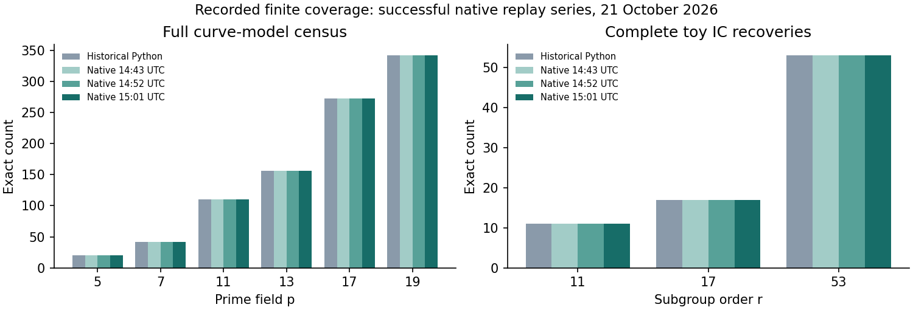

# Native replay, identity records, and partial formalization

Run `run-20261021T150125Z`, 21 October 2026, C++17/OpenSSL on Linux x86-64.
This is a correctness replay under uncontrolled host conditions, with no admitted
timing or cross-method performance result. UTC boundaries are process provenance.

[Report PDF](report.pdf) · [LaTeX source](report.tex) · [Recorded-value plot source](render.py)
· [SVG](coverage.svg) · [Graph data](graph-data.json)

**Executed scope:** every original finite workload, with unchanged primes, fields,
point sets, seeds, relation/descent budgets, and controls. [Native receipt](../../native/runs/run-20261021T150125Z/parity.json)
compares all 434 deterministic fields with the archived results. Both runs cover
942 models, 4,188,162 ordered S3 triples, 113,342 S4 quadruples, 260,064 extension
points, 289,440 twist group-law identities, 94,176 scalar transport checks,
274 common odd-prime cases, all 81 toy IC logs and 3,219 bilinearity identities.
The four trace-zero fixtures, subfield example and all four transported relation
histograms also match. Statistical sampling uncertainty does not apply to the
census counts; the original associativity checks outside p=5 remain their stated
12 seeded samples per model, not exhaustive associativity proofs.

**Independent verification:** [separate tuple-based auditor](../../audit.cpp)
recomputes 84 newly emitted IC certificate matrices (three headline and 81 all-log
runs), factor-base logs, scalars and pairings. The [basis certificate](../../native/runs/run-20261021T150125Z/basis.json)
checks 2,401 field elements, 2,475 point equations and 2,025 source-group map
identities before the simple-basis target is registered. [Controls](../../native/controls-20261021T150300Z/run.log)
reject a false new relation, missing log coverage and a false historical count.

**Checked universal implications:** [18 Lean statements](../../lean/README.md)
pass the repository proof gate on standard foundations, with zero trusted native
proofs. Three exact ring identities have [IDC1 certificates](../../certificates/identity-index.json):
`IDC1h07a9b2e6b0a3a9d3`, `IDC1h98f781bdd4756596`, and `IDC1hfb8edf881dcde851`.
Their native checker rederives 32 sealed and 16 extra evaluation points; deliberately
false identities are rejected. The Lean source proves the identities over every
commutative ring; the certificate evaluation modulus alone would not prove that.

The [catalog](../../../../docs/curves/sources/quadratic-twist-native-20261021.json)
registers 1,921 exact ICV1 models and 27 selected EC1 representations. For a
`c*y^2=x^3+a*x+b` model its monic representative uses `(x,y) -> (c*x,c^2*y)`;
that conversion is explicit, not an inferred equality of base-field DLPs.
The subfield tower has `u^2=3`, `v^2=1+u`; `w=v` gives
`w^4+5*w^2+5=0` and `u=w^2-1`. Its coordinate conversion is checked. All other
unselected subgroup/generator choices remain unknown.

**Findings and limits:**

- The kernel-checked mixed-eigenspace implication forces `2B=0`, and forces
  `B=0` under an odd annihilator. The native census retains the nonzero
  2-torsion exception, so omitting oddness is disproved by a valid-point example.
- S3 and S4 relation conditions match after twist transport over the splitting
  field. Full transported two-sum histograms agree in four fixtures; the twist
  supplies no additional relations under those matched bases.
- The shared odd-prime cases satisfy the embedding-degree-two condition.
  All pairing/finite-field IC fixture recoveries succeed. This is the specified
  pairing route, not a new general prime-field IC shortcut.
- A smooth/anomalous twist does not force the same original group order or a
  nonzero rational homomorphic transfer. The exact point-count examples survive
  the replay; coprime-order homomorphisms are formally proved zero.
- A model descending after twisting does not make this fixture's order-three
  target rational over the smaller field. Four trace-zero kernels match the
  retained exact counts. These do not implement general GHS descent.
- The fully enumerated restricted relation family remains rank 5 of 6 after
  272 smooth relations among 2,448 candidates; the broader seeded family reaches
  full rank. Relation counts alone do not certify a solvable system.

Four statements use the actual elliptic point group, q-power Frobenius and
rational base-change map. They derive fixedness of rational lifts and the
mixed-relation consequence for an explicitly Frobenius-negated B. The twist
embedding's minus-eigenspace identification, full rational-eigenspace equality,
summation-polynomial lifting and nondegenerate pairing reduction remain open.
The 14 group/ring and four actual-point proofs are partial formalization of the broader report.
General ECDLP hardness, a general GHS implementation and asymptotic advantage are
not established. Invalid-curve attacks remain outside scope.

The original archive and import report are preserved. The failed first port
comparison (JSON null handling), failed first proof elaboration, unavailable
Conductor invocation, initial sparse-checkout dependency error, and cache setup
failures remain in the validation history. Rust/Lean are now installed; the earlier
missing-tool statements are historical. Repository test results and exact remaining
coordination limits are recorded in [validation](../../validation/README.md).

Canonical graphs checked: `docs/index-calculus-scoreboard.html`,
`docs/ic-leaderboard.html`, `docs/ic/progress-timeline.json` and the existing study
coverage graph. Cost graphs and benchmark/leaderboard rows stay unchanged because
there is no new admitted cost data. The earlier study graph remains attached to
its frozen import report; this new paired graph reports the expanded native scope.
Raw records remain loose because receipts, source hashes and review links name them.
