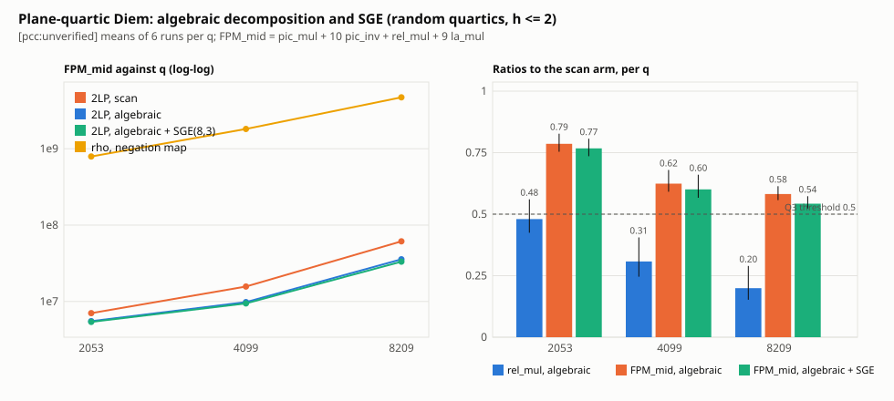

# Plane-quartic Diem: algebraic decomposition and SGE (lead C3) — results (2026-11-21)

Status: `[pcc:unverified]` throughout. Shared 4-vCPU container (not an isolated host), so no row
reaches the leaderboard (pre-gate). Protocol: [`PROTOCOL.md`](PROTOCOL.md) (`frozen.sha256`), with
[`AMENDMENT1.md`](AMENDMENT1.md) (rho rows at q = 8209 reused from the bound-r study; reading of Q1).
Data `quartic_alg.jsonl`, `analysis.json` (from `analyze.py`), tables [`tables.md`](tables.md), figure
`fig_quartic_alg.svg` (from `render.py`), hashes `data.sha256`, `binary.sha256`.

## What was built (all additive; defaults leave every count byte-identical)

- `quartic_ladder.rs`: `Decomp::{Scan, Algebraic}`, `run_diem_opts(inst, params, QIcOpts {decomp, sge})`
  (`run_diem` is `run_diem_opts` with the defaults); `Ctx::decompose_alg`: chart `x = 1`, resultant in
  one variable of two conics of the net (degree <= 4), counted `proots`, back-substitution by the
  quadratic formula (one counted inversion per trial and conic), the point must be on `C` (hash
  lookup in the point table, uncounted like the line relations' residual-point lookups) and on all
  three conics (counted evaluation); the at most four points of `C` on `x = 0` by direct counted test;
  a degenerate pair (resultant identically 0) is replaced by another of the three pairs and by the
  swapped elimination order; if all six are degenerate the trial falls back to the scan
  (`decomp_fallbacks`, 0 in every run here). `proots` gets a private RNG seeded from the class, so the
  main stream is untouched. `QIcResult` gained `la_sge`, `sge`, `decomp_fallbacks`.
- SGE: `genus_ladder::sge_reduce` between `peel` and `wiedemann`, `la_sge` merged into `la`, the main
  stream advanced as the unmerged solve would (a copy of `skip_wiedemann_draws`, which is private there).
- `genus_ladder` driver: `--quartic-alg` (default off) adds arms `Q_diem_2lp+alg` and
  `Q_diem_2lp+alg+sge(8,3)` and, only with the flag, `rel_enum_mul`, `rel_decomp_mul` on the existing
  quartic arms; alg rows record `decomp_trials`, `decomp_relations`, `decomp_fallbacks`, `rel_mul`,
  `la_sge_mul`.
- Tests (`cargo test --release --lib quartic_ladder`): the 5 existing and 2 new tests pass (9 passed, 1 ignored
  timing test): `algebraic_decomposition_matches_scan` (260 random classes at each of q = 101, 251, 1031;
  identical `Option<[u32;3]>` on every class; 39-46 decomposed per q, 0 fallbacks) and
  `algebraic_and_sge_runs_are_identical_where_they_must` (q = 101, 251, same seed, `verify_relations`:
  identical relation counts, rows by large primes, trials, core, `group_ops`, `pic_*`, `rel_enum`;
  recovered `t` certified; the merged run identical in the relation phase).

## Run

`genus_ladder run --primes 2053,4099,8209 --genera 2 --curves 3 --seeds 2 --arms R --quartic
--quartic-alg --max-h 2 --qc 3.0 --threads 4`: 134 lines, 218 s; 9 quartic instances, 18
(instance, seed) pairs, all runs certified. Cross-check with the bound-r study: the nine quartic
instance lines are identical and the 54 default-arm rows (`Q_diem_full`, `Q_diem_2lp`, `Q_rho_neg`)
are identical on every counted field, i.e. the default path is byte-identical on this grid.

## Scorecard (frozen predictions; failures reported as failures)

| id | prediction | measured (mean of 6, bootstrap 95%) | verdict |
|---|---|---|---|
| Q1 | identical relation phase, Scan vs Algebraic | 18/18 pairs identical on every counted field outside `rel_decomp`; `+alg+sge` identical on the whole relation phase 18/18 | holds |
| Q2 | `rel_mul` Alg/Scan <= 0.4 at 8209, falling | 0.480 [0.425, 0.561], 0.308 [0.246, 0.406], 0.199 [0.152, 0.290] | holds |
| Q3 | FPM_mid `alg+sge` / `2lp` <= 0.5 at 8209 | 0.768, 0.601, **0.542 [0.523, 0.573]** | **falsified** (interval above 0.5) |
| Q4 | exponent of `alg+sge` over 2053..8209 <= 1.2 | **1.313 [0.943, 1.606]** (scan 1.563 [1.157, 1.877]; alg 1.346) | **falsified** by the frozen criterion (point estimate); the interval contains 1.2 |
| Q5 | `alg+sge` / `Q_rho_neg` <= 0.005 at 8209 | 0.0068, 0.0052, **0.0070 [0.0037, 0.0133]** (scan arm at 8209: 0.013) | **falsified**; the ratio improved about 1.9x |

## Findings

- The decomposition scan is replaced by `O(log q)` algebra without changing a single relation: the
  decomposition share of `rel_mul` falls to 0.123, 0.057, 0.036 of the scan's at q = 2053, 4099, 8209
  (ratio of means; about 590 multiplications per trial at q = 1031 against 2930), and the per-q
  `rel_mul` falls to 0.48, 0.31, 0.20. At q = 101 and 251 the algebra is not cheaper per trial than
  the scan (121085 against 76969 at q = 101, 163567 against 177923 at 251, 154794 against 761605 at
  1031 over 260 classes each): the crossover is near q = 250.
- The FPM_mid gain is real but smaller than predicted because `rel_mul` is only part of the cost.
  At q = 8209 the scan arm costs 6.1e7 (pic 7.5e6, rel 3.2e7 of which decomposition 2.7e7, 9 la_mul
  2.2e7); the algebraic arm costs 3.6e7 (rel 6.4e6, of which enumeration 4.5e6), so the arm is now
  dominated by the linear algebra: 9 la_mul is 58% of FPM_mid (1.94e7 of 3.33e7 with SGE; 61% without), the Pic
  steps 23%, relations 19%. Algebra alone gives FPM ratios 0.786, 0.624, 0.582 (0.557..0.614 at 8209).
- SGE(8,3) removes only 11% of `la_mul` at 8209 (ratio 0.935, 0.908, 0.890): the cores here are small
  (about 290 x 205 at 8209), and the merge's gain is the same order as at genus 3 for comparable
  sizes, not the 0.25 of the larger genus-3 cores. Together with the algebra, the FPM ratio of
  `alg+sge` to the scan arm is 0.768, 0.601, 0.542 and falling with q.
- Exponents: the scan arm's 1.56 falls to 1.31 with the algebra and the merge; three primes and six
  runs per cell give intervals about 0.65 wide, which contain both 1.2 and the old exponent's lower
  half. The rho arm's own fit is 1.29 [0.88, 1.71] over the same primes (cofactor scatter, `h <= 2`;
  theory 1.5), so the exponents here do not separate the arms.
- Distance to rho (not a pass/fail gate): `alg+sge` costs 0.0068, 0.0052, 0.0070 of the matched
  `Q_rho_neg` FPM at q = 2053, 4099, 8209 (scan arm: 0.009, 0.009, 0.013). The ratio does not
  rise with q for the new arm in this sample (the 8209 interval [0.0037, 0.0133] spans the other two).
  This is an FPM_mid reading on the shared host; the matched-rho GAE band of AGENTS.md section 5a was
  not re-derived (protocol section 4), so no ranking claim beyond FPM_mid is made.

## Deviations and caveats

1. `QIcParams` was not extended: `src/bin/smith_transfer_cost.rs` (not owned) builds it with a struct
   literal, so new fields would break that file. The options are `QIcOpts`, taken by `run_diem_opts`;
   `run_diem` and every existing literal are unchanged.
2. The frozen command omitted `--rho-cap 1.2e8`; rho was skipped at q = 8209 and the six rows come
   from the bound-r study (identical instances), see `AMENDMENT1.md`.
3. `+alg+sge`'s `group_ops`/`pic_mul` differ from the scan arm's in 6 of 18 pairs (-9..+11 group
   operations, up to 0.4% of `pic_mul`), `attempts` and the whole relation phase identical. They
   count the certificate multiplication `[t']G` of every candidate a solve returns; the merged
   system may return a different candidate on a failed attempt. This reading of the cause was not
   separately verified (assumption). The recovered `t` is certified in every run.
4. Exactness of the decomposition: the algebraic routine returns the scan's answer on all 780 test
   classes and, through identical relation phases, on all 18 grid runs; the cases it cannot do
   algebraically (a net whose six elimination choices are all degenerate, or a conic pair vanishing
   on a whole vertical line) fall back to the scan and are counted; none occurred. A class whose net
   has an infinite base locus (collinear `D`) is not exercised by the tests and would be answered by
   the scan through the same fallback.
5. The hash lookup of a found point in the point table is uncounted (as for the line relations);
   charging it would add one table lookup per candidate, no field operation.
6. One shared host, six runs per cell, three primes: wide exponent intervals; single random-quartic
   family with `h <= 2`; synthetic curves only.

## Next steps

The cost is now the linear algebra (58% of FPM_mid at 8209) and the enumeration of the points
(`rel_enum`, 4.5e6, 13% of the arm; `O(q log q)`). A deeper merge (C1's `w_max`, `fill_max` sweep) or a
cheaper solve on the 290 x 205 cores are the next levers; the Pic steps (23%) are fixed by the walk
design.
