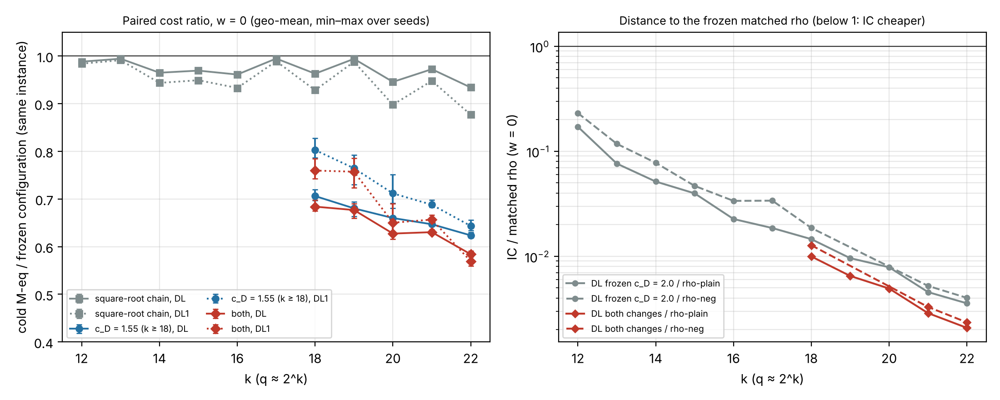

# Smaller double-large-prime factor base and a fixed-exponent square root: plane-quartic IC on the GHS-weak family

Scored against [`PROTOCOL.md`](PROTOCOL.md), frozen at `978de1aef2` before any data of this study. Every
number below is an **unverified assertion** `[pcc:unverified]`: no validator report exists yet, so no
leaderboard or `benchmarks/README.md` row moves (validation gate, AGENTS.md).

Scope: the GHS-weak family `E0/F_{q^3}`, `#E0(K) = 4 ell`, of `research/quartic_n4v2_20261020` only.
Not generic, prime-order or standard curves.



*Left: cold M-eq of each change divided by the frozen configuration on the same instance (frozen grid
constants, w = 0; points are geometric means over seeds, bars min–max). Right: DL against the frozen
matched rho, before and after (rho-neg is missing at k = 19, 20 by the frozen calibration rule).*

## Result under the pre-registered rule: improvement (headline arm DL)

All 116 units ran (k = 12..22, frozen instances and seeds) and every logarithm verified `[pcc:unverified]`. Gates:

| gate | result |
|:--|:--|
| H0: BASE reproduces the frozen grid | 129 records (D, DL1, DL at 43 units), every counted field equal, 0 mismatches |
| H1: the chain changes only `relations.mul` | 174 record pairs, 0 violations; `v3 chaincheck` 0 mismatches on 200,000 inputs per size |
| H2: every unit verified | 116 / 116; no unit needed a retry |

Paired ratio against the frozen configuration (`tables.md` for every arm, size and weight):

| change | IC arm | k = 18 | 19 | 20 | 21 | 22 | below 1 at every seed and w? |
|:--|:--|--:|--:|--:|--:|--:|:--|
| both | **DL** | **0.684** | **0.677** | **0.627** | **0.630** | **0.584** | yes, every size |
| both | DL1 | 0.760 | 0.757 | 0.650 | 0.657 | 0.569 | yes |
| both | D | 1.713 | 1.686 | 1.606 | 1.589 | 1.568 | **no: D is dearer** |
| c rule only | DL | 0.706 | 0.680 | 0.660 | 0.647 | 0.624 | yes |
| chain only | DL | 0.963 | 0.994 | 0.946 | 0.972 | 0.934 | yes (and at every k = 12..22) |

The distance to the frozen matched rho for DL goes from 0.0036 to 0.0021 of plain rho and from 0.0040
to 0.0023 of negation-map rho at k = 22 (w = 0; table in `tables.md`).

## What the counted measure hides (post-hoc, not pre-registered: `sensitivity.md`)

**The c rule trades relation work for heavier linear algebra, and the M-eq model prices additions at
zero.** At c_D = 1.55 the factor base is 22% smaller and the relations phase costs about 0.6× (in counted
multiplications and in CPU), but near the percolation threshold the cycles are longer: mean cycle-row
weight 27.5 → 89.8 and matrix nonzeros 2.5× at k = 22. DL and DL1 handle ±1 coefficients by additions,
which the frozen model (`mul + r_inv·inv + r_lmul·lmul`) does not price; plain-Lanczos D multiplies
them, which is why D gets dearer.

- With additions priced at w_add M-eq each, BOTH / BASE for DL is 0.74–0.66 (w_add = 0.1), 0.91–0.85
  (0.5) and 1.02–0.98 (1.0) over k = 18..22; at 1.0 it is no longer below 1 at every seed except k = 22.
  DL1 loses its improvement from w_add = 0.25 at k = 18, 19 `[pcc:unverified]`.
- CPU seconds (diagnostic: shared 4-core container, L0, four units in parallel): relations 0.54–0.79×,
  linear algebra 1.10–1.48× for DL; the DL arm's total is about 1.0 at k = 18..21 and 0.77–0.87 at
  k = 22. DL1 and D are slower in CPU at every size.
- **Reading:** under the pre-registered measure this is an improvement; in time it is a real gain for DL
  only at the largest size, and it grows with k because the relation stage (∝ c² q) outgrows the
  matrix. A c_D between 1.55 and 2.0 (the pilot's 1.7–1.8) or a lighter cycle basis would keep more of
  the relation saving; that is a new protocol, not a re-scoring of this one.

**The chain lowers the counted multiplications but not, yet, the time.** It removes 3–12% of DL's
counted cost (up to 19% of the relation stage's multiplications) with identical output, but one-at-a-time
interleaved runs at k = 20 gave relation-stage CPU 1.39 s (frozen) against 1.34 s (chain) on average,
within noise. The chain is interpreted (an op list and a 64-word register file per call); a compiled,
unrolled chain is needed before it can show in time.

## Deviation from the default route (owner decision, 2026-11-13)

The protocol named Iso Lab EKS. Before submission the account's monthly budget was found exceeded
(USD 1,679.93 of 1,300; `launch/BUDGET-HOLD.md`), and the owner chose a local run. The published image's
binaries (`launch/image.json`: v2 `183810cf…`, v3 `de500bc1…`) ran under the unchanged `launch/job.sh`
(only the `/opt/study` prefix rewritten, S3 sync stubbed) on the session container (Intel Xeon @ 2.10 GHz,
4 vCPU). Counted operations are host-independent and H0 checks them against the earlier independent
grid run; wall and CPU seconds are L0 and diagnostic only. The image publication was the only cloud spend.

## Files and reproduce

- `PROTOCOL.md` (frozen), `src/` (v3 sources), `launch/` (units, job, image, request, receipts).
- `runs/local-20261113/` (116 unit records, chain check, calibration, `SHA256SUMS`).
- `analyze.py` → `analysis.json`, `tables.md` (pre-registered); `sensitivity.py` → `sensitivity.{json,md}`
  (post-hoc); `plot.py` → `ratio.{svg,png}`; `REPORT.typ` → `REPORT.pdf`.

```sh
(cd ../quartic_n4v2_20261020 && rustc --edition 2021 -O v2.rs -o /tmp/v2)
(cd src && rustc --edition 2021 -O v3.rs -o /tmp/v3)
/tmp/v3 ic 4194271 1 D 3.0 1.55        # one BOTH unit
python3 analyze.py runs/local-20261113 <frozen grid units dir>
python3 sensitivity.py runs/local-20261113
```

The frozen grid units are `research/quartic_n4v2_20261020/results/grid-20261025/units.tar.gz` (artifact
store, sha256 `aac9a25c…`).
