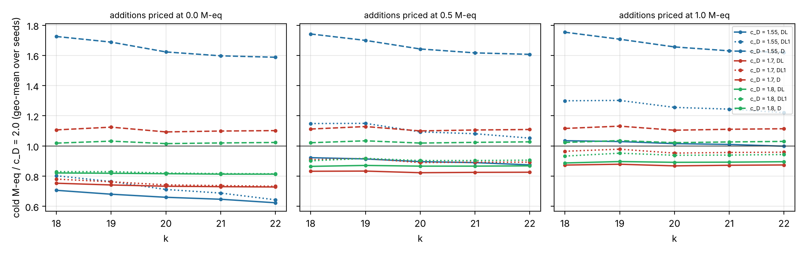

# Follow-up: c_D = 1.7 and 1.8 (plane-quartic double-large-prime IC, GHS-weak family)

Scored against [`PROTOCOL.md`](PROTOCOL.md), frozen at `4d006f312a` (analysis script at `693de1b9d2`)
before any data. Every number is an **unverified assertion** `[pcc:unverified]`; no leaderboard row moves
before the validation gate.

*Cold M-eq of DL (solid), DL1 (dotted) and D (dashed) against the frozen c_D = 2.0 on the same instance,
by addition price (frozen grid constants; geometric mean over seeds 1–3).*

## Result: c_D = 1.7 and 1.8 are robust improvements for DL; 1.7 is the best once additions cost anything

60 units (k = 18..22, seeds 1–3, frozen v2 driver, one unit at a time). A/A: 90 records reproduce the
main study's c_D = 2.0 and 1.55 units exactly; every unit verified; no retries `[pcc:unverified]`.

| DL against c_D = 2.0 | additions free (frozen model) | additions at 0.5 M-eq | additions at 1 M-eq | CPU, diagnostic |
|:--|--:|--:|--:|:--|
| c_D = 1.55 | 0.62–0.71 | 0.88–0.92 | 1.00–1.04 (not robust) | 0.76–1.15 |
| **c_D = 1.7** | 0.73–0.75 | 0.82–0.83 | **0.87–0.88** | 0.72–0.91 |
| c_D = 1.8 | 0.81–0.82 | 0.87 | 0.89–0.90 | 0.72–0.99 |

(ranges over k = 18..22; full tables in [`tables.md`](tables.md)).

- **Pre-registered headline:** for DL, c_D = 1.7 and 1.8 are below c_D = 2.0 at every seed and size both
  with additions free and at 1 M-eq; 1.55 is not (it relies on free additions).
- **Best c_D:** with additions free, 1.55 (as the main study found); at 0.5 and 1.0 M-eq, **1.7** for DL,
  1.7 / 1.8 for DL1. The mechanism is the row weight: mean cycle-row weight 24–28 at 2.0, 84–90 at 1.55,
  41–48 at 1.7 and 32–38 at 1.8; 1.7 keeps most of the relation-stage saving at half the 1.55 row weight.
- **DL1** is robust at 1.7 (0.73–0.78 free, 0.95–0.98 at 1 M-eq) and 1.8.
- **D (plain Lanczos) is dearer at every c_D below 2.0** (1.09–1.13 at 1.7, 1.02–1.04 at 1.8): it pays a
  multiplication for every matrix entry, so lighter rows matter more than fewer relations.
- **CPU (diagnostic, one unit at a time, L0):** DL at 1.7 is 0.72–0.91 of c_D = 2.0 and at 1.8 0.72–0.99,
  below 1 at all 15 (k, seed) pairs for both (1.55: up to 1.15). This run's sequential CPU numbers for
  1.55 (0.76–1.15) are better than the main study's parallel ones, which were confounded by co-running units.

## What changes in the recommendation

The main study's c rule (1.55) is the right choice only under the frozen model's free additions.
**c_D = 1.7 for k >= 18** is the setting that improves DL under every addition price tested and in CPU
time `[pcc:unverified]`. Combined with the square-root chain (separate effect; main study H1), the expected DL ratio is about
0.68–0.74 (free additions; the chain's 0.93–0.99 times 1.7's 0.73–0.75) at k = 18..22; that combination was not run here.

## Files

`PROTOCOL.md` (frozen), `make-units.sh` → `units.tsv`, `run-local.sh`, `runs/` (60 unit records,
`SHA256SUMS`, binary hash, host, log), `analyze.py` → `analysis.json`, `tables.md`; `plot.py` →
`sweep.{svg,png}`. Reproduce: `./run-local.sh <v2 binary> runs && python3 analyze.py runs` (the main
study's `runs/local-20261113` is the A/A reference).
