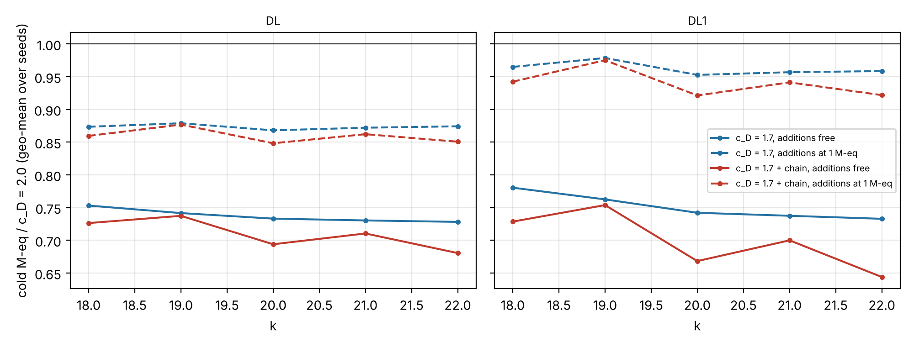

# Follow-up 2: c_D = 1.7 with the square-root chain (plane-quartic double-large-prime IC, GHS-weak family)

Scored against [`PROTOCOL.md`](PROTOCOL.md), frozen at `a595db838d` with the analysis script before any
data. Every number is an **unverified assertion** `[pcc:unverified]`; no leaderboard row moves before the
validation gate.

*DL and DL1 cold M-eq against the frozen c_D = 2.0 on the same instances; solid: additions free (frozen
model), dashed: additions at 1 M-eq (geometric mean over seeds 1–3).*

## Result: a robust improvement for DL at every k = 18..22 (pre-registered headline: yes)

45 units, one at a time, 2026-11-14 03:57–04:12Z, local container. Gates: 90 records reproduce the
sweep's c_D = 2.0 and 1.7 units exactly; in all 45 (q, seed, arm) pairs the chain changes only
`relations.mul` with the same key; every unit verified; no retries `[pcc:unverified]`.

| DL against c_D = 2.0 (k = 18..22) | additions free | at 0.5 M-eq | at 1 M-eq | CPU, diagnostic |
|:--|--:|--:|--:|:--|
| c_D = 1.7 alone | 0.73–0.75 | 0.82–0.83 | 0.87–0.88 | — |
| **c_D = 1.7 + chain** | **0.68–0.74** | 0.79–0.83 | **0.85–0.88** | 0.80–0.91 |

- Predicted before data: 0.68–0.74 (additions free) and about 0.82–0.87 (1 M-eq); measured 0.68–0.74 and
  0.85–0.88.
- DL1 with both: 0.64–0.75 (additions free), 0.92–0.98 (1 M-eq); CPU 0.91–1.06.
- D (plain Lanczos) stays dearer: 1.07–1.12 (the chain takes 1–2% off c_D = 1.7's 1.09–1.13).
- **The chain on top of c_D = 1.7:** DL 0.935–0.994 counted (additions free), but CPU 0.83–1.07 against
  c_D = 1.7 alone: no measured time gain from the chain in this interpreted implementation, as before.

## Distance to rho

The DL arm's distance to the frozen matched rho shrinks by the same factor as the table above; at k = 22
the frozen DL is 0.0036 of plain rho (w = 0), so with both changes about 0.0025 `[pcc:unverified]`.

## Files

`PROTOCOL.md`, `make-units.sh` → `units.tsv`, `run-local.sh`, `analyze.py` → `analysis.json`, `tables.md`,
`plot.py` → `combo.{svg,png}`, `runs/` (45 unit records, `SHA256SUMS`), `runs-combo-20261114.tar.gz`.
Reproduce: `./run-local.sh <dir with v2 and v3> runs && python3 analyze.py runs`.
