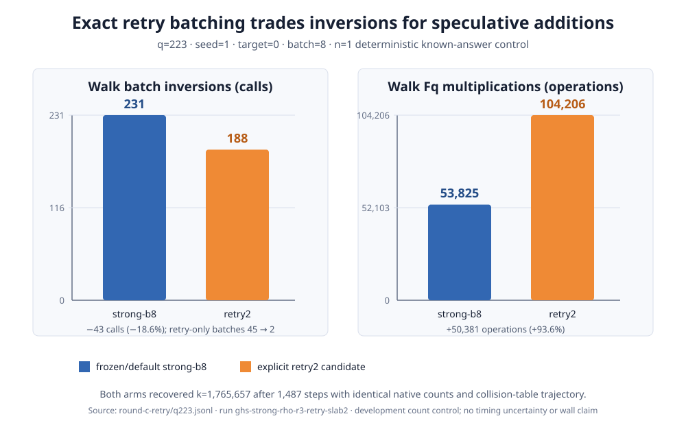

# Round C result: exact retry2 batching is count-negative

Status: deterministic development correctness/count control complete. The
producer evidence is not independently admitted `[pcc:unverified]`. No wall,
throughput, end-to-end, frontier, or leaderboard conclusion follows.

## Outcome

The two-candidate retry slab preserved the complete `q=223` walk trajectory
and reduced retry batch inversions, but it increased total counted work. It is
therefore retained as an explicit development arm and is not accepted as the
new default.

Both `strong-b8` and `strong-b8-retry2` recovered `k=1,765,657` after 1,487
steps, with 76 distinguished points, 0 restarts, 53 look-ahead retries, 2
cycles, and 10 cycle additions. Setup, verification, and every native count
were equal. The source-bound self-test also compared the two helpers on eight
lanes including a lane that required two retries; its returned points, jump
indices, look-ahead count, and native counts were identical.

The counted walk delta was:

| count | `strong-b8` | `retry2` | delta |
|:--|--:|--:|--:|
| batch inversions | 231 | 188 | -43 (-18.6%) |
| retry-only batch inversions | 45 | 2 | -43 (-95.6%) |
| `F_q` inversions | 241 | 198 | -43 |
| `F_q` multiplications | 53,825 | 104,206 | +50,381 (+93.6%) |
| `F_q` additions | 195,560 | 383,592 | +188,032 |
| group additions | 1,551 | 2,988 | +1,437 (+92.6%) |

The first slab still needs one batch inversion per 8-lane outer round: 186
calls. The baseline then needed 45 nonempty retry batches. Retry2 folded the
first retry level into the 186 slabs and needed only two third-candidate
fallback batches, hence 188 total. It paid for second-candidate denominators
and additions on nearly every lane whether or not that lane retried.



## Cost interpretation

The cold field-count delta, including unchanged setup and verification, is

```text
delta M-eq = +50,381 - 43 * r_inv.
```

Break-even would require one `F_q` inversion to cost 1,171.65
multiplications. The inherited N4-v2 pilot reports robust ratios from 15.00
to 25.88 and even its discarded migration-noisy values ranged only from 3 to
325 (`../../quartic_n4v2_20261020/PARAMS.md`). Thus the candidate is count-higher
throughout all recorded prices. At the inherited Xeon sensitivity constants
`r_inv=15`, `r_lmul=1.1`, cold counted cost rises from 188,844.1 to 238,580.1
M-eq, a 1.26337 ratio (+26.3%). The identical one modular multiplication is
included in both totals.

The raw record emits development wall times, but the run had no isolation,
A/A control, interleaving, or checkpoint admission. Those values are excluded
from every comparison.

## Why exact cross-round compaction is obstructed

Retry membership is unavailable until `P + M_j` has been affine-normalised
and its `x` coordinate hashed. At the current outer-round barrier, accepted
lanes cannot supply future additions without being advanced past pending
lanes. Doing that moves canonicalisation, cycle handling, distinguished-point
tests, and table operations out of lane-index order, which can change the
first collision and answer-producing record. Merely precomputing a future
addition does not remove this dependency: cycle escape, a DP collision,
tail-cap restart, or an infinity restart can invalidate it, and all speculative
work must still be charged.

The bounded retry2 slab avoids that ordering change by computing both
`P+M_j` and `P+M_(j+1)` from the same original point, inspecting candidates in
the original attempt-major order, and falling back sequentially from `j+2`.
The exact-output controls pass, but the complete count above rejects this
particular packing strategy.

## Requirement disposition

| requirement | status | evidence |
|:--|:--|:--|
| preserve every lane transition | verified complete | `selftest.txt`, helper equality including a two-retry fallback |
| preserve RNG, collision/table order, answer, and native accounting | verified complete on fixed cell | `q223.jsonl`, `validation.txt` |
| reduce retry batch inversions | verified complete on fixed cell | 45 to 2 retry-only calls |
| reduce total counted cost | failed for this candidate | +50,381 multiplications versus -43 inversions; break-even `r_inv=1171.65` |
| preserve default comparison | verified complete | `retry_prefetch=1` remains the constructor default; candidate requires `-retry2` |
| establish throughput/frontier improvement | not attempted by rule | checkpoint-gated profile/isolation and full matched grid remain open |

## Evidence and flow

- Protocol: `../ROUND_C_RETRY.md`, committed prospectively as `d04ca66499`.
- Raw paired records: `q223.jsonl`.
- Unified run record and flow: `experiment-export.json`.
- Native control: `selftest.txt`.
- Machine check: `validate.sh`; output `validation.txt`.
- Source/binary/host/commands: `metadata.txt`.
- Figure data and editable visual: `counts.csv`, `counts.svg`.

Planned arms: 2; attempted: 2; completed correctly: 2; missing: 0.
Both wall observations are excluded by protocol. The research-KB wrapper and
Conductor executable were unavailable, with their exit-127 failures retained
in `metadata.txt`. No profile or timing run was launched because the inherited
checkpoint gate remains unavailable. The repository-wide release library test
does not compile on the unchanged base as recorded in
`../round-b/full-test-status.txt`; this edited standalone source compiled and
passed its source-bound controls `[pcc:unverified]`.

No canonical dashboard or benchmark graph changes: the default comparator and
admitted performance evidence are unchanged. The next exact-semantics lead is
not wider speculative slabs; it is a different representation that can test
the affine partition without another inversion, or a prospectively redefined
walk whose distribution and collision controls are measured as a new arm.
