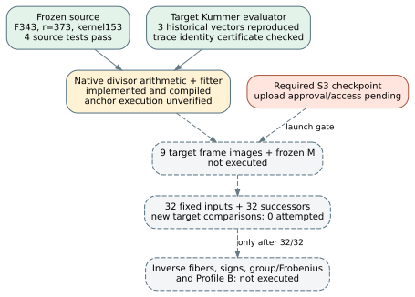

# Native target reconstruction: preparation and fixed-component checks

Date: 2026-10-26. Repository: `isogeny-labs/crypto`.
Implementation commit: `caec72812`. Base: `c12346cb7`.

The next target-side computation is implemented and reviewable. Its new
frame and challenge runs have not started. Fixed historical checks pass;
this is not a new calibration result.

## Requirement-to-evidence status

| Requirement | Observed state |
| --- | --- |
| Fixed F343 case, subgroup 373 and kernel 153 | Unchanged parent manifest and arithmetic; original four source tests pass. |
| Nine-point target arithmetic and matrix fitter | Implemented and compiled; certified-anchor execution remains unverified. |
| Historical target evaluation | All three F49 Kummer vectors reproduced exactly, with both direct and residue-algebra evaluation. |
| Matrix fitter and parser guards | Planted projective map recovered; deficient frame and reference-label field rejected in component tests. |
| Trace-tensor algebraic identity | Certificate `IDC1h368ff5f1ba01b556`; 32 derived plus 16 extra field points accepted, and exact integer coefficient maps agree. |
| Target 32-point challenge | Zero new target challenge runs attempted; fixed inputs remain unchanged. |
| Inversion, signs, group/Frobenius checks and Profile B | Not executed; original requirements remain open. |
| S3 resume checkpoint | Normal gate fails without configured upload access. A later raw-key upload attempt was rejected before execution by automatic approval review. |

Fourteen target-package tests pass: five component tests and nine tests of
the canonical certificate machinery. Four original source tests also pass,
including full frozen-source replay. Strict target Clippy passes. The
[raw target test output](target-tests.log) retains the result. Certificate
issuance and exact expansion were run as proof checks; no target frame or
challenge image was evaluated by them.

## Mathematical route and sources

[Tian section 3.2](https://arxiv.org/html/2012.07173v1#S3.SS2) was read in
full. It supplies the origin delta+P_infinity, the symmetric tensors and
the normalized-function linear-change construction. It does not establish
the missing calibration for this particular frozen case.

[Khuri-Makdisi, Lemmas 2.1--2.3](https://arxiv.org/abs/math/0105182) were
checked with their hypotheses and proofs. Effective divisors are represented
by spaces of forms vanishing on them. The new code checks dimensions and
the degree conditions for multiplication and division. This avoids an
enumeration of Jacobian classes in the arithmetic engine.

The existing prime-field `src/cryptanalysis/plane_quartic_pic.rs` and its
[problem history](../../../../problems/plane-quartic-jacobian-class-arithmetic-missing.md)
were reviewed. Its documented field is an odd prime below 2^31 and its
origin is K-P0. This case needs extension-field coefficients and the fixed
theta origin B. The new adapter is not claimed as a new divisor algorithm.

The historical Sage verifier and symmetric-inversion source were read at
the exact commit in [PROVENANCE.json](../../PROVENANCE.json); they were not
executed. The atlas brief and matching lead
`LEAD-TRF-odd-char-descent-smith-quartic` were read. Its broader Smith/Diem
pipeline is not completed or reclassified by this preparation.

For an etale length-three L-algebra, the traces of multiplication operators
give the symmetric tensor by inclusion-exclusion. This is an L-linear
calculation, not a field-trace conversion of coordinates. Full F7^18
coefficients are preserved. Three already recorded target fixtures verify
the implementation against both direct six-permutation evaluation and
historical expected values. The trace identity's
[certificate](../../target-native/certificates/trace-three-slots.json) is
in the evaluated tier over 2^61-1; its separate
[integer expansion](../../target-native/certificates/trace-three-slots.expansion.json)
checks the stated polynomial over the integers. No formal prover or
independent-runner review is claimed.

## Execution boundary

The code has three separate commands. `calibrate` uses only the declared
training inputs and writes a fresh hash-pinned matrix. `evaluate` reads only
the matrix and frozen coordinate envelope, calling no target oracle or
source enumeration. `validate` may then use the certified anchor and a
validation-only O(r) source enumeration to compute exact target comparisons.
Its costs are retained separately. Output creation refuses overwrite.

The draft [execution protocol](../../target-native/PROTOCOL.md) fixes the
geometry, origin, input envelopes, permutation control, matrix freeze, chart
stops and parent budgets. Its machine record validates as a draft, but
has not been frozen and does not authorize a data claim. Full inverse-fiber
and wrong-origin/incompatible-target controls remain parent obligations.

The required S3 checkpoint is not satisfied. The direct gate reported no
configured AWS profile, token or token file. Automatic approval review then
rejected the proposed temporary raw-key process before it started, citing
absence of specific authorization for that credential use and the new
checkpoint payload/destination. That action was not retried or bypassed;
the helper was removed. A local review-only snapshot and manifest were
prepared outside the repository, and explicit checkpoint-upload approval
plus configured AWS access were requested. The snapshot does not satisfy
the remote checkpoint gate.

The initial preview is 43,171 bytes, SHA-256
`ad0c0f06b1ab8223f5943abba62c73dc5d99e3656cb3da16272c10d80dd4f96e`.
It contains the branch bundle, protocol and resume note. Intended prefix:
`s3://setec-astronomy-artifacts/checkpoints/crypto/codex__quotient-target-calibration-20261026/`.
It contains no credentials, old source/image table or another repository's
private state.

## Flow and remaining work

For the new target pipeline: three phases planned, zero attempted, zero
completed, three blocked on the checkpoint prerequisite. Unit/fixture and
proof checks above are separate completed verification work. No experiment
export is presented because no new experiment ran and the execution record
is still draft.

After authorized checkpoint access is available, record preflight resource
diagnostics, finish instrument/analysis hashes, freeze and commit the native
execution record, and satisfy the gate. Then evaluate the nine target frame
images, publish/checkpoint M, and require 32/32 exact primary and successor
matches before dependent inversion. Keep every failure and the fixed inputs.

No speed, memory-cost advantage, global coordinate identity, complete point
transfer or new vulnerability is established. No canonical cost graph or
leaderboard row changes: those surfaces have no new admitted result here.
