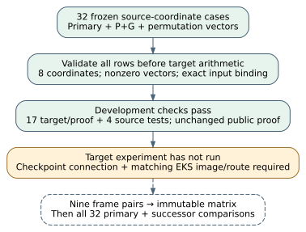

# Quotient-calibration review correction, 2026-10-30

The validator now rejects incomplete projective coordinates before computing
any target divisor. **21 focused tests pass. No new target frame, challenge
image or inverse divisor has been computed.** This continues
[PR #2641](https://github.com/isogeny-labs/crypto/pull/2641) and preserves the
fixed F343/order-373/kernel-153 case, certified anchor and frozen inputs.

## Correctness issue and correction

The review found that the old projective comparison zipped unequal vectors.
For example, a one-coordinate prefix `[1]` could compare equal to an
eight-coordinate vector beginning with 1. Rust's documented
[`Iterator::zip`](https://doc.rust-lang.org/std/iter/trait.Iterator.html#method.zip)
stops when either input ends; it does not enforce equal lengths.

The comparison now returns false for unequal lengths. The reference validator
also parses the entire prediction envelope before target construction:

- Exactly 32 rows, each bound to the frozen case ID, point and P+G input.
- Exactly eight field coordinates in each primary, successor and permutation
  vector; each vector must be nonzero. Individual coordinates may be zero.
- All 18 coefficients of each field element lie in 0..6.
- Expected schema, input/matrix hashes, metadata fields and evaluator flags.

The tests exercise prefixes of lengths 0, 1 and 7, an extra ninth coordinate,
zero vectors, an out-of-field coefficient, missing/extra rows, duplicated cases
and mismatched input metadata. The valid synthetic parsing control computes
no target image. No challenge is refitted, replaced or dropped.

## Development validation

| Check | Observed result | Evidence |
| --- | --- | --- |
| Target package | 8 component tests and 9 canonical identity-certificate tests pass | [Raw stdout/stderr](target-tests.log) |
| Original source package | 4 tests pass, including the full frozen source replay | [Raw stdout/stderr](source-tests.log) |
| Strict target Clippy | Passes for all targets | [Raw output](target-clippy.log) |
| Historical target controls | All 3 F49 Kummer vectors match both existing evaluation paths | Target component test above |
| Public trace proof | Certificate and exact integer expansion reproduce byte-for-byte | [Replay stdout](trace-replay.log), unchanged [proof record](../../target-native/certificates/trace-three-slots.json) |
| Draft protocol | Canonical validator reports 0 findings | [Validation receipt](validation.json) |

CodeQL labeled the public polynomial-identity proof as a potentially sensitive
certificate. The program deliberately publishes that proof, containing no
credential or TLS material. The variable/comment now state its public purpose;
the generated bytes and proof ID `IDC1h368ff5f1ba01b556` are unchanged. This is
not a claim that the security alert was administratively dismissed.

The earlier full root suite completed with 4,845 passes, 17 failures and 121
ignored tests on the old root source. Its 17 diagnostics report absent runtime
fixtures/evidence. The [unaltered failure excerpt](root-prior-failures.log)
records those diagnostics; the full original 435,102-byte log is retained at
`/workspace/quotient-target-validation/root-release-library-materialized.log`.
Its digest and the current root-check status are in `validation.json`. Neither
the old run nor the focused checks constitute a full-suite pass on this merge.
The current root attempt first lacked newly added tracked path dependencies;
those were materialized without changing source. The next locked check stops
because the root manifest requires a lockfile update. Root `src/`, `Cargo.toml`
and `Cargo.lock` are identical to main `423ea37eca`, so this is outside the
quotient change. The unrelated root lockfile was left unchanged.

## Approval, access and execution status

The user explicitly approved ongoing same-branch resume uploads on 2026-10-30
to `s3://setec-astronomy-artifacts/checkpoints/crypto/codex__quotient-target-calibration-20261026/`.
That approval is recorded and will not be requested again. The supported
environment reports no AWS identity, secret or runtime-variable bindings at
configuration revision34. The normal checkpoint gate still lacks an upload
transport. The earlier rejected raw-key process was not retried or bypassed.

The current repository instructions require EKS Spot for this pending
experiment. The valid **draft** protocol now selects `isolab-k8s`/`cpu-spot`
and retains one native thread, 2 GiB and the original shared 3600-second bound.
The [Iso Lab skill](../../../../.agents/skills/isolab-eks/SKILL.md),
[submission reference](../../../../.agents/skills/isolab-eks/references/submission.md)
and maintained workflow were checked. The standard GitHub route builds
`ecbench`; it does not build this standalone target executable. A matching
image and supported custom-command submission still need qualification. No
integration fixture was dispatched as a substitute, and no clock is admitted
as speed evidence.

| Parent obligation | Status |
| --- | --- |
| Source freeze, frame and 32 coordinate inputs | Verified unchanged |
| Native target arithmetic | Implemented; certified-anchor execution unverified |
| Nine-point target calibration | Not run |
| Frozen matrix on 32 primary/successor targets | Not run |
| Inversion, signs, subgroup/Frobenius and eight addition/scalar relations | Not attempted |
| Wrong-origin/incompatible-target and exceptional-fiber controls | Still required |
| Initialization without the certified anchor; global section identity | Not attempted |

After supported checkpoint access and image qualification: perform the declared
preflight, freeze/commit the native record before target data, calibrate the
nine fixed pairs, checkpoint the immutable matrix, then compare every frozen
primary and successor. Preserve all failures and stop dependent inversion on
any mismatch. No global map identity, speedup or vulnerability is established.

## Integration and sources

The owner's merge `90716c292` was reviewed before continuing. The normal
integration of main `423ea37eca` is `1733dc59e`; only the additive problem
index and today's session log required manual conflict resolution. All main
problem rows, the quotient row, both complete parent sequences in today's
log and the full earlier quotient preparation entry were retained. Main's
nonconflicting NIST status update and inherited historical-log formatting
were preserved. [Preservation checks](merge-preservation.json) bind the bytes.
No frozen evidence or target source was selected away in the integration.
The focused research workflow now follows the current repository policy:
main pushes and manual dispatch, with its checks retained. The required PR
merge set remains `gate`, `size` and `artifacts`; no required check was removed.

Sources checked: the Rust iterator primary documentation above; the review
finding [r4381328021](https://github.com/isogeny-labs/crypto/pull/2641#discussion_r4381328021);
the parent [protocol](../../PROTOCOL.md), [provenance](../../PROVENANCE.json)
and [prior preparation report](../preparation-20261026T1824Z/REPORT.md).
Tian §3.2 and Khuri-Makdisi Lemmas 2.1–2.3 remain the mathematical sources;
this repair changes input validation, not their constructions. No lead-atlas,
leaderboard, benchmark or canonical cost graph is promoted by these checks.

The source for the diagram is [review.dot](review.dot). The accompanying
[PDF](REPORT.pdf) is a new dated review report; historical reports are unchanged.
