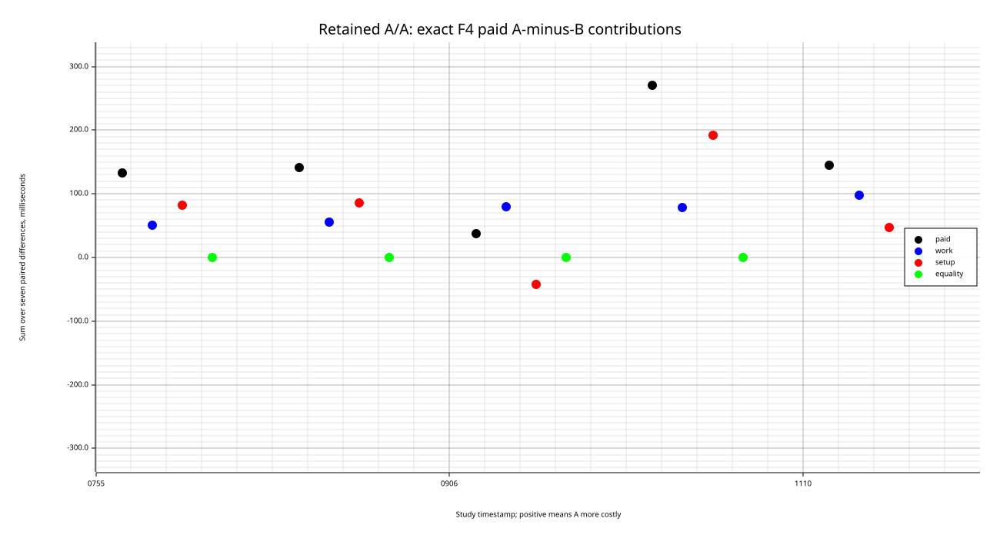

# Retrospective A/A cost layers

Five retained studies, passing and rejected; no new native call, timing retry, pooled speed estimate, fifteen-fold flag or changed gate. Raw summaries are bound to closed-record hashes; every accessed raw file is pinned in audit.json. Counts overlap with the original studies. This descriptive trace identifies measured cost contributions, not a causal source of noise. [pcc:unverified]

Each control paid interval equals its work plus shared fresh three-route setup and equality cost. Setup includes charged original preparation, child process intervals, route parsing/metadata and outer reference overhead. Candidate pays its own work plus preparation and equality. All nesting residuals and sums are checked as integers; ratios/differences are never substituted for old gates. [pcc:unverified]

| Study | Original all-AA pass | Median setup A/B | Median setup first/second | Sum F4 paid A-B ms | Work contribution ms | Setup contribution ms | Equality contribution ms |
|---|---|---:|---:|---:|---:|---:|---:|
| 0755 | false | 1.054816 | 0.978861 | 133.241 | 50.520 | 82.665 | 0.055 |
| 0827 | true | 1.044421 | 1.036607 | 141.443 | 55.519 | 85.762 | 0.162 |
| 0906 | true | 0.994113 | 1.024455 | 37.022 | 79.450 | -42.509 | 0.081 |
| 1029 | false | 1.015109 | 1.009126 | 270.071 | 78.250 | 191.850 | -0.030 |
| 1110 | false | 1.024046 | 0.929783 | 145.108 | 97.961 | 47.152 | -0.005 |

Signed totals sum the seven labelled differences; they are not independent samples, confidence intervals or adjusted results. Positive means A cost more than B; first/second orientation follows the frozen alternating execution schedule. Separate inputs and algorithms are retained per study, never pooled to estimate speed. No causal hardware/cache/scheduler/clock diagnosis follows. All original successes and rejections remain in force. [pcc:unverified]

Sources checked (KB unavailable): official Rust Instant/Command::status contracts and recorded Runner/Panel/reference code, with the existing paired protocols. Recorded process walls include wrappers, scheduling and stdout consumption; outer costs include parsing and metadata. Missing CPU-time/temperature/counter evidence prevents attributing a physical cause. No native measurement or timing code is changed. [pcc:unverified]

{width=90%}
