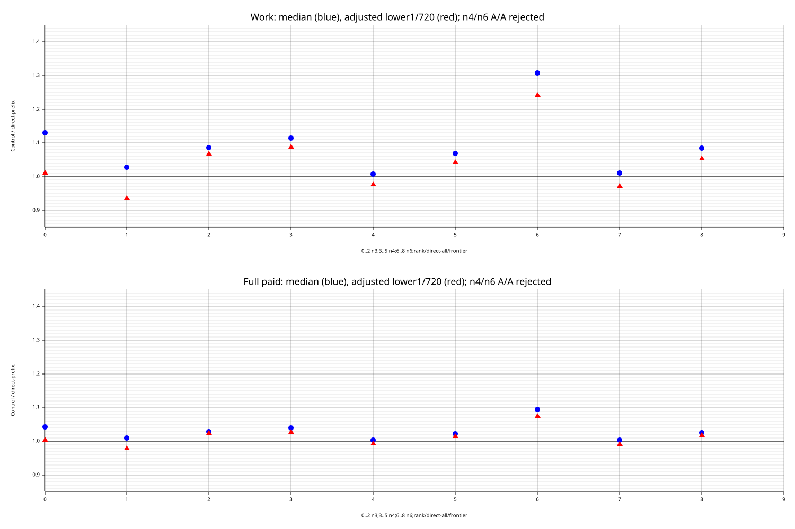

# Per-phase medians

Each entry is the median of25 main calls in milliseconds. Phase medians do not add to the median work cost. The frontier's constructor and full replay are inside its native phase; extra preprocessing is not its total construction cost. Ratios use paired block observations in the main report, not ratios of these medians. [pcc:unverified]

|n|Arm|Extra preprocessing|Own preparation|Fresh identity check|Native solve/check|Work|Full paid|
|---|---|---:|---:|---:|---:|---:|---:|
|3|rank|0.592970|0.370717|9.994415|3.836068|15.148212|43.480389|
|3|direct-all|0.080551|0.132139|9.697129|3.953715|14.006596|43.076142|
|3|direct-prefix|0.084727|0.140801|9.427234|3.894846|13.830954|42.129810|
|3|frontier|0.000380|0.051708|9.808666|4.937323|15.180157|45.266050|
|4|rank|1.186491|0.541052|9.112053|3.811123|14.755808|41.172777|
|4|direct-all|0.108292|0.130136|8.852624|3.670992|12.854783|39.280946|
|4|direct-prefix|0.083505|0.155384|8.818793|3.694117|12.868113|39.465442|
|4|frontier|0.000320|0.053531|8.605472|5.059177|13.800132|39.318943|
|6|rank|3.138161|0.969755|9.836026|4.316480|18.325549|50.189984|
|6|direct-all|0.200150|0.139439|9.313561|4.245403|14.068249|45.863088|
|6|direct-prefix|0.089855|0.180381|9.170847|4.139925|13.607307|45.283700|
|6|frontier|0.000361|0.079980|8.853771|6.059126|15.347088|47.460567|

{width=90%}
