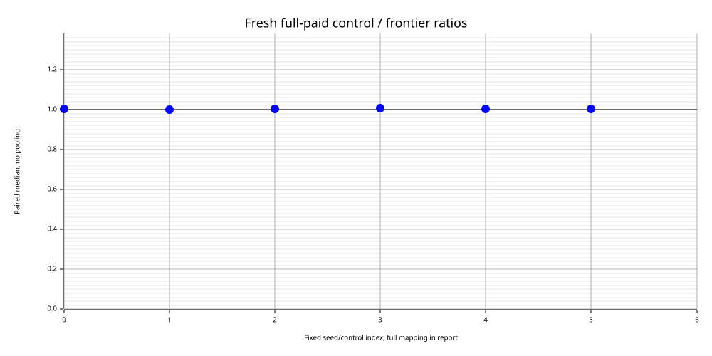

# Fresh matched native comparison

PCC-20261116-e67478; method:PCC-20261116-49c28b. Qualification:false; monitor admission:true. Three native routes use identical complete proof checking and identical common fees. Prior fastest is the primary comparison; matched same-source39 is the secondary control. Unsigned localL0; original family holdouts remain untouched. [pcc:unverified]

| Case | Control | Work median | Paid median | Work adjusted lower | Paid adjusted lower | Paid/shared ceiling |
|---|---|---:|---:|---:|---:|---:|
| last-n16-s41011 | prior-fastest-streamed | 1.032623 | 1.002306 | 0.951182 | 0.996570 | 1.077515 |
| last-n16-s41011 | same-source-streamed | 1.012594 | 1.000885 | 0.968625 | 0.997750 | 1.076520 |
| last-n16-s43013 | prior-fastest-streamed | 1.035859 | 1.002391 | 0.950330 | 0.996288 | 1.076750 |
| last-n16-s43013 | same-source-streamed | 1.099594 | 1.005810 | 1.027540 | 1.001991 | 1.079546 |
| last-n16-s47017 | prior-fastest-streamed | 1.044978 | 1.002709 | 1.008814 | 1.000607 | 1.074661 |
| last-n16-s47017 | same-source-streamed | 1.085429 | 1.005261 | 0.979489 | 0.998648 | 1.076818 |

## Separate phase diagnostics (milliseconds)

| Case | Mode | Input parse | Construction/wire | Wire write | Root replay | Parent remainder |
|---|---|---:|---:|---:|---:|---:|
| last-n16-s41011 | streamed | 0.163155 | 6.875130 | 0.310747 | 2.266643 | 5.569270 |
| last-n16-s41011 | frontier | 0.220291 | 5.455651 | 0.286169 | 2.247374 | 8.342312 |
| last-n16-s43013 | streamed | 0.145469 | 7.487140 | 0.343445 | 2.528896 | 5.460597 |
| last-n16-s43013 | frontier | 0.132379 | 5.697733 | 0.322164 | 2.430569 | 4.944662 |
| last-n16-s47017 | streamed | 0.147041 | 7.158573 | 0.340922 | 2.738073 | 5.143227 |
| last-n16-s47017 | frontier | 0.175994 | 5.891389 | 0.346470 | 2.342319 | 7.729888 |

324 captured uninstrumented answers replayed from original bytes/wires; all-case increment flag:false. Monitor-valid result requires:true. A rejected/incomplete case is never pooled away. [pcc:unverified]

Generation/preparation and complete fresh3CAS references are fully charged to every route without amortization; native work already includes construction/full native checks/root replay/output consumption. The conditional ceiling assumes only candidate work becomes free while the same shared fee remains; it is not a global complexity bound. Instrumented phase calls and capture/report/statistic overhead are separate study costs and never mixed into these ratios. All raw calls/failures/AA/main/phase details remain. [pcc:unverified]

{width=90%}
