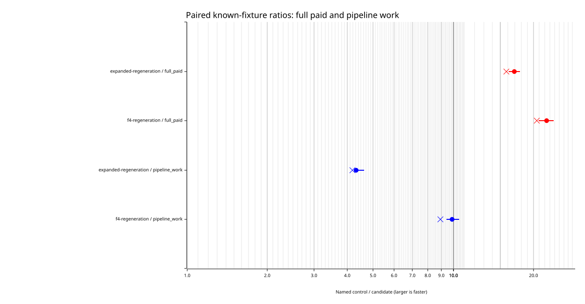

# Paired known-fixture development result

Registered numerical15x flag: **true**; separate10x partial flag: **true**. Both paid adjusted lower bounds must exceed the threshold. This is unsigned localL0 evidence, PCC-20261116-370e58, not a fresh-family or signed execution verdict. [pcc:unverified]

All six A/A scope gates pass;21 counterbalanced main blocks finish, with108 complete matching workflow answers including warmup and A/A. Runtime identities are unchanged and the monitor records0 contended samples. PSI was unavailable and some service threads could not be moved. [pcc:unverified]

| Named control | Scope | Median ratio | Ordinary95% interval | Adjusted lower1/720 |
|---|---|---:|---|---:|
| f4-regeneration | pipeline_work | 9.877205 | [9.421848, 10.496318] | 8.941326 |
| expanded-regeneration | pipeline_work | 4.310077 | [4.222890, 4.627482] | 4.174537 |
| f4-regeneration | full_paid | 22.418114 | [20.881659, 23.838811] | 20.579510 |
| expanded-regeneration | full_paid | 16.919984 | [16.106180, 17.749763] | 15.841749 |

Ratios are named control/candidate. Pipeline-work includes launch, computation, checking and consumption; it is not a raw kernel metric. Full-paid adds the original measured preparation to the candidate and fresh three-route regeneration (including that preparation) to each original control. These are different validation algorithms for the same complete reduced basis. The candidate uses the actual root API and exact FGLM-frontier constructor over p=2^31-1, with checked both_updates_frontier mode and zero exports. [pcc:unverified]

Only previously selected p2147483647,n16,last-star,seed7 is tested. No new seed, dimension or fresh-target generation. The strongest optimized controls and prior candidate retain their separate retained full-control screen results; this three-arm study establishes no15x against the fastest control. The prior-streamed/candidate full-paid ratio was1.058 in that separate single-call screen (PCCa780ec); it is not a paired estimate. Smaller-case regressions are retained in that screen. No intrinsic degree-of-regularity reduction follows from certificate/output degrees. [pcc:unverified]

## A/A admission

| Arm | Scope | Median A/B | Ordinary95% interval |
|---|---|---:|---|
| f4-regeneration | pipeline_work | 1.057277 | [0.977090, 1.186846] |
| f4-regeneration | full_paid | 1.069195 | [0.964509, 1.286519] |
| expanded-regeneration | pipeline_work | 1.021589 | [0.935279, 1.114594] |
| expanded-regeneration | full_paid | 1.081168 | [0.979198, 1.245775] |
| root-sparse-both | pipeline_work | 0.925775 | [0.732977, 1.380720] |
| root-sparse-both | full_paid | 0.928317 | [0.746247, 1.358272] |

This Rust audit recomputes A/A and main statistics from integer costs with the frozen100000-draw joint bootstrap, SplitMix64 seed20261115, unbiased index rejection and nearest-rank endpoints. Every paid sum and block order is checked. Decimal JSON statistics compare within four machine epsilons; all gates compare exactly, without rounding. No trimming, replacement or estimator change. All raw panels/wires remain. [pcc:unverified]

{width=95%}

Points: medians; bars: ordinary95% intervals; crosses: adjusted lower bounds. Lines mark10 and15.
