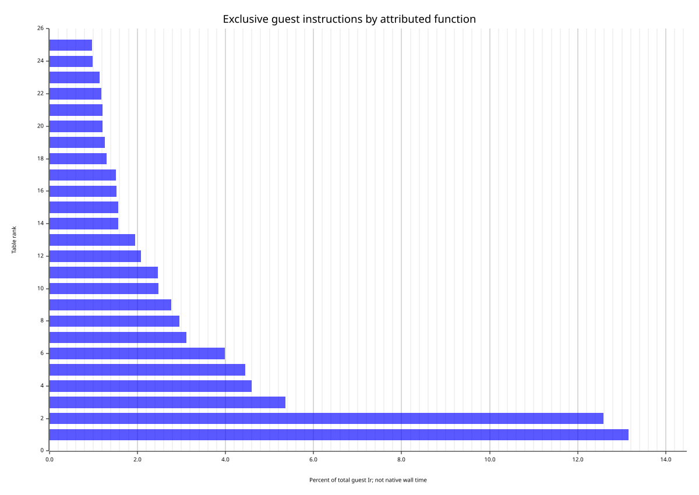

# Native candidate instruction diagnosis

Qualification only: **false**. PCC-20261116-0e4eac. One whole-process guest-instruction profile; generation/preparation and parent capture excluded. No native time/cycle estimate, speed ratio, A/A admission, confidence interval, new target or degree-of-regularity conclusion. [pcc:unverified]

The complete checked canonical answer equals the frozen uninstrumented candidate. Executable/runtime hashes are unchanged. Total guest Ir: **111865803**, across707 attributed functions. Rust recomputation matches both raw summary/totals, every function row and the separately formatted Collected line from the same profiler. This is producer recomputation, not signed independent execution verification. [pcc:unverified]

Self costs are exclusive and add to total. Inclusive costs include callees, overlap and must not be added across functions. Inlined instructions belong to their containing compiled functions. Startup, libraries, allocation and exact checking remain included; instrumented dispatch can differ from native hardware dispatch. [pcc:unverified]

Function names longer than110 characters are abbreviated in tables; full names and object paths remain in functions.json.

## Largest self costs

| Rank | Function | Self Ir | Fraction of all Ir | Inclusive Ir (overlaps) |
|---:|---|---:|---:|---:|
| 1 | certified_relations::axpy_in_place::&lt;alloc::vec::Vec&lt;usize&gt;&gt; | 14713175 | 13.153% | 23551269 |
| 2 | certified_relations::lead | 14074655 | 12.582% | 14074655 |
| 3 | &lt;alloc::collections::btree::map::BTreeMap&lt;alloc::vec::Vec&lt;usize&gt;, u64&gt;&gt;::insert | 6000997 | 5.364% | 7707703 |
| 4 | free | 5140663 | 4.595% | 9402689 |
| 5 | 0x00000000000a0fe0 | 4973151 | 4.446% | 5189158 |
| 6 | &lt;alloc::vec::Vec&lt;usize&gt; as alloc::vec::spec_from_iter_nested::SpecFromIterNested&lt;usize, core::iter::adapter... | 4456144 | 3.983% | 6407367 |
| 7 | relation_replay_checker::add_term | 3480336 | 3.111% | 8383851 |
| 8 | malloc | 3308370 | 2.957% | 6233655 |
| 9 | &lt;alloc::collections::btree::map::BTreeMap&lt;alloc::vec::Vec&lt;usize&gt;, u64&gt;&gt;::remove::&lt;alloc::vec::Vec&lt;usize&gt;&gt; | 3099851 | 2.771% | 4678699 |
| 10 | 0x00000000000a02e0 | 2781166 | 2.486% | 4654806 |
| 11 | certified_relations::normal_form | 2758395 | 2.466% | 16808768 |
| 12 | core::slice::sort::shared::smallsort::insertion_sort_shift_left::&lt;(alloc::vec::Vec&lt;usize&gt;, u64), &lt;[(alloc::... | 2329899 | 2.083% | 2329899 |
| 13 | certified_relations::quotient::change_order | 2175204 | 1.944% | 17849438 |
| 14 | 0x0000000000162880 | 1758121 | 1.572% | 1758121 |
| 15 | 0x00000000000a20c0 | 1753236 | 1.567% | 4792980 |
| 16 | &lt;core::iter::adapters::map::Map&lt;alloc::collections::btree::map::Keys&lt;alloc::vec::Vec&lt;usize&gt;, u64&gt;, certifie... | 1715001 | 1.533% | 1715001 |
| 17 | &lt;alloc::collections::btree::node::NodeRef&lt;alloc::collections::btree::node::marker::Owned, alloc::vec::Vec&lt;u... | 1694976 | 1.515% | 2704526 |
| 18 | core::iter::adapters::try_process::&lt;core::iter::adapters::map::Map&lt;core::iter::adapters::zip::Zip&lt;core::sli... | 1456390 | 1.302% | 7697921 |
| 19 | &lt;core::iter::adapters::map::Map&lt;alloc::collections::btree::map::Iter&lt;alloc::vec::Vec&lt;usize&gt;, u64&gt;, certifie... | 1416787 | 1.267% | 7127276 |
| 20 | &lt;serde_json::de::Deserializer&lt;serde_json::read::SliceRead&gt;&gt;::parse_integer | 1358724 | 1.215% | 1505636 |
| 21 | realloc | 1346484 | 1.204% | 6139844 |
| 22 | &lt;serde_json::de::SeqAccess&lt;_&gt; as serde_core::de::SeqAccess&gt;::next_element_seed::has_next_element::&lt;serde_js... | 1327435 | 1.187% | 1327435 |
| 23 | 0x000000000009ed80 | 1274120 | 1.139% | 1519065 |
| 24 | certified_relations::axpy_in_place::&lt;(usize, alloc::vec::Vec&lt;usize&gt;)&gt; | 1095827 | 0.980% | 1954170 |
| 25 | &lt;core::marker::PhantomData&lt;usize&gt; as serde_core::de::DeserializeSeed&gt;::deserialize::&lt;&mut serde_json::de::D... | 1086666 | 0.971% | 2076479 |

## Native constructor and separate checker: largest inclusive counts

| Function | Self Ir | Inclusive Ir (overlaps) |
|---|---:|---:|
| certified_relations::replay::produce_native_for_rust_with_kernels | 34 | 81619178 |
| certified_relations::replay::produce_native_for_rust | 135 | 81619139 |
| certified_relations::replay::native_product_impl | 250 | 78975727 |
| certified_relations::quotient::compact::solve_sparse_impl | 36 | 68096178 |
| certified_relations::quotient::compact::solve_impl | 17343 | 68096113 |
| certified_relations::monomials_ordered::emit'2 | 908621 | 28791134 |
| relation_replay_checker::verify_json | 35161 | 27190145 |
| certified_relations::axpy::&lt;alloc::vec::Vec&lt;usize&gt;&gt; | 157740 | 23709009 |
| certified_relations::axpy_in_place::&lt;alloc::vec::Vec&lt;usize&gt;&gt; | 14713175 | 23551269 |
| &lt;relation_replay_checker::Arithmetic&gt;::identity | 826870 | 17919131 |
| certified_relations::quotient::change_order | 2175204 | 17849438 |
| certified_relations::quotient::rewrite | 1086562 | 17463383 |
| certified_relations::normal_form | 2758395 | 16808768 |
| certified_relations::quotient::compact::verify_impl | 138803 | 15823251 |
| certified_relations::lead | 14074655 | 14074655 |
| &lt;alloc::collections::btree::map::BTreeMap&lt;alloc::vec::Vec&lt;usize&gt;, u64&gt; as core::iter::traits::collect::From... | 275763 | 13026548 |
| certified_relations::verify | 417649 | 12265627 |
| certified_relations::replay::complete_impl | 24462 | 9810514 |
| certified_relations::check_reference_impl | 18434 | 9585266 |
| certified_relations::row_shift | 205075 | 9453691 |
| certified_relations::quotient::coordinate | 46545 | 9189310 |
| certified_relations::replay::quotient_witness | 31596 | 8700201 |
| relation_replay_checker::add_term | 3480336 | 8383851 |
| core::iter::adapters::try_process::&lt;core::iter::adapters::map::Map&lt;alloc::vec::into_iter::IntoIter&lt;alloc::c... | 37 | 8077063 |
| alloc::vec::in_place_collect::from_iter_in_place::&lt;core::iter::adapters::GenericShunt&lt;core::iter::adapters:... | 966 | 8077026 |

All functions, object paths, counters, raw call graph and exact answer remain in the raw archive and functions.json. Counts describe this compiled binary/input under Callgrind. They can guide a subsequent explicitly qualified optimization; they do not predict its native gain. [pcc:unverified]

{width=95%}

Numbers on the vertical axis map to the self-cost table.
