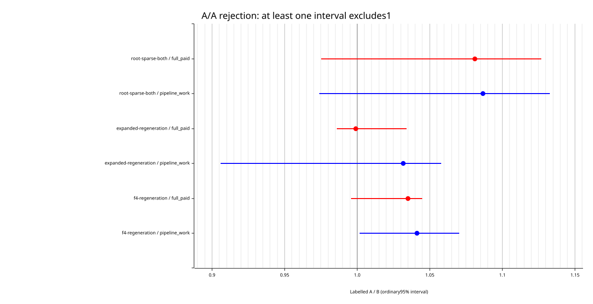

# Paired development test: A/A rejection

The frozen noise gate rejects this run. No main blocks ran and no10x/15x comparison is available. This is a retained rejection, with no replacement or same-source retry. PCC-20261116-3510d3, local L0 unsigned evidence. [pcc:unverified]

Exactly one warmup panel and seven labelled A/A pairs contain45 complete matching workflow answers. Executable/runtime identities remain unchanged. This Rust report checks each paid sum and recomputes all six A/A intervals from the raw labelled pairs with the frozen calculator. Recorded JSON statistics are compared within four machine epsilons (decimal parse rounding); gate decisions are compared exactly. [pcc:unverified]

| Arm | Scope | Median A/B | Ordinary95% interval | Includes1 |
|---|---|---:|---|---|
| f4-regeneration | pipeline_work | 1.041245 | [1.001575, 1.070291] | false |
| f4-regeneration | full_paid | 1.035147 | [0.995955, 1.044998] | true |
| expanded-regeneration | pipeline_work | 1.031788 | [0.905861, 1.057997] | true |
| expanded-regeneration | full_paid | 0.999193 | [0.985961, 1.034137] | true |
| root-sparse-both | pipeline_work | 1.086580 | [0.973863, 1.132851] | true |
| root-sparse-both | full_paid | 1.081256 | [0.975067, 1.126839] | true |

The table retains every ordinary A/A interval and exact gate decision. At least one scope rejects this run; the observations do not establish a cause for the labelled difference. The selected kernel mode and zero exports are checked in every candidate answer, alongside native/root acceptance flags. No main speed ratio is computed. [pcc:unverified]

The computation is the previously selected p2147483647,n16,first-star,seed7 known fixture. Every repeated workflow pays its original measured preparation charge; each panel obtains fresh three-route references charged in full to regeneration arms. Candidate pays construction, serialized proof, separate root API checking and output consumption. These are distinct validation algorithms for the same complete reduced basis. This is not a fresh-target, fastest-control or kernel comparison. [pcc:unverified]

No fresh seed was generated. The earlier single-call screen remains separate. Certificate/output degrees and quotient dimensions do not establish a reduction in intrinsic regularity. The15x objective remains open. [pcc:unverified]

{width=95%}

Points are medians, bars are ordinary95% percentile intervals. Vertical line marks1. No interval or sample was discarded.
