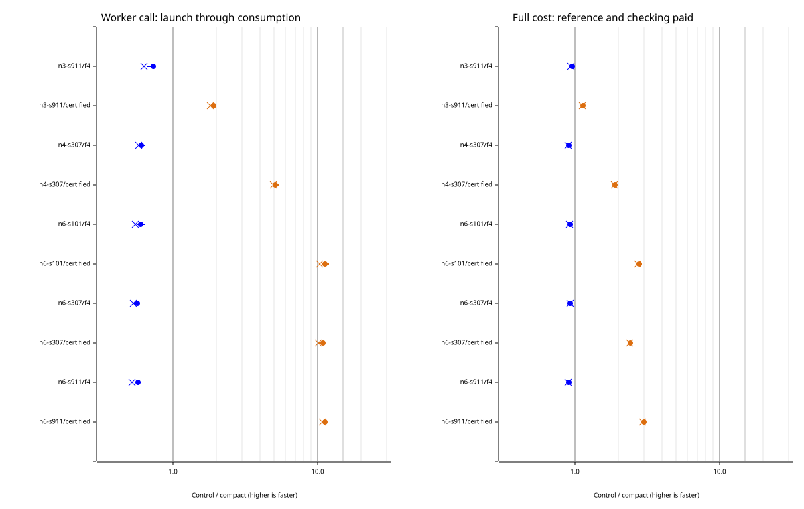

# Local compact pilot: actual measured outcome

Unsigned producer L0 observations, PCC-20261116-1075bb; no independent replay, L2 or fresh-family confirmation. The user's checkpoint waiver enabled this bounded local pilot. All three mature CAS routes agreed before native samples.

The full-cost 10x/15x target was **not met**. Compact beats the expanded-certificate constructor on the admitted cases, but optimized F4 remains faster. Worker-call intervals include launch/consumption; full cost also charges all shared reference setup and per-call checking to every arm. [pcc:unverified]

| Case | F4 / compact worker | Expanded / compact worker | F4 / compact full | Expanded / compact full | Status |
|---|---:|---:|---:|---:|---|
| n3-s101 | — | — | — | — | certified A/A rejected |
| n3-s307 | — | — | — | — | f4 A/A rejected |
| n3-s911 | 0.741x | 1.913x | 0.962x | 1.135x | A/A admitted, 21 blocks |
| n4-s101 | — | — | — | — | f4 A/A rejected |
| n4-s307 | 0.606x | 5.099x | 0.912x | 1.904x | A/A admitted, 21 blocks |
| n4-s911 | — | — | — | — | certified A/A rejected |
| n6-s101 | 0.604x | 11.237x | 0.931x | 2.780x | A/A admitted, 21 blocks |
| n6-s307 | 0.570x | 10.881x | 0.935x | 2.428x | A/A admitted, 21 blocks |
| n6-s911 | 0.577x | 11.182x | 0.916x | 2.986x | A/A admitted, 21 blocks |

Ratios are control/candidate, so values below one mean compact is slower. Four A/A-rejected cases remain failures with missing remainder, never replaced. Each successful case uses the frozen 21-block order, 100000 joint resamples, seed 20261115 and adjusted lower quantile 1/720. Every successful six-variable worker-call expanded/compact adjusted lower endpoint exceeds 10, but its full-cost endpoints do not. This component result does not meet the overall target. [pcc:unverified]

Shared reference setup is a large common cost. The following arithmetic ceilings hold only for these measured control samples with that same setup: even eliminating all candidate compute/check work leaves the paid setup. They do not constrain a different input family or validation design.

| Case | Largest measured F4 full-cost / shared-setup ceiling |
|---|---:|
| n3-s911 | 1.146x |
| n4-s307 | 1.241x |
| n6-s101 | 1.172x |
| n6-s307 | 1.109x |
| n6-s911 | 1.198x |

The next search should target configurations where generic F4 costs dominate, while certified quotient construction remains small. Remeasuring the same small cycles or dropping validation cannot establish the registered full-cost target. No conditional fresh target was generated.

Points are paired-ratio medians, bars are ordinary 95% bootstrap intervals, and short ticks mark adjusted lower endpoints. Threshold lines are 10 and 15. Raw inputs, commands, stdout/stderr, transcripts and failures are retained in the raw archive; executable and library hashes match before/after. Full raw schema and claims remain in the research directory and benchmark record.
