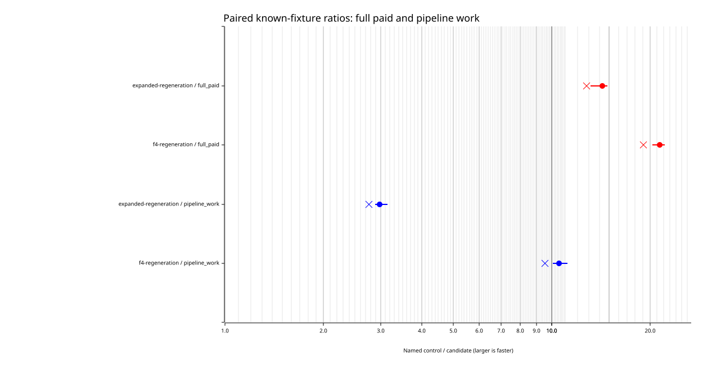

# Paired known-fixture development result

Registered numerical15x flag: **false**; separate10x partial flag: **true**. Both paid adjusted lower bounds must exceed the threshold. This is unsigned localL0 evidence, PCC-20261116-fa96a5, not a fresh-family or signed execution verdict. [pcc:unverified]

All six A/A scope gates pass;21 counterbalanced main blocks finish, with108 complete matching workflow answers including warmup and A/A. Runtime identities are unchanged and the monitor records0 contended samples. PSI was unavailable and some service threads could not be moved. [pcc:unverified]

| Named control | Scope | Median ratio | Ordinary95% interval | Adjusted lower1/720 |
|---|---|---:|---|---:|
| f4-regeneration | pipeline_work | 10.514587 | [10.082793, 11.184766] | 9.532600 |
| expanded-regeneration | pipeline_work | 2.977627 | [2.879258, 3.141795] | 2.756874 |
| f4-regeneration | full_paid | 21.360638 | [20.330704, 22.213597] | 19.107152 |
| expanded-regeneration | full_paid | 14.259076 | [13.150473, 14.791732] | 12.791811 |

Ratios are named control/candidate. Pipeline-work includes launch, computation, checking and consumption; it is not a raw kernel metric. Full-paid adds the original measured preparation to the candidate and fresh three-route regeneration (including that preparation) to each original control. These are different validation algorithms for the same complete reduced basis. The candidate uses the actual root API and M31 arithmetic constructor. [pcc:unverified]

Only previously selected p2147483647,n16,first-star,seed7 is tested. No new seed, dimension or fresh-target generation. The strongest optimized controls and prior candidate retain their separate sixteen-workflow screen results; this three-arm study establishes no15x against the fastest control. Smaller-case regressions are retained in that screen. No intrinsic degree-of-regularity reduction follows from certificate/output degrees. [pcc:unverified]

## A/A admission

| Arm | Scope | Median A/B | Ordinary95% interval |
|---|---|---:|---|
| f4-regeneration | pipeline_work | 1.044928 | [0.955173, 1.150171] |
| f4-regeneration | full_paid | 1.018403 | [0.937166, 1.133959] |
| expanded-regeneration | pipeline_work | 0.977187 | [0.886600, 1.071177] |
| expanded-regeneration | full_paid | 0.981887 | [0.899487, 1.040956] |
| root-sparse-both | pipeline_work | 0.983855 | [0.959919, 1.130254] |
| root-sparse-both | full_paid | 0.984631 | [0.961681, 1.124017] |

This Rust audit recomputes A/A and main statistics from integer costs with the frozen100000-draw joint bootstrap, SplitMix64 seed20261115, unbiased index rejection and nearest-rank endpoints. Every paid sum and block order is checked. Decimal JSON statistics compare within four machine epsilons; all gates compare exactly, without rounding. No trimming, replacement or estimator change. All raw panels/wires remain. [pcc:unverified]

{width=95%}

Points: medians; bars: ordinary95% intervals; crosses: adjusted lower bounds. Lines mark10 and15.
