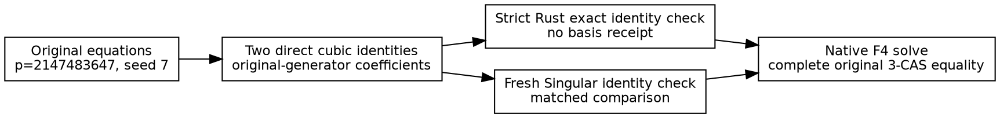

# Exact Rust identity checking: qualification

The independent consumer now offers a bounded identity-only API. Twelve valid and altered mathematical fixtures agree with fresh Singular at n=3,4,6. Four n=3 routes reproduce complete original-input Singular std/slimgb/msolve bases; full frontier wire replay remains. Corrupted paid cost and identity wire are refused before report output. This is unsigned producer evidence, claim PCC-20261117-ac42ce; no timing conclusion yet. [pcc:unverified]

{width=95%}

Scope: prime2147483647, development seed7, LAST-star polynomial systems. Row-only bounds and exact rejection behavior are in PROTOCOL.md and the strict consumer tests. Whole-basis API body is unchanged. Checker10 tests and harness16 library/60 capture tests pass with strict release lint/build. Failed copied unit test58 remains in development logs. [pcc:unverified]

The fixed next study compares prefix-Singular, prefix-Rust, frontier-Singular and frontier-Rust:21 A/A pairs and25 main blocks per case,816 answers total. It retains ordinary95 neutral intervals alongside a prospective simultaneous screen. Existing rejected studies remain unchanged. Admission requires all cases and both full-work/full-paid scopes against both primary controls;15x uses the same bounds. No post-data selection or retries.

Source12dab54dc4 (full hash in METHOD_RECORD.json), configuration60 and38-file runtime dependency manifest are frozen. Full raw qualification, crosschecks, negative controls and driver/monitor archives are bound in qualification-archives.json. Local CPU0 reservation plus taskset0; L0, zero cloud spend, standing checkpoint waiver. Fresh/reserved seeds unused. Sources: existing independent replay arithmetic, ROOT_WORKER_CONTRACT, prior direct-syzygy study, SciPy bootstrap documentation and NIST Bonferroni general union inequality. KB unavailable; no novelty claim.

Requirement status: Rust integration and qualification implemented and checked at producer standing; repeated speed measurement and15x objective remain open. Complete GB certificates and eliminating reference solves are separate unimplemented hypotheses. Canonical performance graphs retain existing values pending new data. [pcc:unverified]
