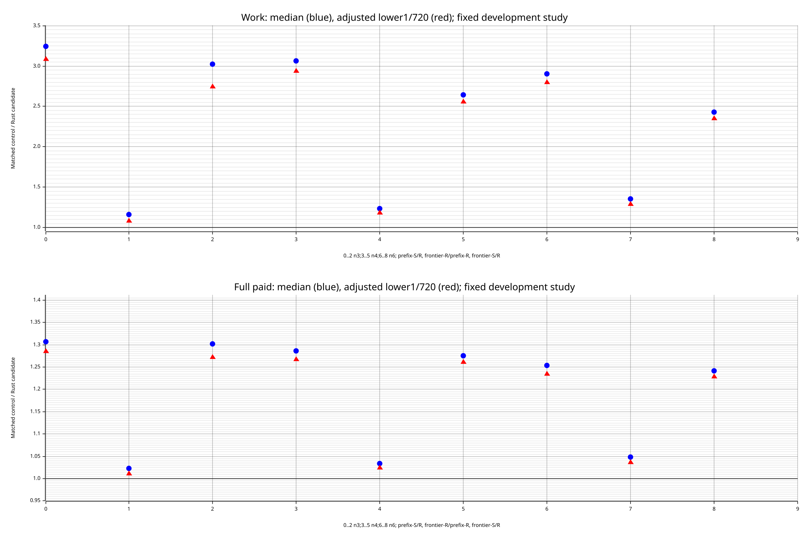

# Rust identity checking: measured development comparison

Replacing fresh Singular identity processes with the bounded independent Rust identity API reduces full checked pipeline time on the fixed p=2147483647, seed 7, LAST-star polynomial fixtures. Median paired Singular-prefix/Rust-prefix ratios are 1.306792, 1.286039 and 1.254269 at n=3,4,6. Work-only ratios are 3.242510, 3.067128 and 2.907275. All 816 answers replay against complete original-input references and strict frontier wires. The registered 15x condition is false. Claim PCC-20261117-afb656 is unsigned producer evidence. [pcc:unverified]

The prospective simultaneous neutral screen passes at all three sizes; ordinary 95% neutral screens pass at n=3 and reject at n=4 and n=6. Thus the stated admission is conditional on the new, prospectively declared screen. It is not evidence of passing the old screen, nor an exact finite-sample bootstrap coverage theorem. Earlier rejected experiments remain unchanged. This run was collected once after methods were published in PR4487 at52f55f958a; no retries, fresh seeds or post-data thresholds. [pcc:unverified]

| n | Prefix Singular/Rust work, median / adjusted lower | Prefix Singular/Rust full paid, median / adjusted lower | Frontier Rust/prefix Rust full paid, median / adjusted lower |
|---|---|---|---|
| 3 | 3.242510 / 3.084746 | 1.306792 / 1.285010 | 1.023303 / 1.010834 |
| 4 | 3.067128 / 2.938723 | 1.286039 / 1.266683 | 1.033552 / 1.024787 |
| 6 | 2.907275 / 2.799336 | 1.254269 / 1.234975 | 1.048089 / 1.035972 |

Ratios are medians of 25 paired main blocks, not ratios of phase medians. Adjusted lower bounds use the frozen joint 100000-resample bootstrap, lower1/720. All six metrics at each size, including the frontier checker replacement and both accounting scopes, appear in [the full audited table](report-01/report.md). The first four bounds exceed1 in every case under the registered simultaneous screen; none reaches15. [pcc:unverified]

{width=95%}

At n=6, descriptive identity-phase medians are 8.949226ms for prefix-Singular and 0.109775ms for prefix-Rust. Their work medians are13.239697/4.460197ms and full-paid medians44.394871/35.260206ms. Full-paid ratios use the actual paired observations above. The identity phase includes file reading, exact independent arithmetic and receipt writing; Singular includes process startup and raw capture. Those process costs are part of the computation compared. Phase medians do not add to the median total. [pcc:unverified]

The Rust prefix construction uses two exact original-generator cubic identities with product degree6. It keeps the previously checked F4 solving-degree4 behavior; the new comparison changes identity checking, not the F4 algorithm, polynomial selection or intrinsic degree of regularity. Both checker formats are prepared on all routes. Frontier-Rust also receives native identity checking, so the main prefix/frontier comparison does not give one algorithm a cheaper checker. No original-reference or complete-basis check is removed.

## Accounting and correctness

Work includes construction, own preparation, identity verification, native solve and complete result consumption. Full paid adds the complete fresh common generation/preparation/original std/slimgb/msolve reference/equality fee to each route. The complete pipeline here means this polynomial-kernel comparison. It does not include point collection, relation discovery on new targets, discrete-log linear algebra or scalar extraction. Reference timing is not an external solver speed ranking.

The separately implemented Rust consumer checks original-generator identities exactly modulo2147483647 with strict schema, coefficient, degree, row, term and byte budgets. Its receipt is identity-only; it cannot replace complete GB checks. The old whole-basis API body and frontier replay stay unchanged. Consumer10 tests; harness16 library/60 capture tests; strict release lint/build;12 valid/tampered fresh Singular crosschecks; four-route n=3 calibration; corrupted cost/wire refusals. Raw replay reconstructs constructors, proof identities, complete bases, whole-frontier wires, costs, orders, statistics and all gates. Extracting all four raw archives produces a byte-equal audit. These are producer-side checks, not an independent signed verdict. [pcc:unverified]

Flow: planned816 answers; attempted816; completed816; failed0; warmup12; A/A504; main300; excluded from main analysis516 by the preregistered warmup/control rules. No failed case is removed. Local AMD EPYC9V74, one thread, reserved CPU0 and taskset0, L0; monitor reports0 contended samples, pins unchanged. Collection command exits0 in17.930s including monitor overhead; raw capture clocks remain in the summary. No cloud spend; user checkpoint waiver remains. [pcc:unverified]

Provenance: [method/source pins](METHOD_RECORD.json), [published run command](RUN_RECORD.json), [runtime manifest](runtime-60.json), [raw archives](raw-archives.json), [archive replay](ARCHIVE_REPLAY.json), [neutral screens](visual-02/neutral.md), [phase medians](visual-02/phases.md), [protocol](PROTOCOL.md), and [qualification](QUALIFICATION.md). Benchrec init honestly retains dirty=true because qualification metadata was pending then; the compiler source is12dab54dc4 and the frozen-driver hash is in METHOD_RECORD, while capture records the launch commitfc9f0a683e. This flag is not rewritten clean. Runtime coverage includes38 program/dependency/monitor files, not every OS/Python standard-library/Singular runtime file.

## Requirements and next hypothesis

Rust identity integration, qualification, bounded repeated study and source-bound raw replay are complete at unsigned producer standing. 15x full-pipeline speedup remains unachieved. The new API supports only the fixed p31 domain; a roughly53-bit field is not supported or measured. No scaling, fresh-target, fastest-external or intrinsic-regularity conclusion follows. [pcc:unverified]

Next hypothesis: fuse construction and native solve/check to remove process and serialization overhead; then implement complete independently replayable GB certificates before considering removal of repeated reference solves. Apply either change equally to comparator algorithms, preserve original containment and Buchberger obligations, and preregister a new study. These changes are not implemented or measured here. [pcc:unverified]

Sources checked: existing separate replay arithmetic and ROOT_WORKER_CONTRACT; prior direct-syzygy480-answer report, including ordinary-control rejections; SciPy bootstrap documentation; NIST general Bonferroni inequality. KB unavailable (wrapper executable absent, no MCP); no novelty claim. Existing IC/rho curves and progress-chart values are unchanged because this is a synthetic polynomial component study. Browsing copies and the component dashboard carry this result separately from admitted ranked rows.
