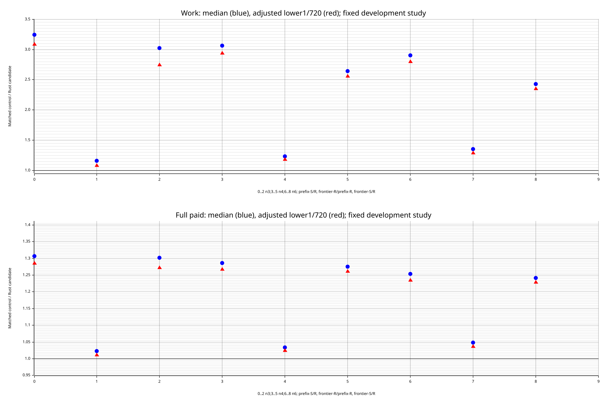

# Rust identity checking: measured development comparison

Replacing fresh Singular identity processes with the bounded independent Rust identity API reduces full checked pipeline time on the fixed p=2147483647, seed 7, LAST-star polynomial fixtures. Median paired Singular-prefix/Rust-prefix ratios are 1.306792, 1.286039 and 1.254269 at n=3,4,6. Work-only ratios are 3.242510, 3.067128 and 2.907275. All 816 answers replay against complete original-input references and strict frontier wires. The registered 15x condition is false. Claim PCC-20261117-afb656 is unsigned producer evidence. [pcc:unverified]

The prospective simultaneous neutral screen passes at all three sizes; ordinary 95% neutral screens pass at n=3 and reject at n=4 and n=6. Thus the stated admission is conditional on the new, prospectively declared screen. It is not evidence of passing the old screen, nor an exact finite-sample bootstrap coverage theorem. Earlier rejected experiments remain unchanged. This run was collected once after methods were published in PR4487 at52f55f958a; no retries, fresh seeds or post-data thresholds. [pcc:unverified]

| n | Prefix Singular/Rust work, median / adjusted lower | Prefix Singular/Rust full paid, median / adjusted lower | Frontier Rust/prefix Rust full paid, median / adjusted lower |
|---|---|---|---|
| 3 | 3.242510 / 3.084746 | 1.306792 / 1.285010 | 1.023303 / 1.010834 |
| 4 | 3.067128 / 2.938723 | 1.286039 / 1.266683 | 1.033552 / 1.024787 |
| 6 | 2.907275 / 2.799336 | 1.254269 / 1.234975 | 1.048089 / 1.035972 |

Ratios are medians of 25 paired main blocks, not ratios of phase medians. Adjusted lower bounds use the frozen joint 100000-resample bootstrap, lower1/720. All six metrics at each size, including the frontier checker replacement and both accounting scopes, appear in [the full audited table](report-01/report.md). The first four bounds exceed1 in every case under the registered simultaneous screen; none reaches15. [pcc:unverified]

{width=95%}

At n=6, descriptive identity-phase medians are 8.949226ms for prefix-Singular and 0.109775ms for prefix-Rust. Their work medians are13.239697/4.460197ms and full-paid medians44.394871/35.260206ms. Full-paid ratios use the actual paired observations above. The identity phase includes file reading, exact independent arithmetic and receipt writing; Singular includes process startup and raw capture. Those process costs are part of the computation compared. Phase medians do not add to the median total. [pcc:unverified]

The Rust prefix construction uses two exact original-generator cubic identities with product degree6. It keeps the previously checked F4 solving-degree4 behavior; the new comparison changes identity checking, not the F4 algorithm, polynomial selection or intrinsic degree of regularity. Both checker formats are prepared on all routes. Frontier-Rust also receives native identity checking, so the main prefix/frontier comparison does not give one algorithm a cheaper checker. No original-reference or complete-basis check is removed.

## Accounting and correctness

Work includes construction, own preparation, identity verification, native solve and complete result consumption. Full paid adds the complete fresh common generation/preparation/original std/slimgb/msolve reference/equality fee to each route. The complete pipeline here means this polynomial-kernel comparison. It does not include point collection, relation discovery on new targets, discrete-log linear algebra or scalar extraction. Reference timing is not an external solver speed ranking.

The separately implemented Rust consumer checks original-generator identities exactly modulo2147483647 with strict schema, coefficient, degree, row, term and byte budgets. Its receipt is identity-only; it cannot replace complete GB checks. The old whole-basis API body and frontier replay stay unchanged. Consumer10 tests; harness16 library/60 capture tests; strict release lint/build;12 valid/tampered fresh Singular crosschecks; four-route n=3 calibration; corrupted cost/wire refusals. Raw replay reconstructs constructors, proof identities, complete bases, whole-frontier wires, costs, orders, statistics and all gates. Extracting all four raw archives produces a byte-equal audit. These are producer-side checks, not an independent signed verdict. [pcc:unverified]

Flow: planned816 answers; attempted816; completed816; failed0; warmup12; A/A504; main300; excluded from main analysis516 by the preregistered warmup/control rules. No failed case is removed. Local AMD EPYC9V74, one thread, reserved CPU0 and taskset0, L0; monitor reports0 contended samples, pins unchanged. Collection command exits0 in17.930s including monitor overhead; raw capture clocks remain in the summary. No cloud spend; user checkpoint waiver remains. [pcc:unverified]

Provenance: [method/source pins](METHOD_RECORD.json), [published run command](RUN_RECORD.json), [runtime manifest](runtime-60.json), [raw archives](raw-archives.json), [archive replay](ARCHIVE_REPLAY.json), [neutral screens](visual-02/neutral.md), [phase medians](visual-02/phases.md), [protocol](PROTOCOL.md), and [qualification](QUALIFICATION.md). Benchrec init honestly retains dirty=true because qualification metadata was pending then; the compiler source is12dab54dc4 and the frozen-driver hash is in METHOD_RECORD, while capture records the launch commitfc9f0a683e. This flag is not rewritten clean. Runtime coverage includes38 program/dependency/monitor files, not every OS/Python standard-library/Singular runtime file.

## Requirements and next hypothesis

Rust identity integration, qualification, bounded repeated study and source-bound raw replay are complete at unsigned producer standing. 15x full-pipeline speedup remains unachieved. The new API supports only the fixed p31 domain; a roughly53-bit field is not supported or measured. No scaling, fresh-target, fastest-external or intrinsic-regularity conclusion follows. [pcc:unverified]

Next hypothesis: fuse construction and native solve/check to remove process and serialization overhead; then implement complete independently replayable GB certificates before considering removal of repeated reference solves. Apply either change equally to comparator algorithms, preserve original containment and Buchberger obligations, and preregister a new study. These changes are not implemented or measured here. [pcc:unverified]

Sources checked: existing separate replay arithmetic and ROOT_WORKER_CONTRACT; prior direct-syzygy480-answer report, including ordinary-control rejections; SciPy bootstrap documentation; NIST general Bonferroni inequality. KB unavailable (wrapper executable absent, no MCP); no novelty claim. Existing IC/rho curves and progress-chart values are unchanged because this is a synthetic polynomial component study. Browsing copies and the component dashboard carry this result separately from admitted ranked rows.

\newpage

# All registered comparisons

Median paired ratios and adjusted lower1/720 bounds,25 main blocks each. Full precision remains in report-01/audit.json. [pcc:unverified]

|n|Comparison|Work median|Work lower|Paid median|Paid lower|
|---|---|---:|---:|---:|---:|
|3|prefix-S / prefix-R|3.242510|3.084746|1.306792|1.285010|
|3|frontier-R / prefix-R|1.158349|1.080994|1.023303|1.010834|
|3|frontier-S / frontier-R|3.022390|2.743968|1.301915|1.271720|
|4|prefix-S / prefix-R|3.067128|2.938723|1.286039|1.266683|
|4|frontier-R / prefix-R|1.236276|1.183741|1.033552|1.024787|
|4|frontier-S / frontier-R|2.643183|2.556982|1.275320|1.260958|
|6|prefix-S / prefix-R|2.907275|2.799336|1.254269|1.234975|
|6|frontier-R / prefix-R|1.355531|1.284129|1.048089|1.035972|
|6|frontier-S / frontier-R|2.430102|2.348420|1.241667|1.228848|

\newpage

# Per-phase medians

Each entry is the median of25 main calls in milliseconds. Phase medians do not add to the median work cost. The frontier's constructor and full replay are inside its native phase; extra preprocessing is not its total construction cost. Ratios use paired block observations in the main report, not ratios of these medians. [pcc:unverified]

|n|Arm|Extra preprocessing|Own preparation|Exact identity check|Native solve/check|Work|Full paid|
|---|---|---:|---:|---:|---:|---:|---:|
|3|prefix-singular|0.085107|0.211677|9.808425|3.638091|13.686317|39.722843|
|3|prefix-rust|0.085168|0.209655|0.080170|3.674957|4.158382|30.358585|
|3|frontier-singular|0.000260|0.074712|9.395365|4.785103|14.536393|41.084257|
|3|frontier-rust|0.000431|0.067241|0.044567|4.694368|4.836741|31.267139|
|4|prefix-singular|0.083956|0.181963|8.697297|3.679354|12.769100|38.106971|
|4|prefix-rust|0.082884|0.194502|0.083646|3.774477|4.185473|29.391837|
|4|frontier-singular|0.000231|0.070185|8.735325|5.064904|13.878146|39.310348|
|4|frontier-rust|0.000270|0.055383|0.047652|5.125405|5.245044|30.779692|
|6|prefix-singular|0.087271|0.194302|8.949226|3.999344|13.239697|44.394871|
|6|prefix-rust|0.088332|0.201713|0.109775|3.956419|4.460197|35.260206|
|6|frontier-singular|0.000251|0.061943|8.760773|5.861830|14.632808|45.907673|
|6|frontier-rust|0.000300|0.061332|0.062975|5.766998|5.915191|36.497104|

\newpage

# Neutral controls

Fixed21 A/A pairs. Both ordinary95 intervals and the prospective simultaneous screens are shown. No exact finite-sample bootstrap coverage assertion. [pcc:unverified]

## n=3

Ordinary95 all-pass=true, simultaneous all-pass=true.

|Arm/scope|Ordinary low|Ordinary high|Simult. low|Simult. high|
|---|---:|---:|---:|---:|
|prefix-S work|0.967466|1.093324|0.944401|1.121793|
|prefix-S paid|0.970590|1.034355|0.961630|1.154892|
|prefix-R work|0.947020|1.107061|0.877294|1.133163|
|prefix-R paid|0.954303|1.030701|0.941972|1.091011|
|frontier-S work|0.944613|1.059405|0.894595|1.143527|
|frontier-S paid|0.959497|1.039282|0.953293|1.054895|
|frontier-R work|0.975076|1.057522|0.951422|1.072442|
|frontier-R paid|0.971860|1.023285|0.964096|1.059968|

## n=4

Ordinary95 all-pass=false, simultaneous all-pass=true.

|Arm/scope|Ordinary low|Ordinary high|Simult. low|Simult. high|
|---|---:|---:|---:|---:|
|prefix-S work|0.989875|1.033594|0.960637|1.086186|
|prefix-S paid|1.015360|1.058779|0.996748|1.090382|
|prefix-R work|0.981225|1.020903|0.980202|1.044506|
|prefix-R paid|1.007669|1.079534|0.999716|1.105889|
|frontier-S work|0.963175|1.012893|0.939100|1.027089|
|frontier-S paid|0.991746|1.048920|0.985783|1.055451|
|frontier-R work|0.957517|1.008507|0.893536|1.028171|
|frontier-R paid|0.993278|1.063876|0.982800|1.074122|

## n=6

Ordinary95 all-pass=false, simultaneous all-pass=true.

|Arm/scope|Ordinary low|Ordinary high|Simult. low|Simult. high|
|---|---:|---:|---:|---:|
|prefix-S work|0.923692|1.003865|0.915040|1.026278|
|prefix-S paid|0.888577|1.004706|0.869593|1.019002|
|prefix-R work|0.945982|0.995209|0.915526|1.017240|
|prefix-R paid|0.908967|1.008041|0.869025|1.017905|
|frontier-S work|0.962527|1.057929|0.897797|1.089405|
|frontier-S paid|0.952054|1.013402|0.890095|1.017213|
|frontier-R work|0.972844|1.027112|0.964887|1.042302|
|frontier-R paid|0.920657|1.012344|0.881846|1.037023|
