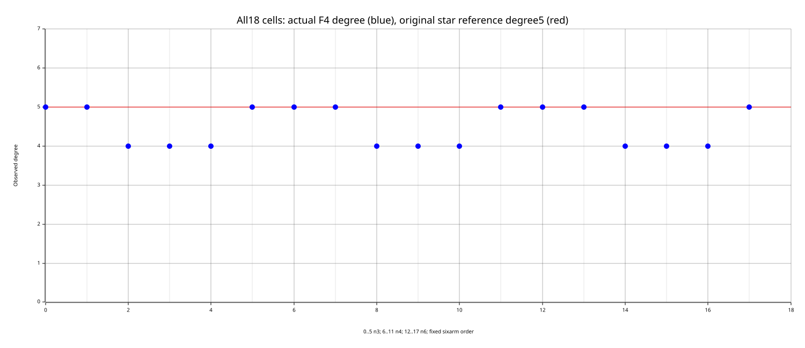
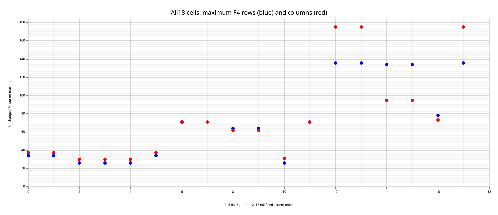

# Exact exported certificate costs

Values below describe exported rows; unused candidate discovery and rank selection are still fully paid. Product degree belongs to original-input membership identities, not F4 solving degree. All18 cells remain; single-call timing gains are unconfirmed. [pcc:unverified]

|n|Class|Selected ids|Total polynomial terms|Total proof terms|Max certificate product degree|
|---|---|---|---:|---:|---:|
|3|"star"|[]|0|0|null|
|3|"differences"|[0,2]|16|4|4|
|3|"syzygies"|[1,3]|20|16|6|
|3|"both"|[0,1,2,3]|36|20|6|
|3|"rank-budget"|[1,3]|20|16|6|
|3|"count-control"|[0,2]|16|4|4|
|4|"star"|[]|0|0|null|
|4|"differences"|[0,2,4]|24|6|4|
|4|"syzygies"|[1,3,5]|30|24|6|
|4|"both"|[0,1,2,3,4,5]|54|30|6|
|4|"rank-budget"|[1,3]|20|16|6|
|4|"count-control"|[0,2]|16|4|4|
|6|"star"|[]|0|0|null|
|6|"differences"|[0,2,4,6,8]|40|10|4|
|6|"syzygies"|[1,3,5,7,9]|50|40|6|
|6|"both"|[0,1,2,3,4,5,6,7,8,9]|90|50|6|
|6|"rank-budget"|[1,3]|20|16|6|
|6|"count-control"|[0,2]|16|4|4|

{width=90%}

{width=90%}
