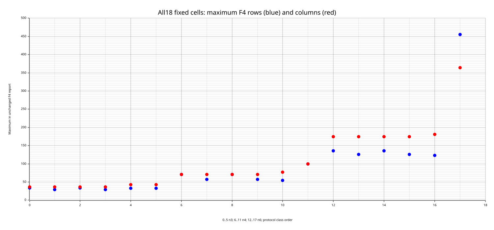

# Matrix, certificate and paid-cost detail

Read-only Rust formatting of the audited18 fixed development observations. All times are single calls in milliseconds; no timing confidence or speed claim. F4 matrix nonzeros/fill are absent from this worker. The terminal affine diagnostic nonzeros and row reductions below belong to the separate closure algorithm. [pcc:unverified]

| n | Class | Terminal degree | Diagnostic new row nnz | Diagnostic reductions | Projection terms | Projection product degree |
|---|---|---:|---:|---:|---:|---:|
|3|star|5|2975|4647|null|null|
|3|root-projection|5|2646|3912|80|14|
|3|nonroot-projections|5|2975|4647|null|null|
|3|all-projections|5|2646|3912|80|14|
|3|leaf-closure|5|2737|4455|null|null|
|3|clique|5|2737|4455|null|null|
|4|star|5|10998|27141|null|null|
|4|root-projection|5|9600|21900|80|14|
|4|nonroot-projections|5|10998|27141|null|null|
|4|all-projections|5|9600|21900|80|14|
|4|leaf-closure|5|10407|25502|null|null|
|4|clique|5|10441|27531|null|null|
|6|star|5|71359|270221|null|null|
|6|root-projection|5|61241|214965|80|14|
|6|nonroot-projections|5|71359|270221|null|null|
|6|all-projections|5|61241|214965|80|14|
|6|leaf-closure|5|67326|243645|null|null|
|6|clique|5|72754|334471|null|null|

| n | Class | Generation | Full construction | Preparation | Identity check | All3 refs | Checked F4 | Fastest external | External ms | Separate diagnostic |
|---|---|---:|---:|---:|---:|---:|---:|---|---:|---:|
|3|star|0.021202|0.016515|0.175683|115.598078|71.122827|9.587289|"msolve"|14.894869|41.385840|
|3|root-projection|0.035013|0.916065|0.353080|14.555313|38.596311|6.006418|"msolve"|11.077903|23.711662|
|3|nonroot-projections|0.030866|1.038529|0.413411|13.511006|35.712104|5.960689|"msolve"|7.725589|40.601475|
|3|all-projections|0.032008|0.912730|0.978949|15.801756|36.403629|5.592662|"msolve"|9.278442|21.350191|
|3|leaf-closure|0.119890|0.136735|0.707553|13.718707|37.122898|6.140680|"msolve"|8.154463|28.416556|
|3|clique|0.039610|0.017266|0.315123|15.907123|45.772350|7.600041|"msolve"|14.953437|34.371528|
|4|star|0.038508|0.020421|0.187271|18.781779|35.467077|5.252196|"msolve"|7.595034|291.808108|
|4|root-projection|0.042394|1.164829|0.830387|25.392501|49.565790|5.042932|"msolve"|9.953804|144.221229|
|4|nonroot-projections|0.041432|1.600223|0.209454|22.403262|42.259695|6.712630|"msolve"|8.383196|274.920181|
|4|all-projections|0.041823|1.079491|0.285749|16.325632|47.163738|6.532579|"msolve"|12.889658|136.702395|
|4|leaf-closure|0.046009|0.023716|0.210626|15.749677|40.675357|6.000068|"msolve"|9.207064|278.368064|
|4|clique|0.058798|0.348504|0.187020|53.509056|61.844490|10.626356|"msolve"|13.791757|191.400917|
|6|star|0.054241|0.176996|0.303416|14.326610|41.608888|7.848384|"msolve"|9.403199|4762.740608|
|6|root-projection|0.060201|2.497069|0.758188|33.942058|44.115326|7.234503|"msolve"|10.543676|2061.423511|
|6|nonroot-projections|0.145829|1.830839|0.561212|30.041666|55.484862|9.391280|"msolve"|12.815703|4555.716391|
|6|all-projections|0.061803|1.847814|0.514092|27.668732|40.535512|6.385407|"msolve"|8.777469|1914.422171|
|6|leaf-closure|0.095773|0.019940|0.238248|15.110201|42.153760|11.917508|"msolve"|8.829240|5360.243476|
|6|clique|0.124967|0.168943|1.015805|29.993431|72.460792|13.167083|"msolve"|15.467332|4255.594863|

Reference clocks include process launch, basis parsing and route checking. The checked F4 clock includes process launch, the unchanged native solver/checks and full equality consumption. These whole-route clocks are descriptive and are not a controlled timing comparison against the fastest external route. Full paid costs also include all three reference routes. Oracle construction is the separately recorded reference fee already included in paid F4 cost. Diagnostic child time is recorded outside that paid cost and is never counted as an F4 speed ratio. Projection product degree measures original-input identity products, not solving degree. [pcc:unverified]

{width=90%}
