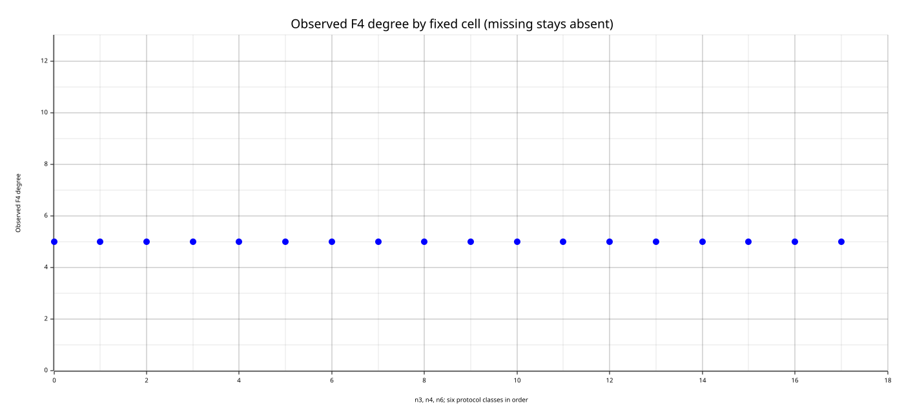

# Fixed development relation ablations

Method PCC-20261116-49c28b; measurements PCC-20261116-13cd4f. [pcc:unverified]

Single bounded calls on public known-answer seed7 fixtures. No statistical speedup admission. Exact F4 observed degree, affine closure threshold, and top-form Hilbert first vanishing are different quantities. Missing/capped values remain null. Unsigned localL0. [pcc:unverified]

| n | Class | Added | Same ideal | F4 degree | Max rows | Max columns | Affine closure | Top-form vanishing | Paid ms |
|---|---|---:|---|---:|---:|---:|---:|---:|---:|
|3|star|0|true|5|34|37|5|null|196.521594|
|3|root-projection|1|true|5|29|37|5|null|60.462200|
|3|nonroot-projections|0|true|5|34|37|5|null|56.666605|
|3|all-projections|1|true|5|29|37|5|null|59.721734|
|3|leaf-closure|0|true|5|33|43|5|null|57.946463|
|3|clique|0|true|5|33|43|5|null|69.651513|
|4|star|0|true|5|71|71|5|null|59.747252|
|4|root-projection|1|true|5|57|71|5|null|82.038833|
|4|nonroot-projections|0|true|5|71|71|5|null|73.226696|
|4|all-projections|1|true|5|57|71|5|null|71.429012|
|4|leaf-closure|0|true|5|55|77|5|null|62.705453|
|4|clique|0|true|5|100|100|5|null|126.574224|
|6|star|0|true|5|136|175|5|null|64.318535|
|6|root-projection|1|true|5|126|175|5|null|88.607345|
|6|nonroot-projections|0|true|5|136|175|5|null|97.455688|
|6|all-projections|1|true|5|126|175|5|null|77.013360|
|6|leaf-closure|0|true|5|123|181|5|null|69.535430|
|6|clique|0|true|5|455|364|5|null|116.931021|

Flow: planned 18, attempted 18, cells with recorded failures 0. All rows retained; no statistical pooling. [pcc:unverified]

Paid costs include generation, preparation, full projection construction even for subset arms, exact identity checking, fresh3CAS references and the complete checked F4 call. Reference/oracle construction and separate diagnostic costs are retained in audit.json; diagnostic time is not production solver speed. F4 matrix nonzeros/fill are unavailable when the unchanged worker does not emit them; affine diagnostic nonzeros are not substitutes. Geometric additions may change the ideal; equal checked complete canonical bases determine the label. Capped closure/Hilbert is not an intrinsic regularity or impossibility result. Star leaf projections may be absent; duplicate/effectively identical arms remain. [pcc:unverified]

{width=90%}
