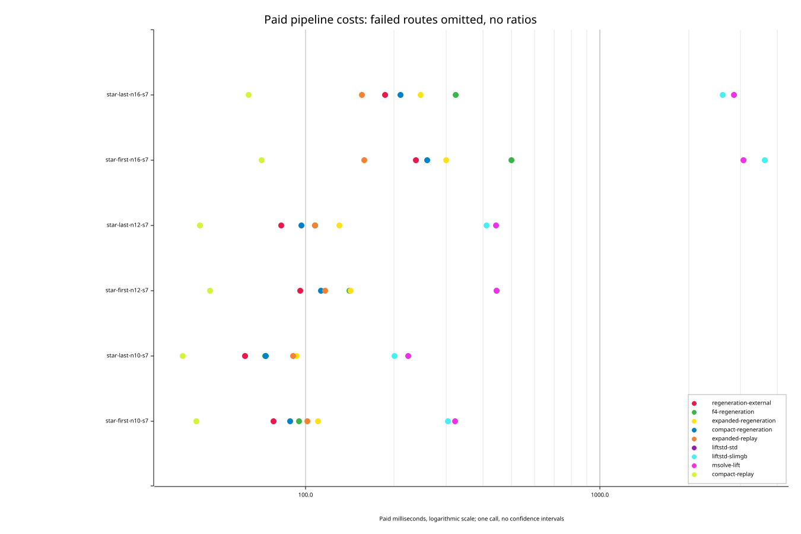

# Full pipeline replay screen

6 declared cases; follow-up selection null. This is unsigned L0 single-call evidence, PCC-20261116-b4b6bd. No complete-roster ratios or confirmed15x gain. All completed answers match; failed controls are retained. [pcc:unverified]

Costs below are paid milliseconds for one planned pipeline call, including its actual construction and validation algorithm. Regeneration charges all three CAS routes; replay charges complete witness construction/import/export, launch, arithmetic checks and consumption. No old clock is changed. Failures have no numeric win. [pcc:unverified]

| Case | R3 | F4+R3 | E+R3 | C+R3 | E replay | Std lift | Slim lift | Msolve+lift | C replay |
|---|---:|---:|---:|---:|---:|---:|---:|---:|---:|
| star-first-n10-s7 | 77.71 | 94.82 | 110.46 | 88.49 | 101.41 | failed | 305.13 | 322.37 | 42.55 |
| star-last-n10-s7 | 62.19 | 72.97 | 93.40 | 73.38 | 90.85 | failed | 201.00 | 222.85 | 38.21 |
| star-first-n12-s7 | 95.83 | 141.09 | 142.31 | 112.62 | 116.58 | failed | 445.50 | 446.31 | 47.48 |
| star-last-n12-s7 | 82.82 | 107.90 | 130.31 | 96.90 | 107.58 | failed | 411.41 | 442.90 | 43.81 |
| star-first-n16-s7 | 237.17 | 500.98 | 300.69 | 258.76 | 158.09 | failed | 3629.94 | 3073.22 | 71.03 |
| star-last-n16-s7 | 186.38 | 323.36 | 246.29 | 210.34 | 155.47 | failed | 2605.16 | 2842.72 | 64.01 |

48 complete outputs and6 failed pipeline attempts retained. R3=three-route regeneration, E=expanded constructor, C=compact constructor. These are single calls, not means or intervals. [pcc:unverified]

| Case | Std cofactor TERM records | Import diagnostic |
|---|---:|---|
| star-first-n10-s7 | 73102 |  |
| star-last-n10-s7 | 150406 | Error: "replay: total cofactor budget" |
| star-first-n12-s7 | 102634 | Error: "replay: total cofactor budget" |
| star-last-n12-s7 | 128760 | Error: "replay: total cofactor budget" |
| star-first-n16-s7 | 73916 |  |
| star-last-n16-s7 | 137010 | Error: "replay: total cofactor budget" |

The required Std control exceeded the wire's100000 total cofactor-term cap. No cap was raised, no call replaced, and no incomplete control was made a numeric ratio. All per-child failure costs and raw matrices remain in the archive. The registered complete-roster gate therefore selects none. [pcc:unverified]

{width=80%}

Failed routes have no point. This plot compares absolute paid costs only. It establishes neither a solving-degree/regularity reduction nor the requested15x gain. Future algorithm or fallback changes require new prospective scope; this record remains frozen. [pcc:unverified]
