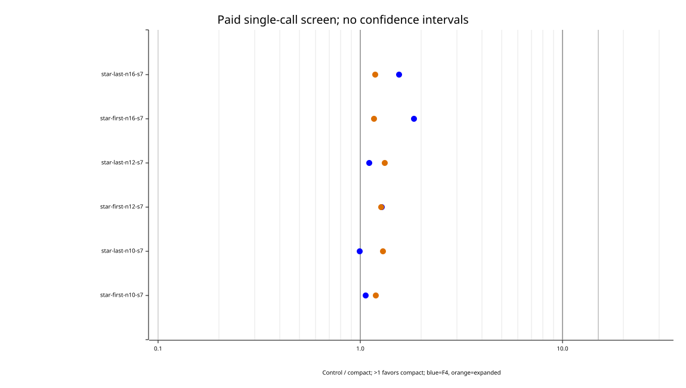

# Recorded "scale-screen"

6 declared cases. Selected follow-up: null. Unsigned producer L0 single-call evidence; no interval, independent execution coverage or confirmed 10x/15x gain. All preparation, mature references and per-call checking are paid. Missing/failed arms have no numeric win. [pcc:unverified]

| Case | Outcome | F4 degree | F4 max columns | Compact proof terms | Paid F4/compact | Paid expanded/compact |
|---|---|---:|---:|---:|---:|---:|
| star-first-n10-s7 | "screen_complete" | 5 | 1231 | 347 | 1.062x | 1.194x |
| star-last-n10-s7 | "screen_complete" | 5 | 527 | 318 | 0.994x | 1.295x |
| star-first-n12-s7 | "screen_complete" | 5 | 2105 | 395 | 1.277x | 1.267x |
| star-last-n12-s7 | "screen_complete" | 5 | 775 | 364 | 1.106x | 1.317x |
| star-first-n16-s7 | "screen_complete" | 5 | 4929 | 491 | 1.835x | 1.167x |
| star-last-n16-s7 | "screen_complete" | 5 | 1415 | 456 | 1.552x | 1.185x |

F4 degree is the completed worker's observed productive degree, not intrinsic regularity. The native packed grevlex path is used only through15 variables;16 uses its existing vector fallback. No solver path was disabled or retuned. [pcc:unverified]

{width=80%}

Blue=F4/compact; orange=expanded/compact. No point is drawn for an incomplete comparison. Each point is one planned call, with no confidence interval. The original null-selection screen and its frozen protocols remain intact. [pcc:unverified]
