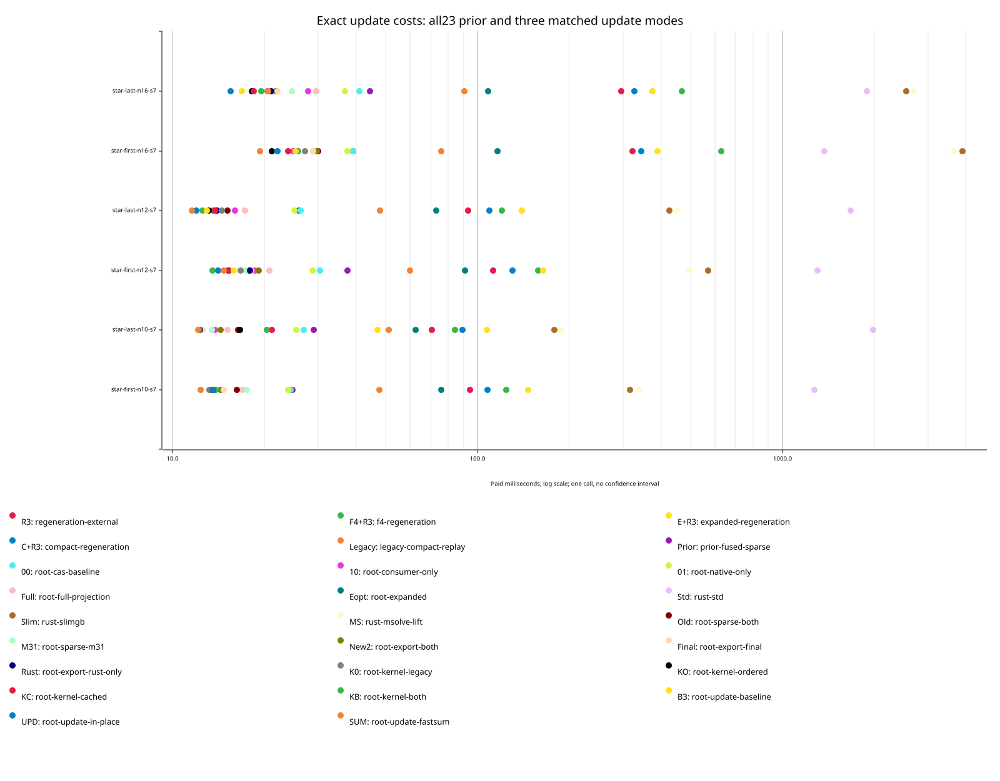

# Exact polynomial update complete paid screen

6 fixed development cases; prospective follow-up "star-last-n16-s7". Unsigned L0 single calls, PCC-20261116-b94249. No paired confidence interval or confirmed15x. K0/KO/KC/KB retain the old matched kernel controls; B3/UPD/SUM are matched both/in-place/in-place-plus-guarded-sum, all with complete native/root checks and zero exports. All23 prior controls remain. Each case uses its fastest optimized mode for displayed ratios; self cells are not control ratios and ties cannot admit. The original measured preparation is charged on these known fixtures; no fresh generation occurred. The two primary denominators are named old fully validated pipelines, not raw kernels or the fastest available control. [pcc:unverified]

All construction, preparation, transfer, exact checking and output consumption are paid. An inner failure and its fresh3CAS recovery remain charged; no sample is replaced. Every denominator remains in raw comparisons. [pcc:unverified]

| Case | R3 | F4+R3 | E+R3 | C+R3 | Legacy | Prior | 00 | 10 | 01 | Full | Eopt | Std | Slim | MS | Old | M31 | New2 | Final | Rust | K0 | KO | KC | KB | B3 | UPD | SUM |
|---|---:|---:|---:|---:|---:|---:|---:|---:|---:|---:|---:|---:|---:|---:|---:|---:|---:|---:|---:|---:|---:|---:|---:|---:|---:|---:|
| star-first-n10-s7 | 94.53 | 124.14 | 146.57 | 107.71 | 47.60 | 24.73 | 24.42 | 13.75 | 23.93 | 16.91 | 75.96 | 1271.34 | 316.54 | 337.23 | 16.24 | 17.54 | 14.37 | 14.70 | 13.47 | 13.22 | 13.62 | 13.53 | 13.84 | 12.34 | 13.60 | 12.34 |
| star-last-n10-s7 | 70.75 | 84.42 | 107.25 | 89.33 | 51.12 | 29.05 | 26.87 | 13.79 | 25.37 | 15.12 | 62.50 | 1983.86 R | 178.29 | 186.95 | 16.38 | 13.44 | 14.34 | 12.55 | 12.31 | 12.23 | 16.61 | 21.16 | 20.40 | 46.89 | 12.20 | 12.12 |
| star-first-n12-s7 | 112.49 | 158.33 | 163.75 | 130.10 | 60.07 | 37.37 | 30.40 | 18.58 | 28.68 | 20.77 | 90.94 | 1302.86 R | 570.77 | 496.02 | 17.83 | 17.35 | 19.12 | 18.12 | 17.97 | 16.72 | 15.25 | 15.18 | 13.52 | 15.89 | 14.12 | 14.73 |
| star-last-n12-s7 | 93.03 | 120.42 | 140.02 | 109.26 | 47.95 | 25.95 | 26.27 | 16.02 | 25.04 | 17.25 | 73.16 | 1676.80 R | 425.22 | 450.35 | 15.13 | 14.10 | 13.58 | 13.96 | 13.99 | 14.51 | 13.12 | 13.77 | 12.51 | 12.97 | 11.96 | 11.54 |
| star-first-n16-s7 | 321.98 | 630.22 | 389.69 | 344.88 | 75.85 | 39.12 | 38.99 | 24.78 | 37.48 | 28.84 | 116.39 | 1370.22 | 3896.45 | 3648.94 | 30.04 | 25.51 | 29.69 | 28.93 | 25.49 | 27.18 | 21.12 | 23.91 | 25.81 | 25.34 | 22.02 | 19.33 |
| star-last-n16-s7 | 295.80 | 467.89 | 375.40 | 326.80 | 90.56 | 44.39 | 40.86 | 27.87 | 36.78 | 29.57 | 108.53 | 1896.67 R | 2552.07 | 2694.69 | 21.83 | 24.64 | 21.90 | 22.07 | 21.07 | 20.41 | 18.18 | 18.40 | 19.48 | 16.87 | 15.51 | 20.54 |

156 complete matching outer answers,0 failed outer workflows,4 paid recoveries. R denotes recovery. Rust checks every charged recovery sum exactly. Counts are outcomes, not independent timing samples. [pcc:unverified]

Workflow key:

- R3: regeneration-external
- F4+R3: f4-regeneration
- E+R3: expanded-regeneration
- C+R3: compact-regeneration
- Legacy: legacy-compact-replay
- Prior: prior-fused-sparse
- 00: root-cas-baseline
- 10: root-consumer-only
- 01: root-native-only
- Full: root-full-projection
- Eopt: root-expanded
- Std: rust-std
- Slim: rust-slimgb
- MS: rust-msolve-lift
- Old: root-sparse-both
- M31: root-sparse-m31
- New2: root-export-both
- Final: root-export-final
- Rust: root-export-rust-only
- K0: root-kernel-legacy
- KO: root-kernel-ordered
- KC: root-kernel-cached
- KB: root-kernel-both
- B3: root-update-baseline
- UPD: root-update-in-place
- SUM: root-update-fastsum

## All paid single-call ratios (control / casewise candidate)

| Case | R3 | F4+R3 | E+R3 | C+R3 | Legacy | Prior | 00 | 10 | 01 | Full | Eopt | Std | Slim | MS | Old | M31 | New2 | Final | Rust | K0 | KO | KC | KB | B3 | UPD | SUM |
|---|---:|---:|---:|---:|---:|---:|---:|---:|---:|---:|---:|---:|---:|---:|---:|---:|---:|---:|---:|---:|---:|---:|---:|---:|---:|---:|
| star-first-n10-s7 | 7.659 | 10.058 | 11.875 | 8.727 | 3.856 | 2.004 | 1.979 | 1.114 | 1.939 | 1.370 | 6.154 | 103.004 | 25.646 | 27.322 | 1.316 | 1.421 | 1.164 | 1.191 | 1.091 | 1.071 | 1.103 | 1.096 | 1.121 | 1.000 | 1.102 | self |
| star-last-n10-s7 | 5.837 | 6.964 | 8.848 | 7.370 | 4.217 | 2.396 | 2.217 | 1.137 | 2.093 | 1.247 | 5.156 | 163.664 | 14.708 | 15.423 | 1.351 | 1.108 | 1.183 | 1.035 | 1.015 | 1.009 | 1.371 | 1.746 | 1.683 | 3.868 | 1.007 | self |
| star-first-n12-s7 | 7.968 | 11.216 | 11.599 | 9.216 | 4.255 | 2.647 | 2.153 | 1.316 | 2.032 | 1.472 | 6.442 | 92.291 | 40.431 | 35.136 | 1.263 | 1.229 | 1.355 | 1.283 | 1.273 | 1.184 | 1.081 | 1.076 | 0.958 | 1.126 | self | 1.043 |
| star-last-n12-s7 | 8.059 | 10.432 | 12.129 | 9.464 | 4.153 | 2.248 | 2.276 | 1.388 | 2.169 | 1.494 | 6.338 | 145.251 | 36.834 | 39.011 | 1.311 | 1.221 | 1.176 | 1.209 | 1.212 | 1.257 | 1.137 | 1.193 | 1.083 | 1.123 | 1.036 | self |
| star-first-n16-s7 | 16.660 | 32.609 | 20.163 | 17.845 | 3.925 | 2.024 | 2.018 | 1.282 | 1.939 | 1.492 | 6.022 | 70.899 | 201.612 | 188.805 | 1.554 | 1.320 | 1.536 | 1.497 | 1.319 | 1.406 | 1.093 | 1.237 | 1.336 | 1.311 | 1.139 | self |
| star-last-n16-s7 | 19.067 | 30.160 | 24.198 | 21.065 | 5.838 | 2.862 | 2.634 | 1.796 | 2.371 | 1.906 | 6.996 | 122.257 | 164.504 | 173.697 | 1.407 | 1.589 | 1.412 | 1.422 | 1.358 | 1.316 | 1.172 | 1.186 | 1.256 | 1.087 | self | 1.324 |

The prospective gate selects "star-last-n16-s7" (the exact mode is in selected_kernel in traces.json). Selection requires candidate proof fast path, unique lowest cost across every other25 controls, exact old/new mode flags and both named primary paid ratios>=15. This is admission for a separately frozen paired test, not confirmation. Gains against prior replay and optimized expanded remain distinct and can be much smaller than primary ratios. [pcc:unverified]

## Degree and certificate trace

| Case | Observed F4 degree | Output degree | Root dimension | Resultants | Local product bound | Original product bound | Coprime / all pairs |
|---|---:|---:|---:|---:|---:|---:|---:|
| star-first-n10-s7 | 5 | 2 | 4 | 2 | 14 | 21 | 69 / 78 |
| star-last-n10-s7 | 5 | 2 | 4 | 2 | 14 | 21 | 69 / 78 |
| star-first-n12-s7 | 5 | 2 | 4 | 2 | 14 | 21 | 96 / 105 |
| star-last-n12-s7 | 5 | 2 | 4 | 2 | 14 | 21 | 96 / 105 |
| star-first-n16-s7 | 5 | 2 | 4 | 2 | 14 | 21 | 162 / 171 |
| star-last-n16-s7 | 5 | 2 | 4 | 2 | 14 | 21 | 162 / 171 |

Observed F4 degree, native certificate degree and quotient dimension are different diagnostics. No intrinsic regularity reduction follows. Complete F4 observations, exact consumer counters and failure diagnostics remain in traces.json and the raw archives. [pcc:unverified]

{width=85%}
