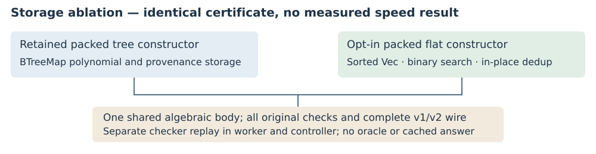

# Sorted-vector packed constructor: correctness qualification

The new opt-in flat constructor produces exactly the same complete proofs as the retained packed tree and legacy vector constructors on all 36 fixed cases. The real worker path also passes all 72 wrapped/native calls. **This is correctness qualification; no comparative speed result or 15× admission.** [pcc:unverified]

## Implementation and rationale

The existing packed constructor body moves into one shared include, instantiated by the retained BTreeMap backend and a private sorted-vector backend. All six algebraic kernels remain unchanged. Every original packed assertion is preserved byte for byte, apart from the moved container import. The opt-in worker modes are `flat-constructor-sparse` and `flat-constructor-dag`; default and older modes remain.

The flat map stores ordered unique entries in a Vec. Lookup uses binary search; insertion/removal shifts entries and can cost more as maps grow. Stable sorting and in-place duplicate coalescing preserve the last value and existing-key semantics. Differential tests exercise mixed operations, entry defaults, removal, key identity and triple duplicates. No unsafe code, cached answer, known scalar or checker arithmetic constructs a result. Packing caps, typed refusals, charged existing fallbacks and complete certificate obligations remain.

This tests the flat-vector alternative proposed in hypothesis 182, motivated by the earlier allocator/axpy instruction attribution 179. Those profiles do not predict a wall-time ratio. Complete proof bytes, metadata and checker statistics remain identical; the change establishes no reduction in certificate size, intrinsic regularity or F4 solving degree. No F4 solve runs; observed solving degree remains null.

## Recorded qualification

|Check|Recorded outcome|
|---|---|
|Final default producer suite 271|74 passed|
|Field-counter producer suite 272|75 passed|
|Separate unchanged checker suite 273|14 passed|
|Direct fixed matrix 277|36 cases; 108 full replays; exact legacy/tree/flat wire, metadata, basis and statistics equality|
|Polynomial mutations 277|126 rejected|
|Real worker matrix 281|72 complete calls; 36 launcher identities; four expected negative controls|
|Saved artifact audit 297|180 full replays; 126 stored mutations; two receipt saboteurs and all four transport controls checked|
|Copied-data canaries 298/299b|Missing mutation obligations and altered control-summary expectations both rejected with exit 1|

All outcomes are unsigned producer data. Saved audits do not independently re-execute OS limits, native operation counters or parent clocks, and imply no signed execution verdict. Raw worker diagnostic clocks are retained but never used for selection or comparative statistics. [pcc:unverified]

Both declared primes, 2147483647 and 9007199254740881, n3/4/6, seed7 LAST-star, and all three kernels are retained. No fresh or reserved instance seeds are selected. The full original-ideal membership, input containment, reduced monicity and strict-standard/checked-product S-pair checks remain.

## Actual-root dependency recovery is unfinished

New FlatSparse/FlatDag adapter forms delegate through the complete existing wire replay and native F4 representation checks; older forms and tests remain. Their new 36-case native test preserves every original packed-matrix assertion. Attempts 279, 284 and 286 stop before test execution on upstream syntax corruption. Zero new native matrix cases have run. [pcc:unverified]

Reviewed BHEC recovery 283 uses the complete projected-cover feature source at 4c1acb and retains projected labels, all stage callbacks, the live genus conversion and classification form. EFD recovery 285 uses the complete previously qualified source. Batch 289 restores six complete valid-parent support/front-door files. All retain current function/test names; those inventories are structural checks and do not prove semantic equivalence. The actual compiler/runtime gates remain open. [pcc:unverified]

Read-only syntax audit 287 identifies further damaged files. Candidate histories contain different algorithms and newer tests; whole-file rollback would omit some of them. Temporary three-way merge proposals and all before/reference snapshots are retained for explicit union/review. No module or test was disabled to obtain a passing result.

## Remaining experiment and provenance limits

No flat-constructor comparative timing experiment has run. Any future experiment must retain the strongest qualified old packed worker, all faster eligible controls and equivalent launcher/transport improvements, publish complete source/tool/input pins before data, keep all repeats/A/A/outcomes, and apply the original six-case 15× criterion. Earlier repeated result 200/211 and its neutral spread remain unchanged; this component qualification does not improve that result. [pcc:unverified]

Canonical protocol/export access is still pending. The [experiment-protocol SKILL.md](https://github.com/isogeny-labs/workspace/blob/main/.agents/skills/experiment-protocol/SKILL.md) requires “Read the canonical SKILL.md and follow it.” Its canonical files are encrypted and the supported unlock has no configured KEY binding. No proof or measurement gate is waived.

Pin 274 skipped Cargo paths during the temporary partial sparse checkout. Preserve it unchanged; supplement 278 binds the exact restored parent manifests/locks and confirms every previously pinned source remains unchanged. This is a correctness provenance supplement, not a prospectively validated timing declaration. Initial source contexts 269/270, unused audit build 295, all failures, canaries and raw outputs remain. The first 299 shell appended diagnostic printing and therefore did not capture the analyzer's exit; direct rerun 299b records exit 1 without replacing the first logs.

References: HYPOTHESIS_FLAT_CONSTRUCTOR_268.md, FLAT_SUITES_273.json, FLAT_MATRIX_OUTCOME_277.json, FLAT_WORKER_OUTCOME_281.json, FLAT_ARTIFACT_AUDIT_297.json, FLAT_ARTIFACT_CANARIES_299.json and the source/recovery records. Primary container contracts: Rust BTreeMap and Vec documentation, including Rust 1.87 Vec::dedup_by's later/earlier argument order. No novelty claim. LocalCPU0, one thread, zero cloud and checkpoint/S3 waiver persist. Canonical admitted benchmark graphs and trust keys remain unchanged.
