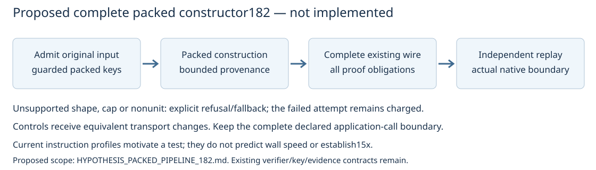

# Proposed complete packed constructor182

Status: hypothesis and implementation specification, not an implemented candidate or a performance result. The original15x goal remains active. Instruction profiles169/179 are diagnostic; full-boundary96 still admits no improvement. [pcc:unverified]

The next candidate will retain packed monomials through the whole constructor and its provenance arithmetic. Current guarded packed multiplication repeatedly returns to exponent vectors and generic BTreeMaps; local-resultant sharing leaves most of that representation in place. All36 profiles retain generic axpy, exponent-vector construction and allocator self hotspots. These observations motivate testing a complete representation change, without predicting a runtime ratio.

## Candidate scope

Use a private, guarded key with at most16 seven-bit exponent lanes and total-degree cap64. Preserve all checked additions/subtractions and dimension validation; a product is admitted only when its combined degree prevents lane carries. Reuse the existing producer/checker admission contract, with separate producer arithmetic. Do not call checker arithmetic to construct a basis.

Carry that representation through polynomial axpy, shifts, multiplication, reductions, root projection, coordinate propagation, change of order and provenance. Use exact u128 coefficient products and explicit specializations for the two declared primes. Prototype ordered packed maps first; a sorted flat-vector merge is a separate ablation if the complete profile supports it. Unsupported inputs or nonunit subresultants still take an explicit existing fallback, whose entire failed attempt is charged.

Keep full transient provenance as bounded local identities where it reduces repeated cofactor expansion. Retain explicit v2 acyclic definitions, the512-node cap and all other current budgets. Any cap refusal remains a refusal/fallback, not acceptance of an incomplete proof. Existing v1 APIs and budgets remain unchanged and reject newer formats. No precomputed basis, known scalar, target-specific relation shortcut or external solution may enter construction.

The first candidate must emit a complete existing proof wire. Any later binary transport/serialization change is a separately versioned ablation with complete original-ideal membership, input containment, reduced monicity and strict-standard/checked-product S-pair obligations. Matched controls receive equivalent transport and format improvements. Neither a slower launcher nor an older parser may define an artificially weak baseline.

## Qualification and decisive measurement

Run all maintained producer/checker tests and mutation canaries; include overflow/degree/dimension refusals, nonunit/disconnected fallbacks and proof-budget cases. Check complete basis equality and exact proof replay for both primes, n3/4/6, seed7 LAST-star. Re-run the actual-root36-case integration for any new backend before a full-root timing claim. Continue the existing solving-degree null: proof size and instruction count do not measure F4 solving degree or intrinsic regularity.

A measured experiment is not yet declared here. After the implementation qualifies, publish its source, immutable binary/input pins and a finite prospective protocol before data. Preserve the full agreed application-call interval: launch/wrappers/input/raw capture; construction and internal checks; complete serialization and independent replay; proof writes; stdout parsing, controller second replay, exact basis comparison and digests. Charge any added actual-native representation checks equally.

Use the strongest matched controls across all six fixed inputs, retaining allthree compact kernels and any faster qualified same-boundary control. Include balanced repeated A/B and neutral A/A, all observations/failures/outliers, unchanged resource/proof limits and the original cross-case15x criterion. Do not select fresh/reserved seeds, infer wall speed from Ir, promote a component gain to the whole pipeline, or hide costs in setup/amortization. [pcc:unverified]

## Sources checked and gaps

KB unavailable: no research-kb MCP tools or repository wrapper in this runtime, as previously logged. Fallback primary sources are maintained `crates/certified-relations/src/{lib.rs,projection.rs,quotient.rs,quotient/compact.rs}`, independent `crates/relation-replay-checker/src/packed.rs`, source-pinned Callgrind86, prospective169 and raw/profile audit179, and the complete full-boundary96 experiment. Packed monomial arithmetic, rational-univariate construction and change of order are established techniques; no novelty claim is made. Reuse their current admission bounds and exact verification interfaces.

The profile gives instruction attribution on the child and cannot rank wall-time bottlenecks or establish a15x opportunity. Controller/process costs remain material parts of the measured boundary. This candidate can fail; preserve that outcome and choose the next mechanism from evidence. [pcc:unverified]
