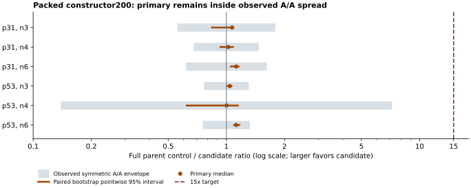

# Packed-constructor result: fifteenfold criterion rejected

The prospectively published1260-call experiment completes with all complete proofs accepted, no monitor-flagged contention and unchanged declared source/tool/worker pins. Frozen Rust analysis211replays every saved whole proof and binds all raw receipts, inputs, bases and replay statistics. Primary median control/candidate ratios are1.0027–1.1244, below each case's observed symmetric A/A maximum. The original six-case15x criterion fails; no improvement is admitted. [pcc:unverified]

The graph's gray envelope is observed neutral variation, not a confidence interval. Brown intervals are pointwise paired bootstrap95%; admission uses the separately recorded simultaneous0.05/6lower bounds, all>15, plus the other frozen gates. All observations remain. In particular, p53n4has a7.20symmetric A/A ratio despite no CPU contention flag; the source of that variance is not established. There are five observations per arm/case, not1260independent replicates of one target. [pcc:unverified]

PACKED_RESULTS_212.md gives the six-case table. PACKED_ANALYSIS_211.json retains all18ABarms per case, all12control A/A pairs, raw paired ratios and bootstrap outputs. The minimum of12controls is selected separately in every paired round; that can differ from the arm with the lowest median. Frozen85/96workers and rebuilt matched controls remain eligible. The primary packed-dag487 was fixed before data, and no secondary arm replaces it after observation.

Rust descriptive phase accounting212records primary median full-call times4.045–5.145ms, construction+wire0.550–0.928ms and worker replay0.209–0.385ms. These nested phase clocks are descriptive and cannot be added as separate full-call gains. A hypothetical free-constructor calculation holds all other measured costs fixed; it is a conditional model, not a measured runtime or universal bound. These observations reject assuming that another constructor-only change can deliver the required full-call gain. [pcc:unverified]

Next discriminate the remaining full parent cost: capture/input opens; launch and process wait; process-receipt writes; stdout parsing; proof/artifact readback; controller whole-proof replay; basis/stat binding and digests. A bounded descriptive trace must preserve all constructor, independent proof and native integration obligations. Any generic wrapper, transport or replay improvement must also reach the strongest matched controls. No weakened baseline, new seed selection, omitted proof checks or hidden shared setup is authorized. The15x objective remains active. [pcc:unverified]

Correctness qualification remains scoped:68default and69counter-enabled producer tests,14checker tests,36packed/legacy byte-equal full proofs and36new+36old actual-root cases. Native integration198/199 used explicit opt0release correctness builds. Saved audit203/207 replays all36native proofs and binds bases/stats, without independently re-executing native operation counters. No F4 solve runs and observed solving degree remains null. Ordinary root full-suite165is still incomplete; historical benchmark/PCC failures are retained unchanged. [pcc:unverified]

Reproduction uses published PACKED_COMPARE_PROTOCOL_200.md, PACKED_PINS_200.json, PACKED_PUBLICATION_209.json, all raw200artifacts and monitor, frozen analyzer and complete packed-qualification206source/tool archive. Every failure/outlier is kept; no replacement run. All new records are unsigned producer data, with localCPU0/one-thread/zero-cloud and the standing checkpoint/S3 waiver.
