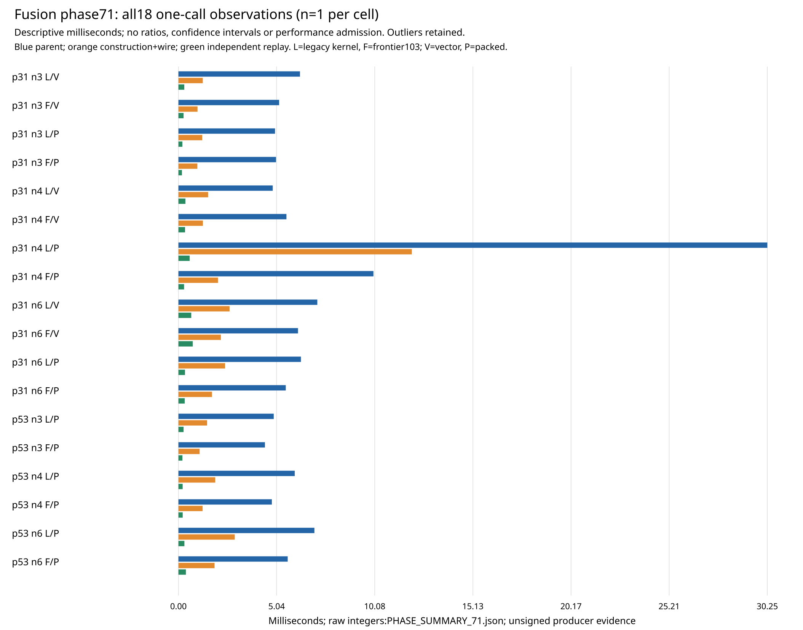

# Fused phase diagnosis71

All18 planned one-call observations completed with full proof readback,unchanged pre/post pins and the fixed case/order roster. This is a descriptive phase diagnosis,not repeated speed confirmation. No timing ratio,confidence interval or15x admission is computed. All outliers remain. Original15xgoal is active. ClaimPCC-20261117-88a554 is unsigned producer evidence. [pcc:unverified]

{width=95%}

Each API invocation paid original JSON parsing,native construction and its checks,wire serialization,complete independent verification,proof writing and basis receipt. The timed parent interval includes process transport and taskset/timeout/prlimit wrappers and ends when the child exits. Controller JSON consumption and additional read-only proof audits occur after that clock and are excluded. It is a process-phase observation,not a fully charged application-pipeline comparison. At p31 both vector and packed replay paths ran under kernels0/103;at p53 only the admitted packed consumer ran. Each cell has n=1;the n4legacy/packed constructor outlier remains11.989551ms. These observations do not establish any speed ranking. [pcc:unverified]

Source6aeefbe4de,lockfiles/launchrecord1c00434382,PR4510methods published before data. Rawsummary PHASE_SUMMARY_71.json;complete rawtree fusion-phase-71.tar.xz;runtime/source/input pins phase-pins-before/after-71.json. Input seed7,LASTstar,n3/4/6,p2147483647/9007199254740881. CPU0 reservation plus collector/taskset0,one thread,L0,zero cloud,usercheckpointwaiver;child30s/2GiB/16MiB,case180/global600.18attempted/18completed/0failed,noneexcluded;monitorrawretained. S3 not attested. [pcc:unverified]

Construction remained a larger observed phase than replay in these calls,so subsequent correctness trials tested alternativeconstruction/proofrepresentations. They are separate from this timing dataset:flatcubics72,sharedDAG74,prunedDAG75,andexactpackedproducts77. The work-count table below quotes complete independent-replay receipts from those correctness trials,with no timing inference. Oldfirststudies and ordinary95controlrejections remain unchanged. [pcc:unverified]

SharedDAGversion2 prospectively permits512acyclicdefinitions while retaining original byte/degree/term/work caps andallwholebasischecks;oldversion1APIrejectsversion2. FreshCASchecksandp31expandedv1legacyshadows qualifybothDAGconstructors. Packedproduct231 preserves every completewirebyte and fieldcounter relative tofrontier103. Product77rawdirectory labellegacy means103,andfrontier means231;this mapping is pinned in PRODUCT_SOURCE77. No15xoutcome follows. [pcc:unverified]
