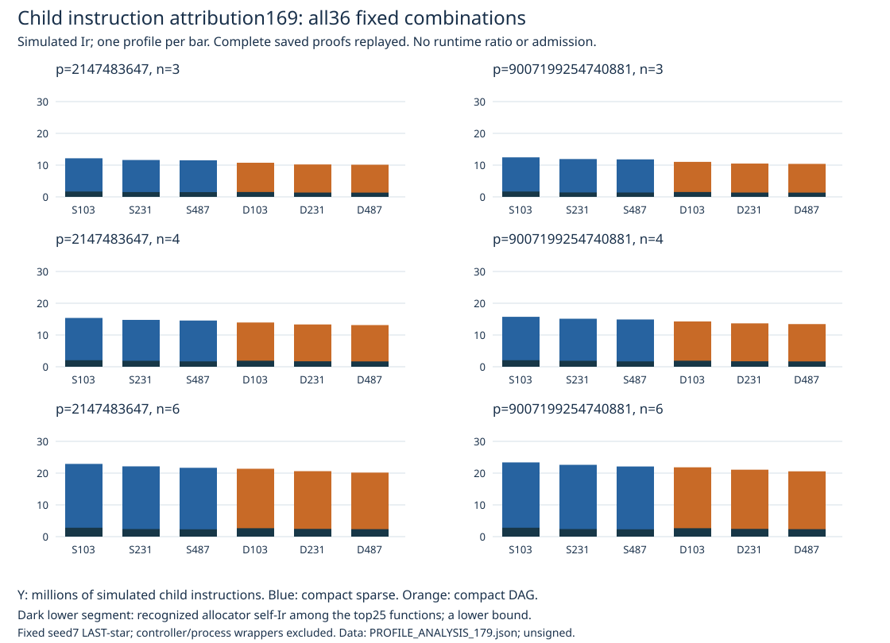

# Complete child instruction attribution169

All36 planned profiles completed, with unchanged worker/input/tool pins and matching complete bases. Rust analyzer179 matches each raw Callgrind summary and totals count, then replays every saved original/proof with separate checker arithmetic and binds basis/stat receipts. The isolation monitor flags zero contention samples. This is diagnostic instruction attribution, not runtime or15x evidence. [pcc:unverified]

The roster is fixed before data: primes2147483647/9007199254740881, n3/4/6, seed7 LAST-star; frozen85 compact-sparse and frozen96 compact-DAG workers, each with kernels103/231/487. Source, protocol and pins were published in da0157df0c and remotely checked in PUBLICATION_174.json. No target selection, replacement call or fresh/reserved seed was used.

The host is AMD EPYC9V74, localCPU0, one thread, zero cloud. Valgrind3.24.0 provides simulated Ir; perf sampling and hardware PMU counters are unavailable. Every call retains its manifest, raw profile, annotated self/inclusive tables, proof, worker output and process status. Child30s/2GiB/16MiB, case180s/global600s limits were declared in PROFILE_PROTOCOL_169.md. The probe and monitor are retained. All evidence remains unsigned and same-host.

## Interpretation and next hypothesis

Generic polynomial/provenance axpy, exponent-vector construction and allocator functions appear in the recorded self hotspots. The visible allocator category counts only six named allocator/wrapper symbols present in the top25; it is a lower bound, not the whole allocation cost. Self instruction categories are separate from overlapping inclusive call paths. Instruction share does not measure elapsed-time share, cache latency or cycles.

The profile covers the child, including construction/internal checks, wire serialization, first complete replay and proof writes. Controller readback/second replay, process launch and wrappers remain in the agreed application-call measurement boundary but are outside child instruction attribution. Profile wall durations are excluded from all performance statistics. The earlier repeated full-boundary96 result is unchanged; no improvement is admitted. [pcc:unverified]

The next hypothesis is a complete packed polynomial/provenance representation through construction, with guarded exact field arithmetic, rather than storing only two extra local resultant nodes. HYPOTHESIS_PACKED_PIPELINE_182.md defines the candidate and its required controls. It is a proposed implementation, not a guaranteed15x route. Transport/serialization changes must be applied to matched controls too, and full-boundary measurement remains decisive. [pcc:unverified]

## Recorded instruction counts

Each row below is one profile, not a runtime sample. Allocator share is the recorded lower bound from the top25 self entries; no confidence interval is inferred. Sources: PROFILE_ANALYSIS_179.json and the complete raw archive.

|Prime|n|Form|Kernel|Raw child Ir|Visible allocator self %|
|---|---:|---|---|---:|---:|
|2147483647|3|compact-sparse|frontier|12152495|13.863|
|2147483647|3|compact-sparse|packed-products|11611736|13.063|
|2147483647|3|compact-sparse|packed-batch|11522574|12.998|
|2147483647|3|compact-dag|frontier|10748452|14.232|
|2147483647|3|compact-dag|packed-products|10205236|13.346|
|2147483647|3|compact-dag|packed-batch|10122065|13.267|
|2147483647|4|compact-sparse|frontier|15371321|13.379|
|2147483647|4|compact-sparse|packed-products|14758620|12.695|
|2147483647|4|compact-sparse|packed-batch|14556877|11.604|
|2147483647|4|compact-dag|frontier|13937878|13.649|
|2147483647|4|compact-dag|packed-products|13322432|12.909|
|2147483647|4|compact-dag|packed-batch|13123458|12.792|
|2147483647|6|compact-sparse|frontier|22904995|12.228|
|2147483647|6|compact-sparse|packed-products|22131800|10.775|
|2147483647|6|compact-sparse|packed-batch|21676739|10.643|
|2147483647|6|compact-dag|frontier|21377982|12.401|
|2147483647|6|compact-dag|packed-products|20618224|11.824|
|2147483647|6|compact-dag|packed-batch|20164577|11.669|
|9007199254740881|3|compact-sparse|frontier|12447995|13.534|
|9007199254740881|3|compact-sparse|packed-products|11912909|11.734|
|9007199254740881|3|compact-sparse|packed-batch|11808474|11.689|
|9007199254740881|3|compact-dag|frontier|11025210|13.875|
|9007199254740881|3|compact-dag|packed-products|10489108|12.985|
|9007199254740881|3|compact-dag|packed-batch|10390743|12.924|
|9007199254740881|4|compact-sparse|frontier|15727864|13.076|
|9007199254740881|4|compact-sparse|packed-products|15121897|12.390|
|9007199254740881|4|compact-sparse|packed-batch|14887645|11.346|
|9007199254740881|4|compact-dag|frontier|14273569|13.328|
|9007199254740881|4|compact-dag|packed-products|13665995|12.584|
|9007199254740881|4|compact-dag|packed-batch|13435199|12.495|
|9007199254740881|6|compact-sparse|frontier|23379533|11.980|
|9007199254740881|6|compact-sparse|packed-products|22614759|10.545|
|9007199254740881|6|compact-sparse|packed-batch|22094796|10.441|
|9007199254740881|6|compact-dag|frontier|21833387|12.143|
|9007199254740881|6|compact-dag|packed-products|21082897|11.563|
|9007199254740881|6|compact-dag|packed-batch|20564777|11.442|

## Reproduction and unrelated root gate

Check `profile-169-179.tar.xz.sha256` from the study directory and extract `profile-169-179.tar.xz` into a fresh directory. Build `src/bin/profile-analyze.rs` with the study manifest, then run `profile-analyze EXTRACTED/matrix EXTRACTED/monitor.jsonl NEW_REPORT.json` to a fresh JSON output. It validates raw/parsed instruction totals and performs all36 full saved-proof replays. Raw profiles and artifacts are published with SHA256/index metadata; nothing was excluded.

The actual-root36-case adapter qualification remains separate. Full root unit165 built7561 tests but its failing pass was deliberately interrupted after46 observed failures; it is not a full pass. All46 observed failures were rechecked from its frozen ELF. Subsequent focused actual-source180 tests pass120 after repairing the double square charge and legacy observer-ID compatibility; the full root gate remains incomplete. ROOT_UNIT_PARTIAL_OUTCOME_177.json and SOURCE_CHECKS_180.json retain the scopes. No old evidence, trust key, catalog or verifier gate was rewritten. [pcc:unverified]

Canonical timing/benchmark graphs and frozen96 records remain unchanged. This diagnostic does not add a throughput result or a leaderboard row. The15x goal remains active and unachieved. [pcc:unverified]
