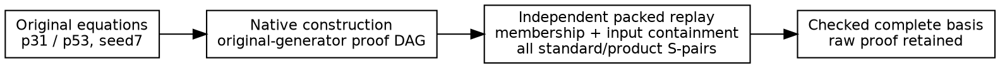

# Fused exact replay: two-field qualification

The packed independent verifier checks complete original-ideal equality, monicity/reducedness, original-input containment and every standard/product S-pair obligation. All12 native cases agree with fresh Singular full-certificate replay:fixed development seed7,LAST-star,n3/4/6,bothnativekernels,andprimes2147483647/9007199254740881. The6p31cases also match the unchanged vector consumer's complete basis and obligation counts. Correctness-only producer evidence; no timing ratio or15x result. [pcc:unverified]

{width=95%}

The53bit CAS path uses Singular's arbitraryprecision residue-ring backend,ring(integer,p); ordinary-characteristic API stays bounded as before. Full arithmetic uses128bit products. Packed exponents use7bit lanes,atmost16variables,totaldegree64; that bound makes multiplication carry-free. Tests exhaustively compare125 small exponent vectors'grevlex orders,check exponent overflow,large53bit products,and reject a polynomially zero but nonstandard S-pair representation. All60producer+13consumer release tests and strict alltargetlint pass. Independent code path is not an independent signed verdict. [pcc:unverified]

The fused worker reads original JSON,constructs a complete native proof with existing native checks,serializes it,replays it through independent arithmetic,and emits the checked basis plus rawproof. Producer returns only unverifiedbytes before replay. No reference answer,witness or target scalar enters construction. The next18call one-shot phase protocol has no ratios or performance admission. Original15xgoal remains active through nulls,component results and PRs.

Raw qualification63 retains the ordinarySingular wide-characteristic refusal; library-loader control64 failed before arithmetic; corrected control65 passes and corpus66 completes. Relocation initially refused nested workspaces,then passed after metadata-only workspace adjustment. Archived source7f3d7d5a91 is pinned in SOURCE_PROVENANCE; new successor directory preserves currentmain source retirements.

Sources: archived ROOT_WORKER_CONTRACT,exact producer/consumer replay,previous phase diagnosis,F4source references Faugere1999/Buchberger1965/Gebauer-Moller1988; installed Singular standard.lib coefficient-ring dispatch. KB unavailable; no novelty assertion. LocalCPU0,zero cloud,standing usercheckpointwaiver. Full performance scope and strongest-matched-control15x confirmation remain open.
