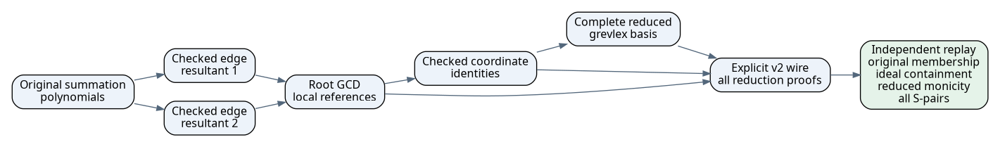

# Local resultant certificates: repeated comparison96

**The new constructor does not establish 15x.** All 210 planned calls completed with matching fully checked bases. No isolation sample was flagged as contended. Its median paired ratios against the strongest of three frozen compact controls range from 0.9960 to 1.0489; each is within its case's A/A spread. No improvement is admitted. Every failed, slow or unusual observation is retained; there were no replacement calls. [pcc:unverified]

|Field|n|Strongest old control / new candidate|Empirical lower quantile|A/A largest symmetric ratio|
|---|---:|---:|---:|---:|
|2147483647|3|1.0207|0.9871|1.1157|
|2147483647|4|0.9960|0.8630|1.2664|
|2147483647|6|1.0489|0.5013|1.1421|
|9007199254740881|3|1.0464|1.0285|1.2050|
|9007199254740881|4|1.0163|0.8966|1.2098|
|9007199254740881|6|1.0350|0.8655|1.2147|

Values use control/candidate, so below1 favors the control. Empirical lower quantiles follow the prospectively declared paired bootstrap; with only five pairs they are exploratory, not guaranteed confidence coverage. None approaches15. [pcc:unverified]

## Method and correctness

Five A/A rounds precede five balanced AB rounds. Every case uses the same seed7 originals: LAST star, n3/4/6, primes2147483647 and9007199254740881. The three controls are frontier103, packed-products231 and packed-batch487, using the frozen85 worker. Candidates are the root-resultant DAG with frontier103 and batch487. The primary comparison is root-DAG batch versus the minimum of the three old controls in each round. The other new arm is a same-family ablation. No input was selected from a fresh or reserved seed.

The complete parent interval includes raw capture, process wrappers and input transport; native construction and internal checks; full wire serialization; independent original-ideal membership, input containment, reduced monicity and all strict-standard or checked product S-pairs; proof writes; stdout parsing; a second complete proof replay, exact cross-arm basis comparison and proof digest. Fixed input hashes, directory creation, builds and analysis are outside this declared application-call interval. This is not an ECDLP total.

The code retains two checked edge-resultant nodes before the root GCD. It uses explicitv2 with512-node cap and unchanged other budgets. Existingv1 APIs keep their n-node cap and rejectv2. Qualification87/88 includes12 fresh Singular complete replays and the original p31 vector consumer on expanded-v1 shadows. The65-test producer suite passed; a separate added connected-path/disconnected-input test also passed. No solving-degree or intrinsic regularity is inferred from proof sizes. [pcc:unverified]

\newpage

## Reproduction and remaining dependencies

Source and protocol0bab6ab79e and launch pinsd9d89e071c were published before data. Pre/post source, input and ELF pins match. Reserved and pinned CPU0, one thread, zero cloud, user checkpoint waiver. Child30s/2GiB/16MiB; case180/global600s. The unchanged monitor used0.1s sampling and0.1 maximum other CPU. Host noise outside the monitor remains possible; A/A spread is reported explicitly.

Extract root-dag-96.tar.xz for every original, proof, stdout, stderr, process status and outcome. Check the SHA256 sidecar. ROOT_DAG_SUMMARY_96.json and ROOT_DAG_ANALYSIS_96.json contain raw integers, all paired ratios and statistics; the frozen Rust collector and analyzer are checked in. All evidence is unsigned and no S3 upload is attested.

Full crypto_lib adapter validation remains pending. At stage96 the baseline had missing module exports and malformed merged source; attempted fixes were saved. Later recovery106 repairs the reviewed scopes and passes47 focused SAT/codec tests plus the metrics-module test. The full library still reports109 other API/type errors; see ROOT_RECOVERY_REPORT.md for current status. Maintained producer/checker qualification remains separate. Global benchrecord closure refuses an older documentary receipt without a captured exit; no historical evidence or gate was edited.

{width=100%}

The15x research goal remains open. Current constructor-only leads have not met it. The next full integration step requires a compilable root baseline so the saved fused adapter can be validated with all native representation checks charged. No claim is made that all algorithmic avenues are exhausted. [pcc:unverified]

\newpage

# Repeated complete-certificate comparison96

All times below are parent milliseconds including controller replay. Five observations per AB arm and five A/A pairs per case; no trimming. [pcc:unverified]

|Field|Variables|Arm|Parent median ms|Parent minimum ms|Construction median ms|Replay median ms|
|---|---:|---|---:|---:|---:|---:|
|2147483647|3|frontier|4.528996|4.446042|1.014114|0.189996|
|2147483647|3|products|4.618741|4.361895|0.952792|0.184517|
|2147483647|3|batch|4.468826|4.248885|0.921665|0.180601|
|2147483647|3|root-frontier|4.657209|4.193261|0.949267|0.174312|
|2147483647|3|root-batch|4.294434|4.048374|0.858000|0.164056|
|2147483647|4|frontier|4.936128|4.707915|1.269017|0.222765|
|2147483647|4|products|4.750239|4.668626|1.172452|0.215775|
|2147483647|4|batch|4.996730|4.675206|1.229597|0.216625|
|2147483647|4|root-frontier|4.740764|4.622216|1.099983|0.212410|
|2147483647|4|root-batch|4.693965|4.543107|1.056899|0.221333|
|2147483647|6|frontier|5.579294|5.509890|1.749639|0.332450|
|2147483647|6|products|5.641738|5.356350|1.788959|0.306180|
|2147483647|6|batch|5.606145|5.254096|1.652764|0.302515|
|2147483647|6|root-frontier|5.435509|5.308106|1.573524|0.300592|
|2147483647|6|root-batch|5.280927|5.079574|1.456740|0.290988|
|9007199254740881|3|frontier|4.471559|4.359051|1.048466|0.222234|
|9007199254740881|3|products|4.524610|4.278509|0.995666|0.198238|
|9007199254740881|3|batch|4.565391|4.254754|0.966061|0.184067|
|9007199254740881|3|root-frontier|4.273452|4.222756|0.909467|0.184047|
|9007199254740881|3|root-batch|4.098930|4.086572|0.836016|0.169906|
|9007199254740881|4|frontier|4.968447|4.707094|1.281045|0.229916|
|9007199254740881|4|products|4.937069|4.801715|1.245912|0.214603|
|9007199254740881|4|batch|4.857610|4.603127|1.212632|0.219380|
|9007199254740881|4|root-frontier|4.742407|4.566312|1.141576|0.213771|
|9007199254740881|4|root-batch|4.631570|4.481835|1.037700|0.227391|
|9007199254740881|6|frontier|5.557932|5.467427|1.777502|0.308524|
|9007199254740881|6|products|5.686275|5.461838|1.784992|0.322615|
|9007199254740881|6|batch|5.515048|5.361327|1.660145|0.308864|
|9007199254740881|6|root-frontier|5.474277|5.294256|1.620956|0.302525|
|9007199254740881|6|root-batch|5.328548|5.198162|1.543039|0.312139|

All planned calls complete: true. Uncontended: true. RootDAG batch15x admitted across all six declared cases: false. See analysis.json for every raw paired ratio, bootstrap interval, simultaneous lower bound and A/A range.
