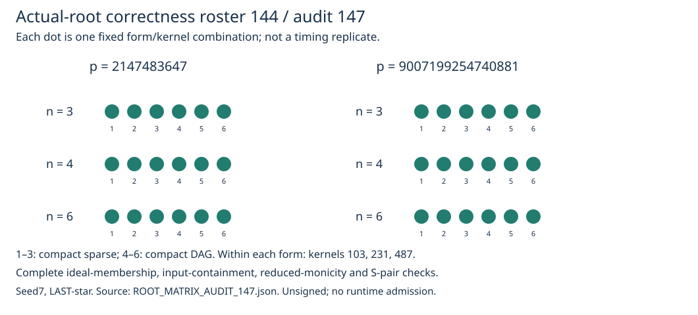
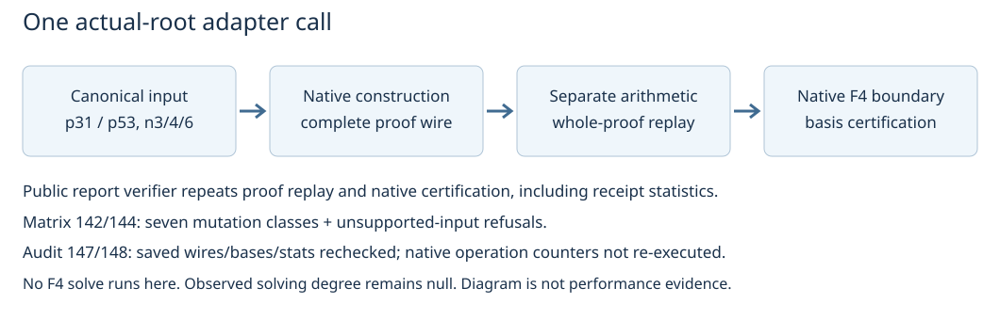

# Actual-root packed certificate integration

The actual `crypto_lib` adapter passes the fixed 36-case release integration matrix. Each complete basis matches the previous compact constructor, and the tests reject seven public mutation classes plus unsupported inputs. A separate arithmetic path replays all saved proof wires, binds the emitted native/control bases and replay statistics, and rejects two hash-consistent metadata sabotage views. Extraction of the published proof archive reproduces that audit byte for byte. These are unsigned producer correctness checks. [pcc:unverified]

The declared inputs are p=2147483647 and p=9007199254740881, n=3/4/6, seed7, LAST-star. Each of the six inputs runs compact-sparse and compact-DAG with kernels103/231/487. No fresh or reserved seed was used for selection. The saved inputs bind to the original frozen96 byte digests and canonical polynomial systems.

`try_packed_replay_basis` includes native construction/internal checks, full wire serialization, complete independent replay, conversion to the actual F4 polynomial representation and native representation certification. Original-ideal membership, input containment, reduced monicity, and all strict-standard/checked-product S-pair obligations remain. `verify_packed_replay_basis` recomputes the proof and native checks and rejects altered public receipt statistics. No F4 solve runs; `observed_solving_degree` stays null. This does not extend regular F4's documented prime range or measure intrinsic regularity.

## Evidence and reproduction

- `ROOT_MATRIX_OUTCOME_142.json`: two passing test functions containing all36 fixed loop combinations and seven mutation classes; source/ELF/log pins. Artifact-emitting run144 also passes those functions.
- `ROOT_MATRIX_AUDIT_147.json` and `ROOT_MATRIX_ARCHIVE_AUDIT_148.json`: all36 complete saved proofs and the two semantic sabotage controls. The auditor is `src/bin/root-matrix-audit.rs`.
- `root-matrix-144.tar.xz` and SHA256 sidecar: 215 indexed files plus the index, including every per-case original, proof, native basis, control basis, receipt, frozen references and exact captured source contexts.
- `root-correctness-177-181.tar.xz` and its SHA sidecar: partial165 raw logs, all46 failure rechecks, exact source180/181 and completed diagnostic logs. Its sidecar uses the archive basename and checks from the study directory. Source165 before these fixes remains in `root-recovery-168.tar.xz`.
- `ROOT_BASELINE_CHECK_141.json`: successful non-test library check before applying the adapter. It reports400 warnings; no clean-lint claim.
- `SAT_NATIVE_SOURCE_CHECK_137.json` and `SAT_STORAGE_SOURCE_CHECK_145.json`: 98 focused source tests pass at both stages, including original observer/arena/XOR behavior and the recovered native admission path. The latter includes retained native-buffer accounting.

From the repository root, check `sha256sum -c research/relation_fusion_20261117/root-matrix-144.tar.xz.sha256`, extract into a fresh directory, then run `cargo run --release --locked --bin root-matrix-audit -- EXTRACTED_ROOT/matrix EXTRACTED_ROOT/references EXTRACTED_ROOT/ROOT_DAG_PINS_BEFORE_96.json NEW_REPORT.json` with this study's manifest. `NEW_REPORT.json` must not already exist. Use `root-integration/Cargo.toml` and its own checked-in lock for the actual-root integration test. The archive's source contexts and captured source pins identify the historical run; later working sources are not relabeled as those inputs.

The saved-artifact auditor uses separate checker arithmetic, not a separate host or signed execution identity. Native F4 operation counters were exercised in the actual-root test and mutation canary but are not independently re-executed by this saved-artifact auditor. No signing key or trust gate changed. [pcc:unverified]

## Root source recovery and remaining qualification

Primary Git sources and scopes are listed in `PRIMARY_RECOVERY_SOURCES_167.json`. The recovery retains current observer/arena/indexed-XOR/telemetry algorithms, exact scalars and wide arithmetic, original custody and admission gates, channel policy enforcement, planted/EFD populations, PMU/whole-worker ownership, snapshot capacity/deadline handling, and separate paid/historical owned-replay verdicts. Distinct HEC 15-bit and hyperelliptic 8-bit codecs remain distinct. Genus optional paths retain their complete original checking/fallback logic. No existing live test assertion was weakened to make a build pass.

The separate full release library unit target initially failed107 compile diagnostics146, then30in158, then5in161; all raw failures remain. Forty-eight unique missing includes were materialized exactly from Git. Unit165 then built7561 tests, but its failing pass was interrupted after46 observed failures; all46 were rechecked from its frozen ELF. It is not a completed full-suite result. ROOT_UNIT_PARTIAL_OUTCOME_177.json and ROOT_RUNTIME_FAILURES_185.json retain the failure scope.

Current actual-source tests180 pass120, including the original98 source checks plus22 binary-field/tally tests. The source restores a single batched-square charge and preserves the legacy arena-offset observer identifiers through physical reclamation using optional retained names. No initial-verifier acceptance rule changed. Actual-root diagnostic181 passes allthree original initial-provenance tests, including the two previously failing cases, with7558 other tests filtered. It explicitly uses release-profile optimization0 and supplies correctness evidence only. The full ordinary release unit gate remains incomplete. SOURCE_CHECKS_180.json and ROOT_INITIAL_OUTCOME_181.json pin the exact contexts. [pcc:unverified]

These library-unit diagnostics are a different build target from non-test check141. Their counts must not be pooled into one trend. Qualification and compilation durations are not pipeline timings.

## Original speedup goal remains active

No new unprofiled timing measurement was made during this integration recovery. Thirty-six prospectively declared child instruction profiles169/179 now complete with raw Ir totals checked and all saved proofs replayed; see PROFILE_REPORT_179.md and profile-report-179.pdf. Those simulated instruction counts do not provide runtime admission. The last repeated full-boundary comparison96 remains unchanged: primary median ratios0.9960–1.0489 against the strongest matched compact controls, within each case's A/A spread. No improvement is admitted; the15x criterion remains unmet. The source-linked report is `ROOT_DAG_FINAL_REPORT_96.md` and its frozen summary/analysis/protocol. [pcc:unverified]

The complete child profile169/179 covers every fixed input and allthree compact controls in both forms. It motivates the proposed complete packed representation in HYPOTHESIS_PACKED_PIPELINE_182.md. Neither instruction shares nor constructor-only optimization establish a full-boundary gain. Any new candidate still requires a prospective repeated matched comparison, neutral controls, unchanged resource/proof checks, and published raw failures/outliers.

Canonical IC/benchmark graphs and frozen96 figures remain unchanged: this round adds correctness integration and source recovery, with no new graphable performance admission. Historical benchmark closure and PCC-ledger metadata failures remain recorded and unmodified. All artifacts are localCPU0/one-thread/zero-cloud under the standing checkpoint waiver; no S3 upload or signed independent execution is attested.
