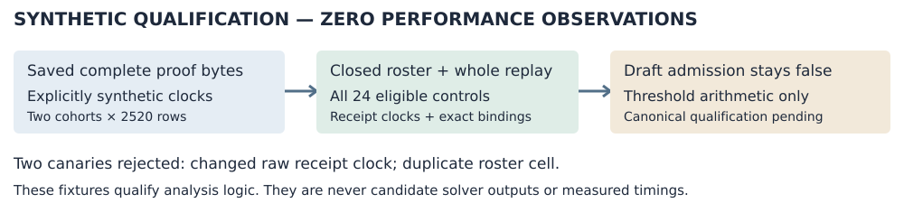

# Matched-launcher analysis qualification: synthetic fixtures only

**Zero actual performance observations. The original 15× goal remains unachieved.** This work prepares the comparison logic while canonical protocol/export checker access is pending. A fixture reuses saved complete proof files solely to qualify the analyzer; it is never a candidate solver.

The proposed comparison offers both wrapped and native launchers to all 12 original control algorithms and all six packed variants: 24 controls and 12 candidates. Five rounds across both declared primes and n3/4/6 seed7 LAST-star give 1440 AA + 1080 AB cells. The primary stays `packed-dag-487-native`, judged against the minimum of all 24 eligible control times per round. Full boundary, complete proofs, source/input/tool pins, six-case thresholds and neutral controls remain required.

Source/tools 253 qualify the complete saved-artifact analysis path on two **explicitly synthetic** 2520-row cohorts. Every proof is replayed by the fixture generator and again by the analyzer; the analyzer total is 5040 replays, with no excluded rows. Synthetic clocks and monitor records are labelled throughout. These are logic controls, not measured positive calibration or real timing results. [pcc:unverified]

|Synthetic scenario|Recorded Rust analysis|Admission|
|---|---|---|
|A faster native control defeats a wrapper-only apparent gain|Six primary medians 0.8; thresholds fail|False|
|Deliberately constructed ratio of 20 in all cases|Arithmetic thresholds pass|False: draft cannot admit|
|One raw process receipt clock changed|Exit 1: complete phase/boundary binding|No result|
|One roster cell duplicated, another lost|Exit 1: missing/duplicate cell|No result|

Both canaries preserve the closed file roster and alter exactly one file in their own synthetic copy; atomic replacement avoids changing a shared source inode. Fourteen final binary unit tests pass (eight distinct definitions; three shared roster checks execute in each of three binaries). Tests include strongest-control selection, strict thresholds, A/A noise, contention, missing/zero controls, clock/phase bindings and all-six-case completeness. Final source/tool pins remain unchanged. All outcomes are unsigned producer data, with no signed execution verdict. [pcc:unverified]

The earlier 249/250 context and the later 253 context remain separate and reproducible. The final analyzer always reports admission false. Before actual timing, reconcile and qualify a separate final source version with the canonical schema/checker, complete masking and actual measured positive calibration, freeze all source/tool/input pins, publish them before data, and retain every failure/outlier. Existing complete mathematical checks and the original repeated full-boundary criterion are unchanged.

The [experiment-protocol skill](https://github.com/isogeny-labs/workspace/blob/main/.agents/skills/experiment-protocol/SKILL.md) says, “Read the canonical SKILL.md and follow it.” Its canonical files in crypto-autoresearcher are authenticated ciphertext; the documented unlock has no configured KEY binding. A settings question remains pending. No benchmark gate is waived; no frozen evidence or trust key is rewritten. LocalCPU0, one thread, zero cloud and the checkpoint/S3 waiver persist.

Evidence: SUPERVISED_SYNTHETIC_SOURCE_253.json, SUPERVISED_SYNTHETIC_QUALIFICATION_260.json and the complete raw/proof/source/tool archive. Draft design: SUPERVISED_COMPARE_DRAFT_248.md. Source context 250 retains the earlier qualified snapshots. Functional supervisor outcome 240 and saved audit 241 remain separate from this synthetic qualification. No actual-root or full ECDLP timing claim.
