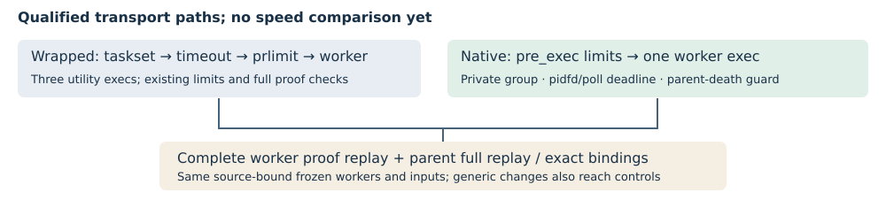
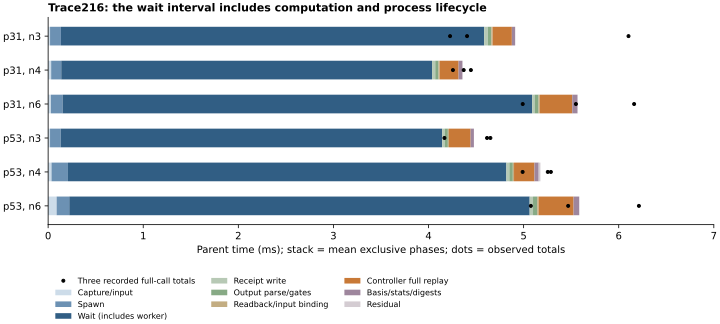

# Parent trace and native-supervisor qualification

The opt-in native Linux supervisor now passes five OS controls, 216 functional proof cases and a saved-output audit of those 216 proofs. Every one of 108 wrapped/native launcher pairs has equal complete proof bytes, constructor metadata, independently checked bases and replay statistics. Six transport controls preserve expected failures, later arms and proof-directory ownership. These are functional results, not a measured speedup. [pcc:unverified]

The opt-in native path removes the three taskset/timeout/prlimit utility execs while retaining a fresh worker process, CPU0, hard 2 GiB address-space / 16 MiB file limits and an absolute 30 second deadline. It uses a private process group, pidfd/poll supervision and group cleanup, and refuses nondefault SIGCHLD handling. A parent-death signal plus parent-PID race check closes a gap found after the first qualification. Scope is frozen ordinary unprivileged single-process workers; no credential changes or disabling the guard. It is not a general process sandbox.

|Requirement|Status/evidence|
|---|---|
|OS affinity, hard limits, allocation/file refusal|Five OS tests 238 passed, including prior four controls|
|Deadline/group cleanup and supervisor-death cleanup|238 includes descendant termination and abrupt-parent-death test|
|Same fixed inputs/workers|Both primes 2147483647 / 9007199254740881, n3/4/6, seed 7 LAST-star, all 18 control/candidate arms|
|Final paired complete proofs|240: planned 216, attempted 216, completed 216, excluded 0; 108 pairs equal|
|Saved artifact replay/bindings|241: 216 whole proofs, 6 transport controls and 3 sabotage classes checked|
|Repeated matched timing / 15×|Not run for the native launcher; original criterion remains open|

The source and tool pins 239 were published at 2647188b4a before final functional calls 240. Preliminary 229/234/237 records remain unchanged; they cover the earlier supervisor and do not establish parent-death protection. Failed build 230 (workspace membership) and intermediate/final builds are preserved. All evidence is unsigned producer data, with no independent-host execution attestation. The saved-proof auditor does not independently re-execute OS limits. [pcc:unverified]

## Why test a different launcher

Prospectively published parent trace 216/223 completed 324 calls: three rounds × six inputs × 18 arms, with every whole proof and exclusive phase partition checked. Archive 225 has 1984 indexed files plus index; extraction 226 reproduces audit 223 byte for byte. The following chart shows only the fixed primary packed-dag-487: 18 calls, three per case; all other arms remain in 223. [pcc:unverified]

The wait interval includes the complete worker computation and process lifecycle. It is not all wrapper overhead. For the fixed primary, recorded median process-interval-minus-reported-worker times are 2.87–3.50 ms, while mean controller whole-proof replay is 0.199–0.367 ms. These scopes and summaries differ; neither is an independent end-to-end gain. The trace motivates testing fewer utility execs and does not predict a speed ratio. Instrumentation overhead and every outlier remain. There were zero monitor-flagged CPU-contention samples, not an independent isolated-host attestation. [pcc:unverified]

## Remaining comparison and evidence gates

The latest completed repeated comparison remains 200/211: 1260 calls, primary median ratios 1.0027–1.1244 inside observed A/A spread, no improvement or 15× admission. A new launcher comparison must preserve the full application-call boundary, upgrade the strongest matched controls with the same launcher, publish immutable protocol/source/input/tool pins before data, retain neutral controls and every observation, and apply the original six-case 15× criterion. No F4 solve runs; observed solving degree stays null. Historical full-root qualification and signed-execution status remain separate. [pcc:unverified]

Current canonical experiment-protocol/schema/checker files in crypto-autoresearcher are authenticated ciphertext. The documented unlock route reports no KEY binding; a settings request is pending. Canonical protocol/export validation is open. This does not waive any existing proof, measurement or publication gate. No native-launcher parent-performance statistics have been collected.

Sources: man7 pidfd_open, poll, getrlimit, PR_SET_PDEATHSIG and setsid; official Rust CommandExt::pre_exec docs and local Linux/glibc headers. KB/conductor were unavailable; primary-source fallback is recorded. Current report-evidence, research-visuals and controlled-experiment workflows are applied. No novelty claim. User LocalCPU0/one-thread/zero-cloud and checkpoint/S3 waiver persist.

Canonical IC/benchmark graphs stay unchanged: no newly admitted speed result. Performance-report copies may be stored beside the study; an admitted benchmarks README row still requires the repository's unchanged validation manifest and matched reference. No gate or frozen catalog/key was modified to create one.
