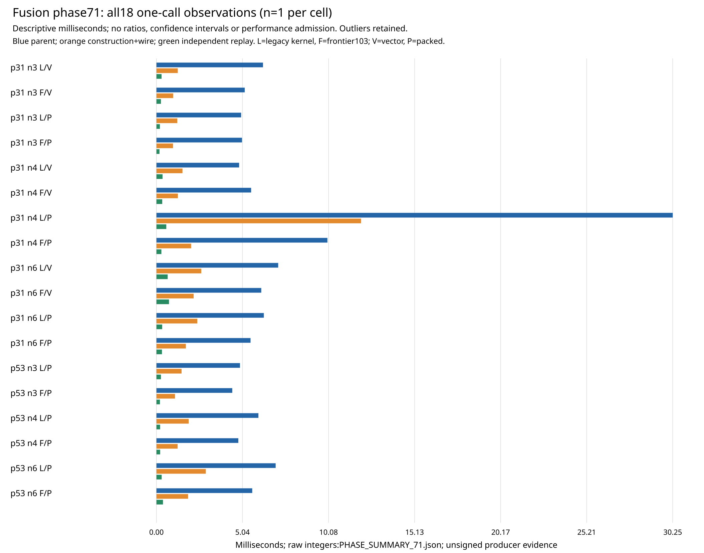

# Fused phase diagnosis71

All18 planned one-call observations completed with full proof readback,unchanged pre/post pins and the fixed case/order roster. This is a descriptive phase diagnosis,not repeated speed confirmation. No timing ratio,confidence interval or15x admission is computed. All outliers remain. Original15xgoal is active. ClaimPCC-20261117-88a554 is unsigned producer evidence. [pcc:unverified]

{width=95%}

Each API invocation paid original JSON parsing,native construction and its checks,wire serialization,complete independent verification,proof writing and basis receipt. The timed parent interval includes process transport and taskset/timeout/prlimit wrappers and ends when the child exits. Controller JSON consumption and additional read-only proof audits occur after that clock and are excluded. It is a process-phase observation,not a fully charged application-pipeline comparison. At p31 both vector and packed replay paths ran under kernels0/103;at p53 only the admitted packed consumer ran. Each cell has n=1;the n4legacy/packed constructor outlier remains11.989551ms. These observations do not establish any speed ranking. [pcc:unverified]

Source6aeefbe4de,lockfiles/launchrecord1c00434382,PR4510methods published before data. Rawsummary PHASE_SUMMARY_71.json;complete rawtree fusion-phase-71.tar.xz;runtime/source/input pins phase-pins-before/after-71.json. Input seed7,LASTstar,n3/4/6,p2147483647/9007199254740881. CPU0 reservation plus collector/taskset0,one thread,L0,zero cloud,usercheckpointwaiver;child30s/2GiB/16MiB,case180/global600.18attempted/18completed/0failed,noneexcluded;monitorrawretained. S3 not attested. [pcc:unverified]

Construction remained a larger observed phase than replay in these calls,so subsequent correctness trials tested alternativeconstruction/proofrepresentations. They are separate from this timing dataset:flatcubics72,sharedDAG74,prunedDAG75,andexactpackedproducts77. The work-count table below quotes complete independent-replay receipts from those correctness trials,with no timing inference. Oldfirststudies and ordinary95controlrejections remain unchanged. [pcc:unverified]

SharedDAGversion2 prospectively permits512acyclicdefinitions while retaining original byte/degree/term/work caps andallwholebasischecks;oldversion1APIrejectsversion2. FreshCASchecksandp31expandedv1legacyshadows qualifybothDAGconstructors. Packedproduct231 preserves every completewirebyte and fieldcounter relative tofrontier103. Product77rawdirectory labellegacy means103,andfrontier means231;this mapping is pinned in PRODUCT_SOURCE77. No15xoutcome follows. [pcc:unverified]

\newpage

# Fixed one-call phase diagnosis

Each row is one planned call; times in milliseconds, no ratios or performance admission. Parent pays process/transport/proof writes; phase clocks are descriptive. [pcc:unverified]

|Prime|n|Kernel|Checker|Construct+wire|Replay|Worker+proof write|Parent|
|---|---|---|---|---:|---:|---:|---:|
|2147483647|3|legacy|legacy|1.249266|0.299800|1.660513|6.243004|
|2147483647|3|frontier|legacy|0.979921|0.263336|1.361695|5.172816|
|2147483647|3|legacy|packed|1.220453|0.200411|1.531559|4.962130|
|2147483647|3|frontier|packed|0.971379|0.178398|1.241263|5.011905|
|2147483647|4|legacy|legacy|1.525611|0.356566|2.094074|4.843913|
|2147483647|4|frontier|legacy|1.254834|0.339470|1.692992|5.547840|
|2147483647|4|legacy|packed|11.989551|0.577477|19.803572|30.251519|
|2147483647|4|frontier|packed|2.032992|0.289545|3.231362|10.017019|
|2147483647|6|legacy|legacy|2.625952|0.658308|3.636140|7.133781|
|2147483647|6|frontier|legacy|2.180243|0.735955|3.266003|6.141120|
|2147483647|6|legacy|packed|2.392903|0.335824|2.988617|6.292527|
|2147483647|6|frontier|packed|1.722005|0.322384|2.425502|5.513027|
|9007199254740881|3|legacy|packed|1.472220|0.263466|1.844589|4.894029|
|9007199254740881|3|frontier|packed|1.087703|0.203084|1.381754|4.442860|
|9007199254740881|4|legacy|packed|1.889537|0.215283|2.210469|5.974620|
|9007199254740881|4|frontier|packed|1.241615|0.217777|1.651630|4.798044|
|9007199254740881|6|legacy|packed|2.892152|0.305719|3.585664|6.984787|
|9007199254740881|6|frontier|packed|1.854124|0.383436|2.703379|5.612526|

\newpage

# Complete-certificate work counts

Each entry is a correctness-case receipt, not a timing sample or speedup. All whole-proof obligations remain. Versions1/2 represent the same complete reduced grevlex basis; larger DAG node count is prospectively bounded. [pcc:unverified]

|Prime|n|Constructor|Definitions|Cofactors|Referenced term products|
|---|---|---|---:|---:|---:|
|2147483647|3|frontier103|3|238|1606|
|2147483647|3|flat cubics|2|1057|9309|
|2147483647|3|shared DAG|31|453|3865|
|2147483647|3|pruned DAG|21|441|3774|
|2147483647|4|frontier103|4|303|1979|
|2147483647|4|flat cubics|2|3393|30367|
|2147483647|4|shared DAG|51|884|8117|
|2147483647|4|pruned DAG|39|870|8012|
|2147483647|6|frontier103|6|433|2725|
|2147483647|6|flat cubics|2|21769|196659|
|2147483647|6|shared DAG|106|2249|21918|
|2147483647|6|pruned DAG|90|2231|21785|
|9007199254740881|3|frontier103|3|238|1606|
|9007199254740881|3|flat cubics|2|1057|9309|
|9007199254740881|3|shared DAG|31|453|3865|
|9007199254740881|3|pruned DAG|21|441|3774|
|9007199254740881|4|frontier103|4|303|1979|
|9007199254740881|4|flat cubics|2|3393|30367|
|9007199254740881|4|shared DAG|51|884|8117|
|9007199254740881|4|pruned DAG|39|870|8012|
|9007199254740881|6|frontier103|6|433|2725|
|9007199254740881|6|flat cubics|2|21769|196659|
|9007199254740881|6|shared DAG|106|2249|21918|
|9007199254740881|6|pruned DAG|90|2231|21785|
