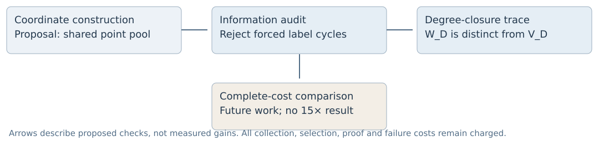

# Three relation leads: information, degree falls, overlapping pencils

2026-11-23 · Follow-up to merged PR #4989 · Proposal review, with two limited algebraic regression checks. No new solver, relation-yield or performance experiment. No novelty claim. [pcc:unverified]

I recommend implementing the coefficient-information audit and the degree-closure trace together, then using them to judge an overlapping-pencil generator. This changes what we select and what we measure; it does not assume that collecting more rows, finding a low-degree basis or making proof storage smaller lowers solving degree. These are falsifiable proposals, not a 15× result.



| Lead | Concrete change | First rejection criterion |
|---|---|---|
| Information audit | Preserve P/Q coefficients through augmented-row elimination; expose formal tautologies | The whole pool has a formal-label factorization and no unforced point identification |
| Certified degree-fall selection | Admit candidate consequences by their marginal effect on degree-bounded closure, with original-input certificates | No closed-space rank gain at the investigated degrees, or added certification cost outweighs a later solve reduction |
| Overlapping line families | Generate cheap collinear triples over a coordinate-defined pool, then seek cross-family relations and anchors | Forced triples stay in separate blocks; cross-links, useful rank or membership yield fail to compensate generation cost |

## 1. Audit information before optimizing relation count

Work in a cyclic subgroup of certified prime order ell, generated by nonzero P. Let Q=dP and let every factor-base point B_j belong to that subgroup. Curve coordinates live in F_p; relation coefficients live in F_ell. Those are different fields in general. A torsion test alone need not prove membership in the chosen cyclic subgroup when rational ell-torsion has rank two.

Use the row convention below; z_j denotes the unknown logarithm of B_j:

```text
sum_j R_ij B_j = a_i P + b_i Q
R z = a + d b                  (all scalar equations modulo ell)
lambda^T R = 0  =>  A + d B = 0
A = lambda^T a,  B = lambda^T b
B != 0  =>  d = -A / B; verify dP = Q
```

Written derivation: apply the logarithm isomorphism from the stipulated subgroup to F_ell to each valid row, then multiply by lambda. This exposes every group and field assumption; no coefficient arithmetic modulo the coordinate prime is substituted. Formal verification of the subgroup bridge and extraction is open. [pcc:unverified]

The important failure mode is stronger than duplicate rows. Suppose all pool points are assigned known formal labels B_j=alpha_j P+beta_j Q, and every retained relation was manufactured from those labels, so a=R alpha and b=R beta. Then any lambda annihilating R also annihilates a and b. Such a dependency yields A=B=0. Proof: lambda^T(R beta)=(lambda^T R)beta=0, and likewise for alpha. This does not rule out homogeneous geometric rows that help later target-bearing rows; do not discard a useful homogeneous row merely because a_i=b_i=0. [pcc:unverified]

For finite matrices over F_ell, a useful dependency exists exactly when b is outside the column space of R. If b is in the column space, the previous calculation rules it out. Otherwise extend a basis of that column space by b and take a linear functional that is zero on the old basis and one on b. This functional supplies lambda. Valid rows also give a+d b in that column space, so rank([R,a,b])-rank(R) is at most one. A gain of two flags a failed assumption or invalid data. These are written finite-dimensional arguments, not checked Lean theorems. [pcc:unverified]

The augmented-rank test is a success test, not a predictor of future yield: a gain already supplies a logarithm witness. For partial pools, retain component/rank structure and every unforced point identification with two different labels. Equality discovery cost is charged. If sparsifying rows, preserve the augmented row space [R,a,b], not just the row space of R: a row dependent in R can carry the decisive new right-hand side. Known coefficients are needed for target construction, not for every factor-base point.

Implementation hypothesis: carry (a,b) through singleton/degree-two elimination and sparse row operations, retaining an exact provenance vector. Tag forced construction identities separately from coordinate-discovered relations. Start with the existing coefficient/collision-ledger APIs; do not replace the independent checker or infer a speed gain from relation count. [pcc:unverified]

## 2. Select consequences by degree closure, not sparsity alone

This is a selection layer over existing certified-consequence constructors, including the already proposed direct cubics. It is not a renaming of the earlier DAG, packed-map, batch-inverse or flat-storage candidates. The new question is whether a candidate supplies information earlier in the solver's degree filtration.

Fix the original polynomial ring F_p[x_1,...,x_n], term order, original input F and a degree cap D. Distinguish two spaces:

```text
W_D(F) = span of monomial multiples u*f with deg(u*f) <= D
V_D(F) = smallest vector space containing original generators of degree <= D,
         closed under multiplication while the resulting degree stays <= D
Delta_D(g) = dim V_D(F union {g}) - dim V_D(F)
```

A single Macaulay matrix gives W_D. Its row reductions can produce lower-degree rows whose allowed multiples create additional rows. Repeat reduction and multiplication to a fixed point before claiming to have V_D. A candidate outside W_D may already lie in V_D; counting only the raw-rank gain would overstate the opportunity. The closure and solving-degree definitions follow [Caminata–Gorla, sections 1–3](https://arxiv.org/pdf/2112.05579).

Require a certificate g=sum_i h_i f_i in the ORIGINAL ideal before admitting g. If g already belongs to V_D, adjoining it does not change that closed space. If it lies outside, it can enlarge the degree-D space without changing the affine ideal. This is a screening condition, not a guarantee that an actual F4 run reaches a smaller peak degree or costs less. Computing the screen can itself be expensive. Use it as an offline diagnostic first; any eventual online selector must pay for its own work and cannot import a reference basis for free. [pcc:unverified]

Trace schema proposal: original-input and candidate hashes; coordinate prime; ring and term order; explicit W-versus-V mode; D; canonical monomial order; rows/columns/nonzeros before and after closure; exact ranks with replay witnesses; candidate origin and original-generator certificate; maximum degree of h_i*f_i; actual solver event degrees and peak matrix sizes; all censor/failure states. Field-operation and byte counts remain separate. Solving degree, first fall degree, maximum basis degree and regularity are separate fields; unsupported quantities remain null. No trace has been implemented or collected in this review.

Preserving one affine ideal preserves its intrinsic invariants, including those of its intrinsic homogenization. It does not force the ideals generated by the highest homogeneous parts, or by separately homogenized generator lists, to stay equal. Therefore do not claim either that redundant generators always lower regularity or that every generator-dependent degree-of-regularity definition is invariant. Specify the ideal and definition. [Caminata–Gorla](https://arxiv.org/pdf/2112.05579) gives the relevant distinctions; [Kosters–Yeo](https://arxiv.org/pdf/1503.08001) cautions against extrapolating a small first fall degree to regularity, in its characteristic-two setting.

Rejection plan: retain all zero-gain candidates, refusals and cap-exceeded closures. If all investigated candidates have zero Delta at the declared degrees, reject this finite candidate family at that scope. If Delta is positive but the full solver degree/cost does not improve, reject the proposed proxy as sufficient evidence. Preserve original membership, input-containment, reduced-monicity and all required pair checks. Any auxiliary-variable variant must separately certify its projection to the original ideal; a changed ring has different invariants.

## 3. Generate overlapping line families over a shared coordinate pool

For a nonsingular short-Weierstrass curve y^2=x^3+A*x+B over an odd prime field with p>3, intersect the line y=m*x+c with the curve. The x coordinates satisfy:

```text
h_(m,c)(x) = x^3 - m^2*x^2 + (A - 2*m*c)*x + B - c^2
```

Direct substitution gives (m*x+c)^2-(x^3+A*x+B)=-h_(m,c)(x). If h splits into three distinct rational roots, the lifted collinear points give a cheap three-point zero-sum relation. Repeated roots, tangent, vertical/inverse and infinity cases need their own checked branches; this proposal's simple admission branch excludes them explicitly, with costs and refusals retained. Rationality, curve membership, signs and chosen subgroup membership must be checked. A summation-polynomial zero alone does not supply all those certificates. [Kosters–Yeo, Proposition 2.1](https://arxiv.org/pdf/1503.08001).

Proposed construction: define a pool from intersections with a small, prospectively fixed set of horizontal fibers. This gives coordinate-defined points whose logs are not known formal expressions in P/Q. Use additional slopes to connect fibers; retain third intersections that return to the same pool. Inject separately verified P- and Q-bearing anchor rows. Track component rank, cross-family rank contribution, augmented information and total factor-base growth, not only the number of cheap within-fiber triples. [pcc:unverified]

The failure case is explicit: one independent triple on each disjoint three-point fiber leaves separate degrees of freedom. Repeating those triples does not connect the unknown logs. For an unstructured pool of density rho, a third intersection need not land back in the pool more often than its density suggests. No higher reuse rate or useful rank is assumed. Price cubic factoring/root isolation, subgroup checks, failed membership, pair scans, pool storage, elimination and anchor discovery. [pcc:unverified]

This is coordinate-specific exploration. Shoup's [generic-group bound](https://www.shoup.net/papers/dlbounds1.pdf) applies to algorithms that do not exploit the encoding beyond equality and oracle group operations; it neither validates this geometry nor proves that all coordinate-specific ideas fail. A generator using only labelled group additions still needs an unforced equality or other independent relation to escape the formal tautology above.

The six existing LAST-star polynomial inputs do not by themselves define this point pool or prove a geometric distribution. A future geometric study needs its own explicit curve/subgroup identities and declared corpus. It cannot substitute new inputs or selection seeds for the original fixed p31/p53,n3/4/6,seed7 full-boundary15× comparison.

## 4. What was actually checked, and what comes next

Two fixed polynomial building blocks were checked by the existing native identity-certificate issuer/checker. This is the only new numerical work: correctness regression, not a solver, relation-yield or timing experiment. Certificate IDC1h84fb3192d73a50e6 covers 2×2 sum reassociation; IDC1h41de375d1f91decb covers affine-line substitution. Each uses 32 issuer-derived points plus 32 extra domain-separated points over 2^61-1. Both have null formal-proof pointers. The issuer/checker share the local host and implementation. [pcc:unverified]

For each statement, rhs+1 fails issuance; a statement tamper with a recomputed valid id fails evaluation; a valid-length digest tamper fails; an understated degree is refused. Source402, pre-call403 and outcome403 pin the native driver, frozen executable and actual cached checker dependency. The checker module has the same Git blob on the current base and frozen root source. These finite evaluations do not prove arbitrary-size matrix/group statements, integer identities, p31/p53 identities, performance or statistical independence from an adversarial issuer. [pcc:unverified]

Formal source contains attempted declarations RelationInformation.labelled_column_cancellation and RelationInformation.affine_line_substitution, with no sorry/admit/custom claim axiom. They are NOT elaborated or kernel checked: lake build exits 127 because lake is absent. Neither an axiom report nor a fresh-kernel replay exists. Toolchain reference is Lean 4 v4.35.0 at crypto-lean revision ff94d4295f592c679074034cf926695c76de4ddc; matching Mathlib dependencies are still needed. PROOF_MAP.json lists the larger missing bridges. [pcc:unverified]

Next implementation order: coefficient/provenance audit; a correctness-only closed-space trace with exact witnesses; candidate admission/ablation; then a separately declared overlapping-pencil study if the geometry remains of interest. No new seed was used to select a faster algorithm. For the original speed goal retain all 36 eligible matched controls and any stronger qualified same-boundary control before freezing the next protocol, all six original cases, repeated A/A, the full agreed application-call boundary and every complete proof/failure obligation. A component or proposal does not establish 15×.

Requirement status: new ideas and their rejection criteria are delivered; two finite algebraic regression checks are recorded; arbitrary-size formal verification, trace/generator implementation and performance validation remain open. The prior timing-protocol decision remains relevant to future real measurements, not to this proposal deliverable. No new benchmark or admitted graph value exists, so canonical leaderboard/progress figures stay unchanged. Scope review leaves docs/ic/LEADERBOARD.md, docs/ic/leaderboard.json, docs/ic-leaderboard.html and docs/ic/progress-timeline.json unchanged: there is no eligible performance value or curve-map edge to add.

## Sources and scope of review

- Existing lane reports 96, 71, 179, 358, 372, 391 and direct-cubic/packed/flat hypotheses: preserve prior nulls and avoid repackaging an already-tested storage change as a new mathematical mechanism. Their actual source contexts remain historical.
- [Caminata–Gorla, arXiv2112.05579v2](https://arxiv.org/pdf/2112.05579): definitions 1.1/1.4/1.5, closed Macaulay construction and examples 4.1–4.4. These determine the trace fields and prevent conflating invariants.
- [Kosters–Yeo, arXiv1503.08001v3](https://arxiv.org/pdf/1503.08001): section 2 summation-polynomial domain and the characteristic-two warning about first fall versus regularity. No transfer of that characteristic-two estimate to prime-field systems is asserted.
- [Shoup1997, revised paper](https://www.shoup.net/papers/dlbounds1.pdf): primaryPDF page 1 visually read after text extraction failed; generic-encoding assumptions only. The local PDF hash is recorded in SOURCES_402.json; no whole copyrighted paper is copied into this PR.
- Semaev2004/031 primaryPDF returned 403. Kosters–Yeo is the accessed primary source for the summation-polynomial statement; no unread detail is attributed to Semaev's text.
- KB unavailable: repository wrapper reports no configured executable. Planned exact-mechanism, negative, application and adjacent-field queries are recorded in SOURCES_402.json; existing primary modules/reports and the accessed papers are the fallback. Conductor is also unavailable; no other agent is used.
