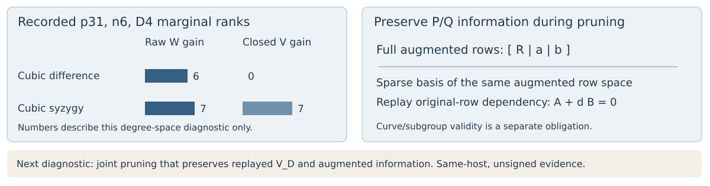

# Relation selection: closed degree spaces and P/Q information

2026-11-24 · Rust implementation and fixed-input correctness study · PR5102.
All findings here are same-host, unsigned producer evidence. PCC-20261124-378198 records the producer tests and retained partial failure; PCC-20261124-df9c2d records the complete trace/replay. Neither has a signed verification verdict. [pcc:unverified]

The existing certified-relations crate now exposes raw-versus-closed degree-space snapshots with original-generator and bounded-derivation witnesses, plus an augmented P/Q row audit and sparse original-row selection. It extends existing trace()/hilbert()/analyze(); those functions, their algorithms and maintained assertions are preserved. PREDECESSOR_ERRATA_409.md corrects the proposal review's missed implementation details without changing its frozen report or claims. [pcc:unverified]



## Fixed-input findings

The native producer completed 276 paired raw/closed records across both declared coordinate primes 2147483647 and 9007199254740881, n=3/4/6, seed 7 LAST-star, D=2/3/4, every existing cheap-consequence single, all and every leave-one-out presentation. There were 0 case errors and0 censored records. It reports 152 records with positive closed-space gain and 20 with raw gain but zero closed gain. These are overlapping presentations of six fixed inputs, not independent trials or 152 performance wins. Native replay reproduces every rank/gain and the entire summary. [pcc:unverified]

Below, W denotes the raw Macaulay span and V its degree-bounded multiplication closure. Base is the original polynomial list; All adds every existing cheap cubic consequence. Every displayed number is copied from the native SCAN_SUMMARY_422.json. The archive retains D=2, singles, leave-one-out, witnesses and all zero-gain records as well. [pcc:unverified]

| Case | D | Base W / V | All W / V | Gain W / V |
|---|---|---|---|---|
| p2147483647-n3 | 3 | 0 / 0 | 4 / 4 | 4 / 4 |
| p2147483647-n3 | 4 | 4 / 10 | 18 / 31 | 14 / 21 |
| p2147483647-n4 | 3 | 0 / 0 | 6 / 6 | 6 / 6 |
| p2147483647-n4 | 4 | 6 / 18 | 33 / 66 | 27 / 48 |
| p2147483647-n6 | 3 | 0 / 0 | 10 / 10 | 10 / 10 |
| p2147483647-n6 | 4 | 10 / 40 | 75 / 206 | 65 / 166 |
| p9007199254740881-n3 | 3 | 0 / 0 | 4 / 4 | 4 / 4 |
| p9007199254740881-n3 | 4 | 4 / 10 | 18 / 31 | 14 / 21 |
| p9007199254740881-n4 | 3 | 0 / 0 | 6 / 6 | 6 / 6 |
| p9007199254740881-n4 | 4 | 6 / 18 | 33 / 66 | 27 / 48 |
| p9007199254740881-n6 | 3 | 0 / 0 | 10 / 10 | 10 / 10 |
| p9007199254740881-n6 | 4 | 10 / 40 | 75 / 206 | 65 / 166 |

For `p2147483647-n6`, D=4, single-0 (the existing cubic difference) gives raw gain 6 and closed gain 0; single-1 (the existing cubic syzygy) gives 7 and 7. This is a concrete case where a larger raw span supplies no new closed-space information. Positive closed gain shows earlier availability in this specified filtration; it does not establish reduced actual solver degree or runtime. [pcc:unverified]

The comparison above is an algebraic diagnostic against unaugmented originals. The strongest existing timing controls already use these cubic constructors. It is not an eligible speed baseline, and it does not introduce a new cubic algorithm. No actual F4/F5 timing, event-degree trace, regularity value or 15× result is claimed. [pcc:unverified]

## What the Rust APIs certify

For a specified polynomial presentation F and cap D:

```text
W_D(F): span of monomial multiples u*f with deg(u*f) <= D.
V_D(F): smallest vector space containing admitted generators of degree <= D,
        closed under multiplication whenever the resulting degree stays <= D.
Delta_D(g): dim V_D(F union {g}) - dim V_D(F).
```

An extra row must carry `g=sum_i h_i*f_i` against ORIGINAL inputs. Admitting it preserves the affine ideal; its certificate product degree can exceed D. A separate bounded derivation then describes which original/extra/basis row was multiplied within D and which earlier rows were subtracted. Ideal membership alone cannot forge degree admission. The native regression includes a valid original-ideal row that must still fail an invalid bounded derivation. [pcc:unverified]

Construction reduces monomial products in graded reverse lexicographic order and, for closed mode, repeats multiplication of newly derived lower-degree rows to a fixed point. Replay uses separate wide polynomial arithmetic, its own monomial enumeration and graded lexicographic elimination. It checks original membership and each degree-bounded DAG step, independence of retained rows, and completeness. Raw completeness covers every admitted source product. Closed completeness checks the generators and variable multiples of the verifier's degree-adapted basis. These are the two space-inclusion checks for the particular artifacts; a general kernel-checked implementation theorem is not supplied. Shared types, shape/degree helpers and primality validation are not independent implementations. [pcc:unverified]

Column, row, source, polynomial, proof, retained-proof and expansion budgets bound construction. A censored snapshot yields a rank lower bound and no exact rank or marginal gain; subtracting two incomplete lower bounds is refused as an exact gain. Oversized imported witness shifts return an error instead of overflowing. Producer rows/reductions/rounds are telemetry, not independently certified primitive-work counts. Replay arithmetic, selection costs and verification are not free online work. [pcc:unverified]

Actual algorithmic solving degree, generator-dependent degree-of-regularity notions and intrinsic ideal regularity are distinct. The output leaves F4 solving degree and intrinsic regularity null. The existing top-form Hilbert functionality is not reinterpreted as a value for those fields. The definitions and closure distinction follow Caminata–Gorla, definitions 1.1/1.4/1.5; Kosters–Yeo's characteristic-two first-fall warning is not transferred as a prime-field estimate. [pcc:unverified]

## P/Q information and sparsity

The row convention is `R*z=a+d*b` modulo an explicitly supplied scalar prime ell. The polynomial coordinate prime p is separate. The audit records ranks of R,[R,b],[R,a,b] and requires a in the span of[R,b] before extracting a unique formal scalar. A dependency `lambda^T*R=0` with `B=lambda^T*b` nonzero gives `A+d*B=0` and candidate `d=-A/B`. Rank-gain-one a-only contradictions and rank-gain-two inconsistent systems are refused as extraction cases. This is a linear-equation audit, not a curve/subgroup validation. [pcc:unverified]

Sparse selection greedily picks original rows by nonzero count while preserving the FULL augmented row space[R,a,b]. It does not optimize elimination fill. A homogeneous row can remain necessary for a later useful dependency; formal-label pools `a=R*alpha,b=R*beta` supply only tautological zero right-hand sides. Tests retain both cases. Rank recomputation uses the maintained scalar elimination; dependency dot products use separate wide arithmetic. Fixed two-by-two determinants add 512 checks across the two declared scalar-prime demonstrations, not an arbitrary-size rank proof. [pcc:unverified]

Both native CLI demonstrations recover 37 from supplied abstract linear systems and replay their original-row dependencies. curve_scalar_verified stays false. The six polynomial fixtures contain no curve/group-row metadata, so no labels or subgroup orders are invented for them. A geometric generator, certified group bridge and actual dP=Q verification remain separate work. [pcc:unverified]

## Checks, failures and evidence

Entire producer targets pass 86 default and 87 count-field-ops tests, with 12 new test functions and no failures/ignored/filtered. The unchanged maintained relation checker separately passes 14 tests; that regression checks its existing formats and is not a trusted independent verifier of the new APIs. Source 415 binds producer tests; source 419 changes only native driver transport to compact JSON and its declared output cap. Frozen copies and all inputs/sources remain unchanged. [pcc:unverified]

The fixed driver enforces the complete six-case/presentation/degree roster, recomputes the summary and keeps unsupported values null. Full native replay accepts 276 records. Five canaries, each with a rebuilt native byte index, refuse semantic changes to admission metadata, original membership, bounded degree, the expected artifact roster or the input hash. Original indexes remain byte-identical. An existing-directory refusal preserves its sentinel and does not skip the valid fresh-directory scan. Raw transcripts, plans, source hashes, canary indexes/mutation bytes and POSTCALL_422.json retain all outcomes. [pcc:unverified]

The first native 417 scan failed with OS ENOSPC during an unintended lazy Git history download. Its partial output, including incomplete bytes, is preserved in partial-scan-417.tar.gz with post-call byte index 418; it has no full-matrix admission. Recovery removed only owned rebuildable Cargo output and the abandoned temporary download. The complete 419 run used local memory-backed storage, CPU0, one numerical thread, zero cloud, 1200 seconds / 2 GiB per call and 120 MiB data plus 4 MiB metadata reserve. These are correctness limits, not measured speed comparisons. [pcc:unverified]

Earlier source 410/412 tests and driver warnings are retained. Two outer unit wrappers reported 1 despite complete test-process receipts 0 and passing full rosters; this discrepancy is recorded rather than hidden. A stale origin/main ref caused a misleading keyring/source comparison and the unwanted broad fetch: the configured refspec tracked an older lane. Explicit main-to-origin/main fetching corrected it. CANONICAL_MERGE_421.json preserves the real canonical ledger byte prefix, keyring, claim payloads and full journal-block multiplicities. Full-root crypto_lib qualification, the historical null-exit benchmark refusal and 151 unchanged historical ineligible claim payloads are not resolved by these component checks. [pcc:unverified]

## Next discriminating lead and requirement status

Use closure-preserving joint pruning as the next diagnostic: remove candidate rows only while a replayed exact V_D equals the declared all-candidate space, and retain P/Q augmented information where actual group rows exist. Individual leave-one-out redundancy does not justify removing all such rows simultaneously. Declare every degree cap to preserve before selecting; equality at D=4 can lose availability at D=3. Reuse/inventory the existing greedy analyze() and strongest production controls before treating a subset or shared-anchor route as new. A future online selector must pay for generation, selection, all certificates and verification; a static fixture-selected subset does not establish generalization. This is a testable next idea, not a measured gain. [pcc:unverified]

Implemented and locally checked: fixed-degree raw/closed snapshots, original-input/derivation witnesses, full-space replay, bounded censoring, augmented-label audit and sparse original-row selection. Partial: integration is in certified-relations, not qualification of the actual crypto_lib root. Open: actual solver event-degree tracing, a specified regularity computation/formal proof, geometric reuse/group validation and the original 15× result. General Lean rank/closure/subgroup statements remain unproved; earlier two source-only declarations and limited 61-bit identity checks do not prove this implementation. [pcc:unverified]

The original speed goal still requires a coherent trusted current-root baseline, the pending actual-root integration and 36-case qualification, then prospectively declared repeated full agreed-boundary measurements against every strongest matched control, both original primes and n=3/4/6 seed 7 LAST-star, A/A and complete proof/failure checks. No comparative timing ran here. The canonical timing-protocol access/previous pending documentary decision remains relevant to that later measurement stage. No admitted speed finding changes docs/ic/LEADERBOARD.md, leaderboard.json, ic-leaderboard.html or progress figures; they remain unchanged. [pcc:unverified]

## Sources and reproduction

REPRODUCE.md gives native build, relocation, scan/replay and semantic-control commands. complete-scan-419.tar.gz retains the original audited artifact directory; keep native indexes outside it. SOURCE/PRECALL/POSTCALL files bind sources, calls, raw bytes and archived data; none is a signed execution attestation. [pcc:unverified]

Sources checked: existing certified-relations trace/hilbert/analyze and cheap-consequence kernels; the previous frozen lane reports and proposal source review; [Caminata–Gorla 2112.05579v2](https://arxiv.org/pdf/2112.05579), definitions 1.1/1.4/1.5 and closed-space construction; [Kosters–Yeo 1503.08001v3](https://arxiv.org/pdf/1503.08001), section 2 and first-fall caveat. KB unavailable: the wrapper has no configured executable; SOURCES_402.json in the predecessor study records the inaccessible queries and primary-source fallback. No novelty claim. [pcc:unverified]
