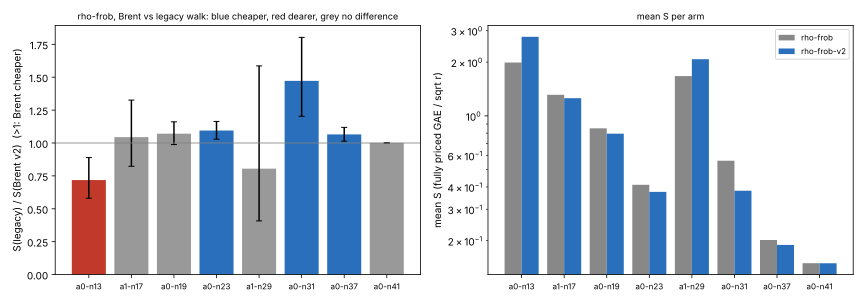

# Brent cycle detection in the fully priced Frobenius rho (2026-11-06)

**Question** (frozen in [`PROTOCOL.md`](PROTOCOL.md) before data, commit `f26d48c0af`): does `rho.signed_frobenius_v2_full` cost less than `rho.signed_frobenius_full`, the `rho-frob` reference of the Koblitz orbit-IC panels, per target, in fully priced GAE?
- `rho.signed_frobenius_v2_full` adds Brent cycle detection beside the 16-point window and is priced like the legacy walk.
- `rho.signed_frobenius_full` is the legacy walk.

**Answer: mixed** [pcc:unverified].

| curve | legacy ÷ v2 | 95 % interval | verdict (frozen rule) |
|---|---:|---|---|
| a0 n13 | 0.718 | [0.580, 0.889] | **v2 dearer** |
| a1 n17 | 1.045 | [0.823, 1.326] | no difference |
| a0 n19 | 1.071 | [0.988, 1.161] | no difference |
| a0 n23 | 1.095 | [1.029, 1.164] | **v2 cheaper** |
| a1 n29 | 0.805 | [0.408, 1.586] | no difference |
| a0 n31 | 1.472 | [1.203, 1.803] | **v2 cheaper** |
| a0 n37 | 1.065 | [1.014, 1.119] | **v2 cheaper** |
| a0 n41 | 1.0008 | [1.000, 1.002] | no difference (the interval touches 1) |

- **Run.** 32 fresh targets × 3 rounds per curve, paired by target (`ecbench compare`).
- **Records.** All 3,072 records verify and replay (`audits/`).
- **A/A.** The control reads exactly 1.000 on every curve: counted operations are deterministic per seed.
- **Pricing band.** `ecbench compare` gives the same point estimate and direction at native weights 0, 0.1 and 1. The interval is computed at the full prices only; the protocol asked for it at all three weights.

## What happens

The two walks share seeds, so they take the same path until the legacy walk meets a cycle its 16-point window cannot see. Most targets therefore read exactly 1.

- **Where v2 is cheaper (n23, n31, n37).** The legacy walk loses whole walks to the step cap, `20·2^dp + 64`. At n31 it loses 0.3 walks per solve, and walk operations fall from 460 to 260 under Brent (`summary.json`).
- **Where v2 is dearer (n13, r ≈ 2^11).** Brent finds about 4 cycles per solve longer than the window and escapes each by doubling. On this tiny class graph the escaped walk keeps landing in another cycle, and 0.2 walks per solve still run to the cap: walk operations go from 18 to 49. The legacy walk abandons such a walk and restarts it, which is cheaper here.
- **At n41.** Caps are rare (1.1 % of walk operations), so the two walks are within 0.08 %.

## What it means

- A switch from `rho-frob` to the v2 walk would make the matched-rho reference 6.5 % stronger at n37 and 47 % stronger at n31. Every IC row's distance to `rho-frob` would grow by the same factor.
- At n13 the reference would get weaker, so a per-size choice would be needed, made on fresh seeds.
- **No reference is changed by this PR.** `rho-frob` stays `rho.signed_frobenius_full`.
- Neither the IC panel nor the leaderboard is touched.

## Files

- [`REPORT.pdf`](REPORT.pdf), with source `REPORT.typ`.
- `fig_brent.svg` / `.png`, from `plot.py` over `summary.json`, which `summarize.py` builds from `tables/` and `sessions/`.
- `PROTOCOL.md`, `make_specs.sh`, `run.sh`, `specs/`, `sessions/`, `audits/`, `tables/` and `logs/`.
- Benchmark record: `benchmarks/records/20261106T0514Z-rho-frob-brent.json`. Copies are in `benchmarks/20261106-rho-frob-brent/`.

## Not claimed

- No index-calculus result. No `benchmarks/README.md` or leaderboard row: there is no validation-gate certificate or validator report.
- A local container run, not Iso Lab. Counted GAE does not depend on the host; wall time is not compared.
- `ecbench` binary sha256 `7abbd8b1ff718d5d8fbaa140b671283b740b3cb2b65d40b74eeeb935798b0197`.
