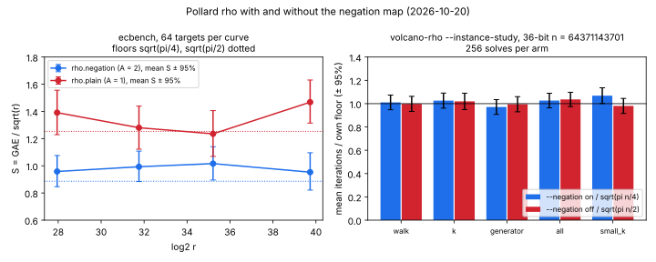

# Rho negation-map audit (2026-10-20)

**Question.** Does every Pollard rho we use as a reference walk on the classes
`{P, −P}` (the negation map, `A = 2`), and does each such walk deliver the
`√2` saving in counted operations that the map promises?

**Answer.** Before this change, two rho walks lacked the map:
`volcano-rho`'s native walk (this repository) and crypto-autoresearcher's
index-calculus baseline (`index_calculus/rho.py`, audit X02/X03). Both now
walk on `{R, −R}` by default. The matched reference `ecbench rho.negation`
already had the map, and it delivers the saving. All three were measured
below. PDF: [REPORT.pdf](REPORT.pdf). Run report:
[reports/run-20261020T0731Z/](reports/run-20261020T0731Z/report.pdf).

## Inventory of rho walks

| implementation | negation map | status |
|:--|:--|:--|
| `ecbench rho.negation` (`ic_boundary::rho_walk_with(NegationClasses, RhoWalk::negation())`), the matched reference | yes: look-ahead, cycle escape | measured here, unchanged |
| `ecbench rho.cubic`, `rho.quartic`, `rho.signed_frobenius*`, `koblitz_strong_rho` | yes, inside larger automorphism classes | unchanged |
| `ecdlp_nist::rho`, `hwcost::rho` (priced at `√(πn/4)`), `ic rho` | yes | unchanged |
| cryptanalysis `ca solve --alg rho` | yes (default; `--no-negation`) | unchanged |
| **`volcano-rho` native walk** (`src/bin/volcano_rho.rs`) | **was no** | **now on by default; `--negation off` restores the old walk** |
| **crypto-autoresearcher `index_calculus/rho.py`** | **was no** | **now on by default; `--rho-walk plain` reproduces the old walk bit for bit** (aburan28/crypto-autoresearcher PR, same branch name) |
| `ecbench rho.plain`, `rho.frozen_reference` | no, by design (`A = 1` controls / historical mark) | unchanged |
| `pollard_rho.rs` (generic `G`, `Z_p^*`) | n/a: no cheap order-2 automorphism | unchanged |
| crypto-autoresearcher `harness/rho.py`, `harness/walk.py` (toy KN-TECH-001 walks) | no | **not changed here; follow-up** |

`tools/icms/adapters/autoresearcher_ic.py` labels the autoresearcher rho
`rho.plain` and refuses to cite it as a matched reference. That policy is
unchanged. The adapter now passes `--rho-walk plain` so the label stays true,
and it rejects output whose `rho.walk` is anything else.

## 1. The matched reference: `ecbench rho.negation` against `rho.plain`

Session `ECBS1h83b97eccdcda`, spec `ECS1h7a0b49db98d3`
([specs/negation_vs_plain.json](specs/negation_vs_plain.json)), main
`6e35e1f42` (clean). Four fresh prime-order curves, 28 to 40 bits
([curves.json](curves.json)). Each `#E` was counted natively by
`volcano-rho --curve` and equals the prime `r`, with cofactor 1; ecbench
checks `[r]G = O` itself. 64 targets per curve and arm, 512 records, all
verified. `ecbench verify --replay 16`: 16 exact replays, 0 problems. Host:
Intel Xeon @ 2.10 GHz, 4 vCPU shared VM, `--cpus none`, isolation L0.

| curve | log2 r | `rho.negation` S [95%] | /floor | `rho.plain` S [95%] | /floor | plain/neg |
|:--|--:|--:|--:|--:|--:|--:|
| icv1-fp28-tm24531-24294e5d | 27.95 | 0.958 [0.846, 1.076] | 1.081 | 1.391 [1.229, 1.556] | 1.109 | 1.452 |
| icv1-fp32-t93403-ef655380 | 31.76 | 0.993 [0.884, 1.108] | 1.120 | 1.280 [1.122, 1.439] | 1.021 | 1.289 |
| icv1-fp36-t360541-9f646956 | 35.21 | 1.016 [0.895, 1.140] | 1.146 | 1.235 [1.069, 1.406] | 0.986 | 1.216 |
| icv1-fp40-tm62443-8b49d5b3 | 39.73 | 0.953 [0.821, 1.096] | 1.075 | 1.468 [1.314, 1.631] | 1.171 | 1.540 |

(measured; `ecbench table`, [table.md](table.md)). Floors are `√(π/4)` and
`√(π/2)`.

- **Pooled ops** (`ecbench compare`, cluster bootstrap, 256 pairs, 4 curves):
  plain/negation = **1.371 [1.257, 1.491]**. `√2 = 1.414` lies inside the
  interval. ecbench labels this "diagnostic only (unpriced work)".
- **§5a band** ([band.json](band.json)): the order holds at 0 and at 0.1 GAE
  per unpriced native operation. At 1 GAE per canonicalisation the negation
  walk's S is 1.89 to 2.03, above plain's. Ranking: unresolved inside the
  band on all four curves. A canonicalisation is one `F_p` negation and one
  compare, far below 1 GAE, but this run did not price it.
- **Wall** (L0, descriptive): median paired ratio 1.140. Most of the counted
  saving does not reach wall time in ecbench's implementation. Not
  investigated here.

## 2. `volcano-rho`: the walk this PR changes

Same binary and seed, `--instance-study` on a 36-bit prime-order curve
(`p = 64371108127`, `n = 64371143701`), 256 solves per arm,
`--negation on` against `off`, `dp_bits = 8`. All 2,560 solves returned the
right `k`.

| arm | on: mean iters ± 95% | on / √(πn/4) | off: mean iters ± 95% | off / √(πn/2) | off/on | ns per iter on / off |
|:--|--:|--:|--:|--:|--:|--:|
| walk | 227252 ± 14131 | 1.011 | 317303 ± 20582 | 0.998 | 1.396 | 363 / 314 |
| k | 230722 ± 14556 | 1.026 | 324191 ± 22292 | 1.020 | 1.405 | 362 / 310 |
| generator | 218396 ± 14257 | 0.971 | 316382 ± 20633 | 0.995 | 1.449 | 362 / 306 |
| all | 230809 ± 14156 | 1.027 | 329497 ± 19512 | 1.036 | 1.428 | 336 / 308 |
| small_k | 240236 ± 15154 | 1.068 | 311756 ± 20534 | 0.980 | 1.298 | 353 / 314 |

(measured; [volcano/instance-on](volcano/instance-on/instance_study.json),
[volcano/instance-off](volcano/instance-off/instance_study.json)).

- Iterations count every group addition: the look-ahead's discarded
  additions and the escapes' doublings are included. The new walk sits at
  its `√(πn/4)` floor and the old one at `√(πn/2)`. Pooled over the five
  arms, off/on is about 1.40.
- Cost per iteration rises 9 to 16% (one extra branch, a field negation and
  a 16-entry cycle-window scan), so wall time per solve improves by about
  1.2×. Descriptive only: L0, 4 threads, no pairing.
- Lens check: a 30-bit, depth-2 volcano with `--walk native` and with
  `--walk pullback`. All 176 solves were correct in each
  ([volcano/smoke-*](volcano/)). The pullback lens is a homomorphism, so
  `read(−R) = −read(R)`, and the sign choice made through it is consistent
  on every curve.
- Unit tests (`cargo test --bin volcano-rho`): both walks recover `k` on the
  registered 16-bit curve. On the 28-bit curve above, 200 paired solves have
  plain/negation > 1.15. On the 16-bit curve the ratio was only 1.13
  (dp_bits = 2): a 32-jump negation walk on a group that small loses much of
  the gain, the same effect that made ecbench pick 4 to 8 jumps below 2^23
  (`rho_jumps_for`).

## 3. crypto-autoresearcher `index_calculus/rho.py`

Measured in that repository
(`research/rho_negation_map_20261020/`): 640 paired solves at 16 to 32 bits,
plain/negation walk_ops = 1.353 [1.281, 1.425]. The negation walk is at
1.19× its floor; plain is at 1.14×. Rows written before 2026-10-20 used the
plain walk, so against them index calculus looked `√2` better than it does
against a negation rho.

## What this is and is not

This corrects a reference: it makes two rho baselines stronger. It is not
an index-calculus improvement and moves no leaderboard row. The crypto
leaderboard's prime rows are already priced against `rho.negation`
(LEADERBOARD.md table B). Any IC/rho ratio computed against the
autoresearcher's plain rho (`sweep`/`census` rows without `rho_walk`) is
`√2` too generous to IC. That is already recorded as audit X02/X03 in
`docs/ic-measurement.html`.

Python in this directory only plots recorded values (`figures/plot.py`).
The four curves were drawn once by a throwaway script that is not
committed (AGENTS.md "no Python"), and each was then checked natively as
described in §1.
