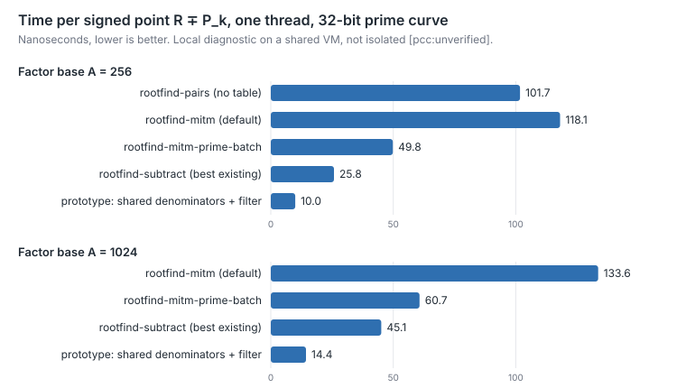

# Root-finding kernel baseline: results

Date: 2026-11-17. Protocol: `PROTOCOL.md` (frozen before data, one amendment).
Every figure is a local diagnostic, `[pcc:unverified]`: a shared 4-vCPU Xeon
2.1 GHz VM (`host.txt`), one thread, no pinning, no hardware counters, no
independent replay. Raw rows: `baseline.jsonl`, `baseline-2.jsonl`,
`floor-probe.jsonl`.

## 1. What one signed point costs today

One target at m = 3 costs the `2A` signed points `R ∓ P_k`, each computed and
probed in the pair table. On the 32-bit prime curve, where random targets are
refutations (0, 1 and 96 of 256 found):

| Arm | A = 64 | A = 256 | A = 1024 | vs default |
|---|---|---|---|---|
| `rootfind-pairs` (no table, per candidate) | 111.2 ns | 101.7 ns | not run | — |
| `rootfind-mitm` (default) | 109.7 ns | 118.1 ns | 133.6 ns | 1.0x |
| `rootfind-mitm-prime-batch` | 45.0 ns | 49.8 ns | 60.7 ns | 2.2–2.4x |
| `rootfind-subtract` (best existing CPU arm) | 24.9 ns | 25.8 ns | 45.1 ns | 3.0–4.6x |
| Prototype (section 3) | 11.1 ns | 10.0 ns | 14.4 ns | 9.3–11.8x |

Per target that is 14.0 µs, 60.3 µs and 195.8 µs for the default arm at
A = 64, 256 and 1024, and 3.2 µs, 13.2 µs and 65.6 µs for `rootfind-subtract`.

Noise floor: the A/A copy of `rootfind-mitm` differs from the first copy by
0.89x to 1.06x across the nine prime cells. Every ratio in the table is well
outside that band.

`rootfind-pairs` costs about the same per candidate as the default arm, but
it visits about `A²` candidates per target instead of `2A`: 13.4 ms per
target at A = 256, against 60 µs.

## 2. Where the time goes

Measured components, 32-bit prime curve:

| Component | Cost | How measured |
|---|---|---|
| One serial group addition (one inversion each) | 54.8 ns | micro-kernel, 256 points, no table |
| One batched addition, blocks of 32 | 29.4 ns | same micro-kernel |
| Default arm, everything else per point (probe, bookkeeping) | about 55–79 ns | arm minus serial addition |
| Batch arm, everything else per point | about 16–31 ns | arm minus batched addition |
| Growth from A = 64 to A = 1024 (table leaves the cache) | +16 to +24 ns per point | same arm across A |
| Table build, per pair inserted | 34–48 ns at A = 64, 92–105 ns at A = 1024 | `prepare` time over build additions |

Three things follow.

- The inversion is no longer the largest cost once it is batched. The batched
  addition still spends about 7 field products per point, part of them
  converting every base point into and out of Montgomery form on every call.
- Probing and bookkeeping are a large share, and the share grows with A. At
  A = 1024 the table holds about 524,000 entries in a general-purpose hash
  map, and nearly every probe is a miss.
- The table build costs as much as about 1,100 default targets at A = 1024
  (110 ms against 196 µs). It matters whenever a base serves few targets.

Koblitz curves (n = 17 with 31 abscissae, n = 23 with 118; many targets
decompose at these sizes, so these rows mix hits and refutations):

| Quantity | n = 17 | n = 23 |
|---|---|---|
| `rootfind-mitm`, per signed point | 25.0 ns | 40.7 ns |
| Batched addition alone | 10.9 ns | 12.2 ns |
| Serial addition alone | 67.8 ns | 97.3 ns |
| Table build, per pair | 86.3 ns | 121.5 ns |

The binary oracle already batches its target additions, so more than half of
its per-point time is the probe. Its table build still uses serial additions:
86–122 ns per pair against 11–12 ns for a batched addition.

## 3. A prototype of the first levers

`examples/rootfind_floor_probe.rs` is scalar, single-thread code for primes
below 32 bits. It changes three things:

1. `R − P_k` and `R + P_k` share the denominator `x_R − x_k`, so one inverse
   serves two points.
2. Only the abscissa is formed, and base, target and keys stay in Montgomery
   form. This is 3.5 field products per point.
3. One inversion per target, and a 16-bit-per-key Bloom filter in front of the
   exact table.

| A | Arithmetic only | With filter and exact check | Filter false positives |
|---|---|---|---|
| 64 | 9.0 ns | 11.1 ns | 0.50% |
| 256 | 8.0 ns | 10.0 ns | 0.43% |
| 1024 | 7.7 ns | 14.4 ns | 0.44% |

Correctness checks, all passed: 0 mismatches against the library's group law
over 172,032 abscissae, and the exact hits found through the filter equal the
exact hits without it in every cell (0, 39 and 2,562).

Against the best existing CPU arm this is 2.2x to 3.1x, and against the
default arm 9.3x to 11.8x.

Limits of the prototype: it does not recover witnesses on a hit, does not
keep the oracle's ledger, and handles only primes below 32 bits. Its key set
is larger than the oracle's negation-folded table (1,048,201 keys against
about 524,000 at A = 1024), which makes its probe harder, not easier.

## 4. What was not measured

- No hardware counters exist on this host, so there is no cycle or
  instruction count and no roofline record. The component table above stands
  in for a profile.
- Prime fields above 32 bits: the library's curve generator stops at 32 bits.
- Nothing ran on the lab's isolated runner; AWS is unavailable to this session.
