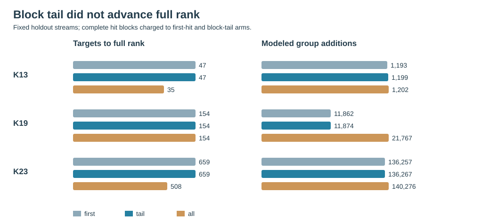

# First-hit block-tail harvesting: fixed-stream negative result

Recorded 2026-11-16. The [protocol](PROTOCOL.md) was committed at
`fe79c218f3` before the test source at `d9ba9ca5d6` and before data.
The library-only release harness passed one test on the fixed K13/K19/K23
streams. It checked exact curve and base identities, the ordered
first-witness torsion pair table, every full triple equation, collision
seed equations, modular row consistency, and planted scalar 641 at full
rank. The [raw stdout](run.stdout), [stderr](run.stderr),
[UTC/resource log](run.meta), [machine result](RESULTS.json),
[derivation](derive_results.py), [editable flow](diagram.dot),
[chart](tradeoff.svg) and [PDF](report.pdf) are retained. This is a
same-producer source screen. [pcc:unverified]

## What the computed block yielded

The production batch oracle computes a whole block of up to eight
`R-P_k` rests and then returns on its first verified triple. The
candidate probes the rest of that already-computed hit block and sends
all valid triples to modular elimination. The first-hit control is
charged for its full hit block, not just the prefix before the hit.
An all-block scan is a secondary ceiling. [pcc:unverified]

| Cell | Seed / full rank | First-hit queries | Block-tail queries | All-hit queries | First / tail / all modeled group additions | Tail extra lookups | Independent tail rows across full sample |
|:--|--:|--:|--:|--:|:--|--:|--:|
| K13 | 5 / 18 | 47 | 47 | 35 | 1,193 / 1,199 / 1,202 | 67 | 0 |
| K19 | 11 / 71 | 154 | 154 | 154 | 11,862 / 11,874 / 21,767 | 306 | 2 |
| K23 | 23 / 139 | 659 | 659 | 508 | 136,257 / 136,267 / 140,276 | 813 | 2 |

Every arm reached full rank and recovered 641. Block-tail used exactly
the same charged point-subtraction blocks as first-hit through the same
full-rank target, but it added 6/12/10 pair re-additions on K13/K19/K23
and the extra lookups shown above. Its 0/2/2 independent later-hit rows
did not move the full-rank target. The fixed-stream prediction of fewer
queries with no increase in modeled group additions was unsupported on
all three cells. The all-hit ceiling saved 12 K13 and 151 K23 queries,
but added 9 and 4,019 modeled group additions; it saved no K19 queries
and added 9,905. These are operation proxies, not wall times.
[pcc:unverified]

## Scope, obstruction and next action

K13 reordered every nonidentity point of its order-2,003 subgroup.
K19/K23 each used 1,024 distinct stride-53 residuals, with known
coefficients disjoint from the earlier multihit screen's K19/K23 sample.
The table, factor base and seed rows were identical across arms. The
three policies were simulated from one source-bound hit stream, so the
counter comparison is paired, but no independent reviewer reran it.
[pcc:unverified]

The model charges one group addition per computed batch rest and pair
re-addition. It does not price native field arithmetic, lookup latency,
row reduction, target construction, setup, memory or final verification.
Production SIMD may make a charged block cheaper than the scalar group
proxy. In addition, the current `Pdp3Koblitz` oracle returns one witness;
delivering several rows would require an API change. Those obligations
prevent a complete-cost or F4/F5/F6 conclusion. The existing
[complete-cost problem](../../problems/rootfinding-complete-cost-calibration.md)
and [frozen K13 comparison](../rootfind_f456_batch_combined_20261115/PROTOCOL.md)
retain the end-to-end gate. [pcc:unverified]

`dominated_by`: on these fixed modeled metrics, the first-hit control
reached full rank at the same target as block-tail with fewer lookups
and pair re-additions. This is a bounded decision against integrating
the simple block-tail policy. `sota_delta`: none; no asymptotic or
complete-call performance change. The next discriminating implementation
would need to select a *different* triple from beyond the first hit block
only when its row can advance rank, with a frozen probe cap and the
additional native and matrix costs charged. A held-out complete-call
panel must still decide whether that candidate helps. [pcc:unverified]

The canonical `docs/ic/LEADERBOARD.md`, `docs/ic/progress-timeline.json`
and `docs/ic-leaderboard.html` were checked; none changes because this
screen provides no admitted timing or complete-cost edge. Production
collector sources remain reserved by Conductor T-6708. [pcc:unverified]
