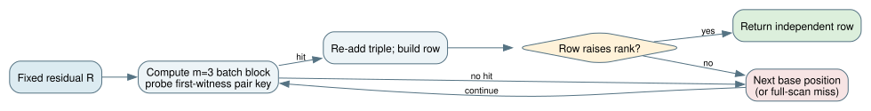
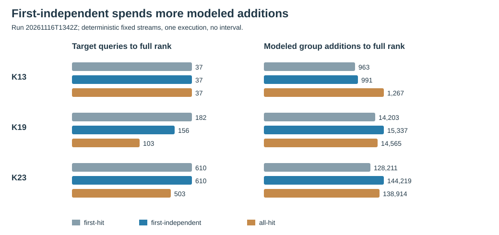

# First-independent relation collection: fixed-stream run

Run ID `run-20261116T1342Z`, source-bound local release test. One requested
test executed and passed at 2026-11-16 13:42:02 UTC. The three fixed public
Koblitz cells all reached full rank under first-hit, first-independent and
all-hit controls. The harness re-added every reported triple, checked modular
row consistency and asserted recovered scalar 641 at each full-rank point.
The machine [result](../../RESULTS.json) derives only the counts printed in
the [raw stdout](../../run.stdout); the [stderr](../../run.stderr) carries
the process resource readout. This is same-producer evidence with no
independent replay. [pcc:unverified]

## Fixed-stream outcome

| Cell | First / candidate / all queries | First / candidate / all modeled group additions | Candidate minus first additions | Later independent candidate rows over full sample |
|:--|--:|--:|--:|--:|
| K13 | 37 / 37 / 37 | 963 / 991 / 1,267 | +28 | 0 |
| K19 | 182 / 156 / 103 | 14,203 / 15,337 / 14,565 | +1,134 | 3 |
| K23 | 610 / 610 / 503 | 128,211 / 144,219 / 138,914 | +16,008 | 1 |

The candidate's fixed prediction required fewer modeled additions than
first-hit. It failed on every cell. K19's candidate reached full rank after
26 fewer target queries but spent 1,134 more modeled additions; its extra
scans cost more than the saved residual queries in this proxy. K13 and K23
reached full rank on the same query as first-hit with more work. All-hit is a
ceiling on relation supply, not an operation winner: it reached full rank on
fewer K19/K23 queries but spent more modeled additions than first-hit.
[pcc:unverified]

## Scope and accounting

The [protocol](../../PROTOCOL.md) fixes E0 n=13/19/23, standard-subspace
dimensions 5/7/8, signed Frobenius-orbit columns, the first-witness torsion
pair table, Q=[641]G and cofactor four. K13 enumerated all 2,003 subgroup
residues, skipping its unique identity query; K19/K23 used 1,024 distinct
coefficients `105000+3t`, disjoint from the two earlier screens. The base
digests, curve IDs, subgroup orders, sample counts and seed ranks are pinned
and checked in [analyze.jq](../../analyze.jq). All three arms start with the
same verified collision/torsion rows. [pcc:unverified]

The proxy charges every computed batch subtraction and pair re-addition as
one modeled group addition. Lookups and row attempts are recorded separately
in `RESULTS.json`. It omits native field arithmetic, actual block-lane
timing, target construction, setup, memory and final verification. The
`/usr/bin/time -l` observation (0.28 s real, 10,174,464 bytes maximum RSS)
covers the entire diagnostic harness and does not compare collector policies.
The host is macOS arm64 under L0 shared-host conditions, with no paired wall
interval. This screen therefore establishes no complete-call ordering against
F4/F5/F6. [pcc:unverified]

## Custody and next action

Frozen protocol commit `0e413634e8`; test source commit `83407456e0`;
locked harness commit `ea2fc503bf`; source-bound executable SHA-256
`f58ad80e4402725f22ee51dfe14db1b8bb0af12a2c56f22cddbbf6de5b6c0247`.
The branch-specific checkpoint passed and its S3 `RESUME.md` matched local
bytes before the run. `run.meta` records the exact UTC start/end and exit;
`run.stdout`/`run.stderr` and `RESULTS.json` are retained beside this report.
The prior [admission record](../../RUN_STATUS.md) is historical; this report
records the subsequent execution. [pcc:unverified]

`dominated_by`: first-hit has fewer modeled additions on every tested cell;
the first-independent policy is not advanced for production integration.
`sota_delta`: none. The next useful optimization must lower the cost of a
successful or failed relation query itself, or the reusable pair-table setup,
then enter the frozen [complete F4/F5/F6 panel](../../../rootfind_f456_batch_combined_20261115/PROTOCOL.md)
when budget and isolation admit it. The existing
[complete-cost problem](../../../../problems/rootfinding-complete-cost-calibration.md)
remains open. Checked `docs/ic/LEADERBOARD.md`,
`docs/ic/progress-timeline.json` and `docs/ic-leaderboard.html`; none changes
because this result has no admitted timing or complete-cost edge.
[pcc:unverified]
