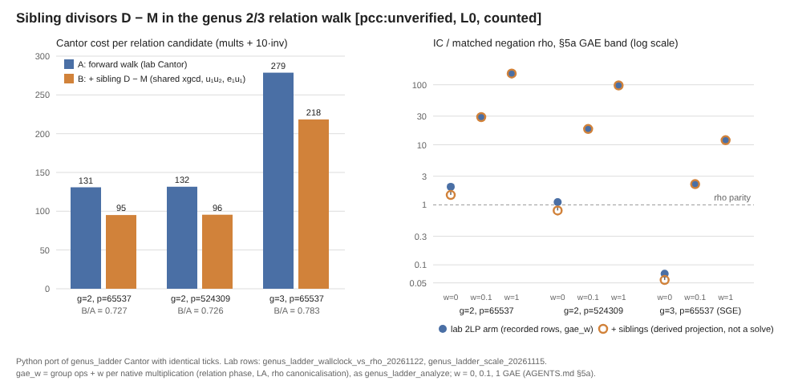

# Sibling divisors D − M in the genus 2/3 relation walk (2026-11-23)

Status: a component measurement in exact operation counts, plus a projection derived from it.
Every number measured here is `[pcc:unverified]`: isolation L0, one shared 4-vCPU VM, a Python port,
no independent replay. Numbers quoted from earlier lab studies keep those studies' standing. This
study adds no leaderboard row and no `benchmarks/README.md` row.

`PROTOCOL.md` was frozen before any data was taken (`frozen.sha256`, 19:27:46Z).
`AMENDMENT.md` was frozen after the first pass and before the replication data (second hash).
The freeze rests only on file mtimes and a self-written `frozen.sha256` (rewritten at amendment time,
19:37:16Z); no git commit pins it, so the order cannot be checked independently. The recorded hashes
match the current `PROTOCOL.md` and `AMENDMENT.md`.

**Corrected 2026-11-23 after an independent red-team review** (section "Red-team review and
responses" below). The first version priced the distance to rho with a home-made band; it is now
priced with the lab's §5a GAE band, and the conclusions about rho changed.

## The lever, and why this one

In hyperelliptic index calculus the relation search is a test of whether `u` splits completely.
In the lab's pipeline (`src/cryptanalysis/genus_ladder.rs`) each candidate costs two things.
First, one generic Cantor step `D ← D + M_j`: 219.7 multiplications and 5.0 inversions at g = 3,
88 multiplications and 4 inversions at g = 2. Second, the splitting test and root finding
(`rel_mul`). On the lab's own g = 3 rows Cantor is 45 % of the arm's field multiplications when an
inversion counts 10 and every multiplication counts 1. Under the §5a GAE band, where a Cantor step is
one group operation and a native multiplication costs w, group operations are only 2.9 % of the arm
total at w = 0.1 and 0.3 % at w = 1 (`tables.md` T3).

The lab has already covered the test side:

- the parity prefilter;
- Cardano–Lucas at g = 3 in the positive control (`ic_positive_control_lucas_20261116`);
- Ferrari at g = 4;
- 2LP, SGE and Wiedemann variants.

The survey's list is in `PROTOCOL.md` §0. One lever on the candidate supply had not been tried for
divisors: the sibling. The step D + M computes `xgcd(u_D, u_M)`, `u_D·u_M` and `e1·u_D`, and
D − M = D + (u_M, −v_M) needs exactly the same three objects. So each walk step can also yield a
second candidate, D − M, at a marginal cost. The lab has tried siblings only in the elliptic k-sum
build (`ic_ksum_sibling_20261118`).

## Results (`tables.md`, `analysis.json`, `rep_analysis.json`, figure `fig_sibling.svg`/`.png`, `report.pdf`)

| cell | Cantor ops/step: port vs lab | c = sibling marginal / step | Cantor cost per candidate B/A | N control | sibling exact / verified |
|---|---|--:|--:|--:|--|
| g = 2, p = 65537 (3 curves × 60k steps) | 88.0 / 4.00 vs 88.4 / 4.00 | 0.445 | **0.727** | 1.000 | 0 mismatches; 600/600 |
| g = 2, p = 524309 (3 × 60k) | 88.0 / 4.00 vs 88.3 / 4.00 | 0.445 | **0.726** | 1.000 | 0; 600/600 |
| g = 3, p = 65537 (6 × 40k) | 219.0 / 5.00 vs 219.7 / 5.00 | 0.572 | **0.783** | 1.000 | 0; 1200/1200 |

- **The cost component is measured, in counts.** A sibling costs 0.445 (g = 2) or 0.572 (g = 3)
  of a forward step. Siblings are emitted on 93.8 % of steps; a step is skipped when
  j_i = j_{i−1}, because then the sibling would be D_{i−1}. Restarts included, the walk's counted
  Cantor cost per relation candidate falls to 0.726–0.727 at g = 2 and 0.783 at g = 3.
- **The instrument is calibrated.** The port's forward-step counts are within 0.5 % of the lab's
  recorded `cantor_mul/group_ops` on the same curves. The lab figure also includes restart
  doublings; the like-for-like inclusive figures agree exactly at g = 3 (227.04 mults per trial
  and per step). The negative control N (the sibling computed by an independent full Cantor) costs
  exactly 1.000 of a step, so the saving comes from the shared work and not from the counter.
- **Correctness.**
  - In arm B, every sibling equals `cantor(D, −M)` bit for bit, over all 100 % of B steps.
  - For 200 sampled smooth siblings per curve, two further checks passed: the root places sum to
    D, and ca·G + cb·T = D (integer coefficients, T = k·G).

### Split rate of siblings against forward points (P2)

| cell | forward | sibling | difference [95 %] | A/A difference |
|---|--:|--:|--|--|
| g = 2, p = 65537 | 0.5029 | 0.5033 | +0.0004 [−0.0029, +0.0038] | −0.0025 [−0.0057, +0.0008] |
| g = 2, p = 524309 | 0.4997 | 0.5017 | +0.0020 [−0.0013, +0.0053] | −0.0003 [−0.0036, +0.0030] |
| g = 3, p = 65537, first pass | 0.1677 | 0.1655 | −0.0022 [−0.0043, −0.00001] | −0.0003 [−0.0024, +0.0018] |
| g = 3, replication R2 (AMENDMENT, fresh seeds, 6 × 120k) | 0.1679 | 0.1668 | −0.0011 [−0.0024, +0.0001] | — |

- **First pass at g = 3:** the interval just excludes 0, with siblings lower. By the frozen letter,
  **P2 failed**.
- **Pre-registered replication:** it reads **R-noise**, because its interval contains 0.
- **Both passes pooled** (descriptive only): −0.0014 [−0.0024, −0.0003], a relative −0.8 %.
- **Post-hoc diagnostic** (`diag_theory.py`, not pre-registered):
  - The exact share of reduced divisors whose `u` splits, N_split/#J, counted per curve, is 0.16683
    pooled over the six curves.
  - Siblings sit at that expectation (0.16648, z = −0.9).
  - The forward walk sits slightly above it (0.16776, z = +2.7).
  - So siblings behave like random divisors. Whether the 16-jump walk's forward points are really
    enriched is an open observation.
- **Effect on the verdict:** even if the pooled deficit is real, it raises the candidates needed
  per relation by 0.4 %. The g = 3 walk ratio then moves from 0.783 to 0.787.

### Duplicates (P3)

- At g = 2, p = 524309 and at g = 3: no duplicate siblings.
- At g = 2, p = 65537 (r ≈ 5–11 × 10^8): 9,329 duplicate siblings, so **P3 failed by its letter**
  at that cell.
- The post-hoc diagnostic `diag_dups.py` traces this to the walk. On curve 17 over 60k steps, the
  forward points repeat 6,182 times, because 4096-step segments merge into earlier trails when
  r < 10^9. Siblings repeat 5,787 earlier siblings and only 3 forward points. Both arms share the
  cause.

### Projection to the lab's 2LP arm, and distance to matched rho (derived, not measured)

Method (`analyze.py` T3, T3b):

- Pricing is the lab's own, from `src/bin/genus_ladder_analyze.rs` `costs()`:
  - §5a GAE band: `gae_w = group_ops + w·(rel_mul + la_mul + native)`, w = 0, 0.1, 1, applied the
    same way to the IC arm and to rho. Rho's `native` (per-step canonicalisation) is included.
  - FPM readings (the lab's cross-genus unit): `cantor_mul + I·cantor_inv + rel_mul + κ·la_mul`,
    low I = 1, κ = 1; mid I = 10, κ = g²; high I = 30, κ = g².
- The sibling projection scales only the walk's Cantor work by the measured B/A per candidate: the
  arm's `walk_ops` in GAE, and `cantor_mul + I·cantor_inv` in FPM (B/A recomputed at each I).
  `rel_mul`, `la_mul`, setup and verify work are kept unchanged: the same relations are needed, and
  the per-candidate yield is equal within 0.4 % (P2).
- Rho is the lab's `R_rho_neg` on the same curves and seeds. A rho walk needs one deterministic
  successor per point, so the sibling does not apply to rho.
- The "current" column recomputes the lab's recorded readings on these rows; it reproduces
  `genus_ladder_scale_20261115/tables_g2.md` (g = 2, p = 524309: 1.11 / 18.6 / 97.6 GAE;
  3.22 / 3.00 / 2.27 FPM). It is still this study's recomputation, not a new lab result.

| cell (lab rows) | reading | current IC / rho | IC+sibling / rho, projected | projected / current arm total |
|---|---|--:|--:|--:|
| g = 3, p = 65537, 2LP+pre+SGE(8,3), 12 runs (`genus_ladder_wallclock_vs_rho_20261122`) | GAE w = 0 / 0.1 / 1 | 0.071 / 2.23 / 11.9 | 0.056 / 2.21 / 11.9 | 0.784 / 0.994 / 0.999 |
| same | FPM low / mid / high | 0.178 / 0.346 / 0.272 | 0.165 / 0.330 / 0.253 | 0.927 / 0.955 / 0.931 |
| g = 2, p = 524309, 2LP+pre, 6 runs (`genus_ladder_scale_20261115`, older binary) | GAE w = 0 / 0.1 / 1 | 1.11 / 18.6 / 97.6 | 0.81 / 18.4 / 97.5 | 0.726 / 0.985 / 0.998 |
| same | FPM low / mid / high | 3.22 / 3.00 / 2.27 | 2.96 / 2.69 / 1.93 | 0.918 / 0.898 / 0.849 |
| g = 2, p = 65537, 2LP+pre, 6 runs (same source) | GAE w = 0 / 0.1 / 1 | 2.00 / 29.4 / 154 | 1.46 / 28.9 / 154 | 0.731 / 0.983 / 0.998 |
| same | FPM low / mid / high | 5.28 / 4.62 / 3.61 | 4.81 / 4.08 / 3.00 | 0.910 / 0.882 / 0.829 |

**Distance to rho (§5a band) [pcc:unverified, derived]:**

- **What the sibling does to the band-priced total.** At w = 0 it cuts the arm total to 0.73 (g = 2)
  and 0.78 (g = 3). At w = 0.1 it moves the total by 0.6 % (g = 3) and 1.5–1.7 % (g = 2); at w = 1
  by 0.2 % or less. The relation phase and linear algebra dominate the band-priced cost, and the
  sibling does not touch them.
- **Genus 3, p = 65537.** The arm is below matched rho only at w = 0 (0.071, projected 0.056). At
  w = 0.1 and w = 1 it is 2.2× and 11.9× rho, with or without siblings. The order with rho changes
  inside the band, so by §5a it is unresolved, and the sibling does not change that. The distance
  remaining at w = 1 is about 12×.
- **Genus 2, p = 524309.** The current arm is above rho at every w (1.11 / 18.6 / 97.6). With
  siblings it would fall below rho at w = 0 only (0.81); at w = 0.1 and 1 it stays 18× and 98×
  rho. No crossing across the band. The distance remaining at w = 1 is about 98×.
- **Reconciliation with the lab's frozen genus-2 result.** `genus_ladder_scale_20261115` RESULTS.md
  X4 reads "failed: no crossing, distance 3–5×" in FPM. The sibling projection keeps that: in FPM
  the p = 524309 arm would go from 2.27–3.22× to 1.93–2.96× rho, still above rho at every reading.
- **Context, not a ranking.** In FPM the g = 3 arm is below rho at every reading (0.18–0.35), and the
  lab's measured wall ratio on these rows is 0.20 (`genus_ladder_wallclock_vs_rho_20261122`,
  `[pcc:unverified]`). The §5a band is known to be unable to show such an IC win
  (`problems/section5a-band-cannot-show-a-known-ic-win.md`: a mulmod costs about 0.005–0.013 GAE on
  lab hosts). No per-host `w_cal` was measured here, so no "ranked at calibrated price" statement
  is made; the band verdict governs.

These are projections on the lab's rows, not an end-to-end solve with siblings. The first version
of this section used a home-made pricing (`tables.md` T3c, superseded) and wrongly claimed "below
rho across the band" at g = 3, a crossing at w ≤ 0.1 at g = 2, and "2.3× to go" at w = 1.

## Scorecard (frozen predictions)

| id | prediction | outcome |
|---|---|---|
| P1 | c ∈ [0.40, 0.80] at g = 2 and 3 | **held**: 0.445, 0.572 |
| P2 | sibling split rate = forward rate (interval contains 0, half-width < 15 %) | **held** at both g = 2 cells; **failed** at g = 3 in the first pass (upper end −0.00001); the AMENDMENT replication reads R-noise |
| P3 | duplicate siblings < 0.1 % | **held** at 2 cells; **failed** at g = 2, p = 65537 (5.5 %), cause shared with the forward walk (diagnostic) |
| P4 | Cantor cost per candidate B/A ∈ [0.70, 0.90] | **held**: 0.727 / 0.726 / 0.783 |
| P5 | projected arm total ratio: g = 3 ∈ [0.85, 0.95]; g = 2, p = 524309 ∈ [0.80, 0.93] (unit not tied to a w by the protocol) | **band-dependent** (derived). §5a GAE: **failed** at every w; g = 3 0.784 / 0.994 / 0.999, g = 2 0.726 / 0.985 / 0.998 (below the interval at w = 0, above it and above the 0.97 "worth porting" falsifier at w = 0.1 and 1). FPM low / mid / high: held; g = 3 0.927 / 0.955 / 0.931, g = 2 0.918 / 0.898 / 0.849. The first version scored "held" on w = 1 of the superseded pricing only (0.903, 0.884), where w = 0 and 0.1 also fell outside |
| P6 | lever does not apply to rho; IC/rho falls by the P5 factor only | held by construction (in every reading) |
| N | N sibling / A step ∈ [0.98, 1.02] | **held**: 1.000 |
| calib. | port within 3 % of lab counts | **held**: 0.3–0.5 % |

## Verdict

- **Frozen decision rule:** PROTOCOL §7 says "refuted if P2 fails". P2 failed at g = 3 in the first
  pass, so **by the letter of the rule this study is recorded as refuted**. P3 also failed at
  one cell.
- **What the evidence does support.** The cost component the lever is about is measured exactly,
  in counts, and controlled:
  - siblings cost 0.45 (g = 2) and 0.57 (g = 3) of a Cantor step;
  - the walk's Cantor cost per candidate falls to 0.73 (g = 2) and 0.78 (g = 3).
- **Yield:** a sibling split-rate deficit of about 0.8 % is plausible; its cost effect is
  negligible (0.783 to 0.787).
  - The replication interval only just contains 0 (−0.0011 [−0.0024, +0.0001], z = −1.76).
  - Both passes pooled (descriptive): −0.0014 [−0.0024, −0.0003], z = −2.5.
  - The post-hoc exact count puts siblings at the random-divisor rate and the forward points above
    it, so the gap may come from the forward walk rather than from the siblings.
- **What this is not:**
  - not an end-to-end improvement;
  - not run in the Rust pipeline;
  - not a wall-time result;
  - not a change in exponent. It is a constant factor on the Cantor part of the cost, which is
    about 45 % of the field multiplications but only 0.3–6 % of the §5a GAE total at w ≥ 0.1.
- **Distance to rho is unchanged in substance:** under the §5a band the sibling moves the arm
  total by 1.7 % or less at w ≥ 0.1; the arm stays about 12× (g = 3) and 98× (g = 2, p = 524309)
  rho at w = 1.

## Red-team review and responses

An independent review found the component measurement sound and three blocking problems in the
distance-to-rho part. All three are accepted and fixed above.

| # | review item | response |
|---|---|---|
| B1 | T3 is not the §5a band: native work priced per field multiplication on top of `cantor_mul + 10·cantor_inv`, rho's `native` left out | **Accepted.** `analyze.py` T3 now uses `genus_ladder_analyze` `gae_w` (group ops + w per native multiplication, rho's native included). Recomputed: g = 3 0.071 / 2.23 / 11.9 → 0.056 / 2.21 / 11.9; g = 2, p = 524309 1.11 / 18.6 / 97.6 → 0.81 / 18.4 / 97.5. These equal the review's figures. "Below rho across the band", "crosses rho at w ≤ 0.1" and "2.3× at w = 1" are withdrawn. One small correction to the review: at g = 2, w = 0.1 the sibling moves the total by 1.5–1.7 %, slightly more than "about 1 %"; at g = 3 it is 0.6 %, and at w = 1 it is 0.2 % or less everywhere |
| B2 | "IC / rho, lab" is this study's re-pricing; reconcile with `genus_ladder_scale_20261115` X4 | **Accepted.** The "lab" label is gone. The GAE and FPM recomputations reproduce `tables_g2.md` (1.11 / 18.6 / 97.6; FPM 3.22 / 3.00 / 2.27). X4 ("no crossing, 3–5×") still holds with siblings (FPM 1.93–2.96×). The g = 2 crossing statement is dropped |
| B3 | P5 "held" rests on w = 1 of a non-standard band | **Accepted.** P5 is scored band-dependent: failed at every w of the §5a GAE band, held in the three FPM readings |
| m1 | freeze is mtime-only; `frozen.sha256` rewritten at amendment | **Accepted.** Noted at the top. The hashes match the current files; the order cannot be checked independently |
| m2 | post-amendment wording softens a pooled deficit (z = −2.5) | **Accepted.** Wording is now "a deficit of about 0.8 % is plausible; its cost effect is negligible (0.783 to 0.787)" |
| m3 | `rep_analysis.json` `combined_descriptive.per_curve` repeats the first pass | **Accepted, fixed.** `per_curve` now pools each curve's counts over both passes; re-run. Pooled figures were never affected |
| m4 | seed derivation differs from the protocol | **Accepted; deviation recorded.** Code hashes the bar-separated tag (rootfind_genus23, p, curve_seed, s); the protocol named (rootfind_genus23, curve_seed, arm, s). Leaving out the arm is what pairs A, B and N on identical walks (asserted in `analyze.py`); adding p does not change any curve's walk |
| m5 | control N is close to tautological | **Agreed in part.** N was designed only to show the counter is symmetric, so a saving is not a counting artefact. It does not show that the sharing carries over to the Rust Cantor or to explicit formulas; that needs the Rust port (open) |
| m6 | calibration compares per-forward-step with per-group-op (includes restarts) | **Accepted.** Like for like (inclusive): lab `cantor_mul / trials` = 227.04 and port (forward + restart mults) / steps = 227.04 at g = 3 (our recomputation; the review quotes 226.9 for both). The claim stands |
| m7 | g = 2, p = 65537 counts duplicate siblings (5.5 %) as candidates | **Accepted.** Per unique sibling the cell's B/A is 0.747 (curves 0.765 / 0.727 / 0.749). Arm A also counts repeated forward points as candidates, so neither figure is per unique point |
| m8 | novelty rests on a grep | **Accepted.** Scoped to "not found by grep in `research/` and `src/cryptanalysis/`"; the literature was not checked |
| m9 | older g = 2 binary, no Rust build, wall time or solve | Agreed; disclosed. This stays a component measurement |
| m10 | projection band misnamed as §5a | **Fixed** by B1. Measured numbers keep `[pcc:unverified]`; the projection is labelled derived |

## What was not done (and why)

- **No Rust port and no end-to-end solve.** `df -h /` showed 751–752 MB free, below the
  workflow's 800 MB build line, so nothing was built. The next step is an `IcExt::sibling` flag in
  `genus_ladder.rs` with certified logs (open thread).
- **No wall time.** Python counts only. The skipped and shared work is real, but its wall effect
  on the Rust Cantor is unmeasured.
- **Untested formula families.** These counts hold only for the lab's generic Cantor (`xgcd` based).
  With explicit Harley/Lange formulas, the shared part (the resultant and inverse) is a different
  fraction, and rho would get cheaper too. Not measured.
- **Older genus-2 rows.** The g = 2 lab rows come from the 2026-11-15 binary. The current g = 2
  incumbent may differ, so re-anchor before any claim.
- **No research-kb, and no lead-atlas checkout** in this container (as in the survey). The
  novelty claim is scoped to "not found by a grep of `research/` and `src/cryptanalysis/`". The
  literature on simultaneous D ± M in hyperelliptic arithmetic was not checked.
- **No per-host `w_cal`** for the §5a calibrated weight, so no "ranked at calibrated price" reading.
- **No AWS/EKS/S3, no bench record, no `.resume` checkpoint push.** The task forbids them.

## Files

- Protocol and freeze:
  - `PROTOCOL.md` — the frozen protocol.
  - `AMENDMENT.md` — the replication amendment.
  - `frozen.sha256` — the freeze hashes.
- Instrument and analysis code:
  - `sibwalk.py` — the instrument.
  - `rep.py` — the replication runner.
  - `analyze.py` — produces `tables.md` and `analysis.json` (T3 re-priced under the §5a band
    after the review; the first pricing is kept as T3c, superseded).
  - `rep_analyze.py` — produces `rep_analysis.json` (per-curve overwrite fixed after the review).
- Post-hoc diagnostics: `diag_dups.py`, `diag_theory.py`.
- Raw data and logs:
  - `raw/runs.jsonl` — 48 rows: 12 curves × arms A, B, N, AA.
  - `raw/rep_n.jsonl` — 6 rows.
  - `raw/diag_*.{txt,json}`.
  - `raw/run.log`.
  - `cells.json` — the public synthetic curves, copied from the lab's published instance lines.
- Figure and report:
  - `render.py` (figure), `mk_report.py` (report.html), `render_pw.js` (PNG and PDF).
  - `fig_sibling.svg`, `fig_sibling.png`.
  - `report.html`, `report.pdf`.
- Session log: `SESSION_LOG.md`.
