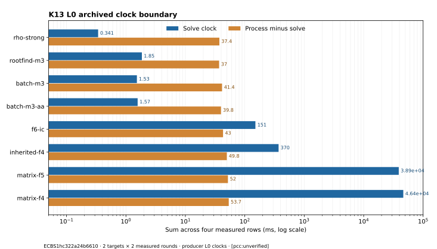

# K13 archived complete-process clock boundary

This is a post-hoc arithmetic audit of one archived K13 L0 session, not a new
trial, an isolated performance ranking, or a claim about an ECDLP cost
exponent. Its [plan](PLAN.md), [amendment](AMENDMENT-1.md),
[script](analyze.py), and [machine output](SUMMARY.json) bind the exact input
object. The independently written [scalar audit](../rootfind_k13_l0_independent_audit_20261116/REPORT.md)
checks reported answers but does not attest the original clocks. [pcc:unverified]

## Boundary readback

The pinned source object is the 453,126-byte JSONL with SHA-256
`dc16c97ae21a250cc1d47237231d9642960c100dc3fdb68f4dd210af171bff44`:
session `ECBS1hc322a24b6610`, source
`8f4cc824c87a236aafd28aa390c744e355a08e45`, two public E0 n13
targets from seed `202611160511`. The audit checked 48 records, retained
16 warmups for identity, and summed the 32 measured rows into four complete
eight-arm target-round cells. Each arm has four measured records. The
`outcome` and `work.complete` flags are producer assertions. [pcc:unverified]

Every value below is a **derived sum of recorded fields**, not a fresh clock.
`outside` is `process_wall_ns − solve_wall_ns`, so it includes startup,
input handling, process teardown, and every other interval outside the solve
marker. The `bitop/v1` column is a producer-priced convention whose coverage
still needs an instruction audit. [pcc:unverified]

| Arm | Solve sum (ms) | Outside sum (ms) | Process sum (ms) | bitop/v1 sum |
| --- | ---: | ---: | ---: | ---: |
| rho-strong | 0.341 | 37.353 | 37.693 | 7,742,824 |
| rootfind-m3 | 1.854 | 36.963 | 38.817 | 19,908,908 |
| batch-m3 | 1.529 | 41.414 | 42.943 | 20,596,967 |
| batch-m3-aa | 1.574 | 39.775 | 41.348 | 20,596,967 |
| f6-ic | 150.783 | 43.047 | 193.831 | 7,707,513,687 |
| inherited-f4 | 370.199 | 49.803 | 420.001 | 15,401,989,837 |
| matrix-f5 | 38,934.723 | 52.030 | 38,986.753 | 3,317,785,883,500 |
| matrix-f4 | 46,397.572 | 53.700 | 46,451.272 | 4,390,322,339,592 |

The paired batch A/A arms have identical producer-priced work in all four
cells, yet their process-clock sums differ. The four batch-m3 solve clocks
range from 263,292 to 505,042 ns on this macOS L0 host, each below the
frozen L2 admission screen's 1 ms floor; this does not predict the x86 result.
The recorded outside-solve interval is much larger than the candidate's solve
interval here, so improving relation collection alone cannot remove that
recorded outside-solve time. [pcc:unverified]

Within batch-m3's **producer-priced solve work**, the phase totals are
13,112,963 bitops for relations, 3,745,792 for linear algebra, 3,207,380 for
oracle setup, 417,572 for the factor base, and 113,260 for verification.
Relation collection is the largest modeled phase in these rows, while the
complete-process clock is dominated by time outside the solve marker. This
distinction is specific to the archived K13 L0 process and does not establish
native counter coverage. [pcc:unverified]



The graph's log axis separates the short solve intervals from matrix-engine
seconds; it does not make these L0 rows an admitted wall comparison. All
eight arms and every measured row are retained in [SUMMARY.json](SUMMARY.json).
[pcc:unverified]

## Limits and next checks

The analyzer's first invocation failed because target coordinates were JSON
lists; the second found the expected `factor_base: null` on rho. Neither
wrote a result file. [Amendment 1](AMENDMENT-1.md) records the corrected
identity checks before the passing invocation. No row, seed, formula, or
metric changed. [pcc:unverified]

The current readback distinguishes a K13 local **process boundary** from
the priced solve work. The source-bound `audit-ir` remains the discriminating
check for native counter coverage, and the frozen EKS v3 admission/full panel
remains the wall-time qualification route once identity, headroom, and
checkpoint gates pass. A/A spread, L0 isolation, producer clock provenance,
and the two-target sample prevent promoting this diagnostic to a general
advantage. No canonical graph was changed: this report only decomposes the
same archived record already represented by the independent audit's ratio
graph. [pcc:unverified]

Reproduce the data and figure:

```sh
python3 research/rootfind_k13_cost_boundary_20261116/analyze.py \
  --records /Users/adamburan/.cache/crypto-store/sha256/dc/dc16c97ae21a250cc1d47237231d9642960c100dc3fdb68f4dd210af171bff44 \
  --out research/rootfind_k13_cost_boundary_20261116/SUMMARY.json
python3 research/rootfind_k13_cost_boundary_20261116/plot.py
typst compile research/rootfind_k13_cost_boundary_20261116/report.typ \
  research/rootfind_k13_cost_boundary_20261116/report.pdf
```

Sources checked: internal [clock contract](../../docs/units/BITOPS.md),
[frozen panel](../rootfind_f456_batch_combined_20261115/PROTOCOL.md),
[admission v3](../rootfind_k13_l2_admission_probe_20261116/AMENDMENT-2.md),
[root-finding manuscript](../../papers/rootfinding-decomposition/rootfinding_decomposition.tex),
and KB `source:8cde248d5b975dc7351e5e2e4d528f2e` (index revision
`9141e386254340a9bdba3036f2bb706a`, 2026-11-14, older than this
record). Retrieved: [Valgrind Callgrind manual](https://valgrind.org/docs/manual/cl-manual.html),
for the meaning of instruction counts. [pcc:unverified]
