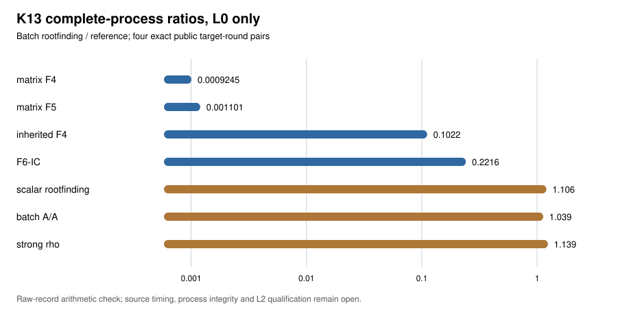

# Independent arithmetic audit of the archived K13 L0 panel

This is a post-hoc audit of the custody-correct session `ECBS1hc322a24b6610`
reported in `crypto:research/rootfind_k13_local_f456_screen_20261116/reports/repeat/RESULT.md`
at source commit `8f4cc824c87a236aafd28aa390c744e355a08e45` (PR #4407).
It introduces no new trial, host, target, timing sample, or performance claim.
The session's existing measurement record is `PCC-20261116-3b7488`, whose
reported standing is `not_covered`: the producer's wrappers are unsigned, and
no L2 observation is in this session. [pcc:unverified]

## Inputs and checks

The [auditor](audit.py) read the 453,126-byte JSONL object with SHA-256
`dc16c97ae21a250cc1d47237231d9642960c100dc3fdb68f4dd210af171bff44`,
as named by the source branch's content-addressed manifest. Its own sparse
irreducibility search selected field polynomial `0x201b`. Pure Python
binary-field and curve arithmetic checked the public generator lies on
`y²+xy=x³+1`, `[2003]G=O`, both targets lie on the curve, and every one of
the 48 reported recovered scalars reproduces its exact public target.
The audit also checked the session, binary, registered curve, target seed,
target identity, factor-base digests, all eight arms in each of four measured
target-round pairs, and the L0 labels. A one-step scalar mutation and a
zero-process-clock mutation were both rejected. The raw [result](RESULTS.json)
and the failed first invocation's [stderr](audit-first.stderr) are retained;
the first invocation confused the factor-base identity digest with its
points digest, and the source was corrected before the passing invocation.
[pcc:unverified]

The exact read-only command was:

```sh
python3 research/rootfind_k13_l0_independent_audit_20261116/audit.py \
  --records /Users/adamburan/.cache/crypto-store/sha256/dc/dc16c97ae21a250cc1d47237231d9642960c100dc3fdb68f4dd210af171bff44 \
  > research/rootfind_k13_l0_independent_audit_20261116/RESULTS.json
```

## Recomputed matched observations

Every row below uses the same four target-round pairs, with numerator the
sum of batch-m3 complete-process wall clocks and denominator the sum of the
reference arm's complete-process wall clocks. The right column is the range
of four individual batch/reference ratios. The independent calculation
agrees with the originating report to its printed precision. These are
descriptive L0 record values, not admitted timing advantages. [pcc:unverified]

| Reference | Sum ratio | Individual pair range |
| --- | ---: | ---: |
| matrix F4 | 0.000924480 | 0.0008–0.0010 |
| matrix F5 | 0.001101484 | 0.0009–0.0013 |
| inherited F4 | 0.102245578 | 0.0944–0.1127 |
| F6-IC | 0.221550605 | 0.2099–0.2410 |
| scalar rootfinding m3 | 1.106297623 | 0.9387–1.3137 |
| batch A/A | 1.038571610 | 0.7848–1.3160 |
| strong rho | 1.139284616 | 1.0200–1.4052 |



The four F4/F5/F6 arm comparisons have ratio below one on each archived
pair, but A/A spread is large, the host is macOS L0, and the source record
does not carry an independently attested process clock. The audit checks
mathematical answers and internal pairing from pinned bytes; it does not
prove the original execution occurred as recorded or qualify L2 timing.
It also does not replay the solver internals, certify factor-base contents
from first principles, or extend beyond these two targets. [pcc:unverified]

## Next action

For the fixed K13 objective, relation-collector changes are currently
less urgent than the frozen L2 complete-call panel: the existing batch-m3
candidate already has a large descriptive margin over F6-IC in this
same-target L0 record, and the next uncertainty is whether it survives
qualified isolation and A/A control. The L2 panel remains unrun under its
resource gate. The source-bound local pilot also cannot run until Conductor
T-6814 releases `.resume/RESUME.md` so that its own checkpoint can pass
`scripts/checkpoint.sh gate`. Neither gate is relaxed by this audit.
The existing `problems/rootfinding-complete-cost-calibration.md` remains
the obstruction record; this report supplies a narrowed, reproducible
pointer to the exact L0 evidence. [pcc:unverified]
