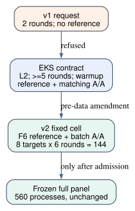

# Amendment 1: native EKS benchmark admission

Filed before any probe execution, source image build, or EKS submission. The
original [protocol](PROTOCOL.md) (SHA-256
`894d9258f0b06800f427a49c5c2284dfba8f43b23a5510d0f87bbb6e2aeaf512`)
and [v1 spec](SPEC-K13-ADMISSION.json) (SHA-256
`4eaae44bd7d3bd0c9f811b8cfe6ffba98bd560644b6e9d2415fbb8aeccb9cc16`)
remain unchanged as the historical design. The intended execution spec is
now [v2](SPEC-K13-ADMISSION-v2.json), SHA-256
`e7a6e076806e0a78c0904927a025ee9f3fdac6f931adbac30bfe1560d3911cb7`.
The frozen ten-arm K13 comparison is unchanged.

## Why the amendment is required

The current native EKS benchmark admission path in
`taskq/deploy/eks-karpenter/mcp/src/main.rs` (SHA-256
`7353a57a151810173d36eaff6b8486a74d840c94dfe9954c543bad76972c8f4c`)
requires L2, at least five measured rounds, one warmup, a reference arm, and
a method-identical A/A control. The v1 probe has only two measured rounds and
no reference arm, so that exact request would be refused before a trial.
The live `isolab` namespace listed one unrelated Job and no matching K13
probe Job when checked on 2026-11-16; this amendment follows no probe data.

## Revised fixed cell

Keep the same registered Koblitz E0 n13 curve, all eight frozen public target
indices from seed `202611151301`, standard-subspace dimension five,
`max_trials=200000`, algorithm seed `202611151302`, methods and one release
binary on one `cpu-l2-spot` c8a.2xlarge placement with four reserved CPUs.
The v2 spec has three arms:

1. `f6-ic`, method byte-for-byte equal to the frozen panel, with role
   `reference` for native EKS admission. The full panel labels that method
   `candidate`; the role metadata does not change the method or seed law.
2. `batch-m3`, the exact frozen candidate method.
3. `batch-m3-aa`, the exact frozen method again, with role `control`.

Use one warmup and five measured rounds in alternating order: 8 targets ×
3 arms × 6 rounds = **144 fresh processes**, 120 measured (40 per arm).
The 30-second per-execution cap remains. Set the native Job deadline to
3,000 seconds to cover queue and startup without an automatic retry. Retain
every row on timeout, error, wrong answer, or interference. The USD 5
new-job ceiling and requirement for at least USD 5 available in both daily
and monthly budgets remain; queue, build, failures, storage and transfer are
charged. The currently exhausted cost gates forbid launch.

The probe's narrow pass condition is: every measured row, including the F6
reference and batch A/A control, has the exact registered workload and shared
target-round seed, a scalar satisfying `[d]G=Q`, complete clocks and phases,
L2 or L3 grade, and `solve_wall_ns >= 1,000,000`. Audit and replay all rows;
retain warmups and every failed/censored execution. Report the 40 batch and
40 A/A solve clocks separately, their paired wall spread, the F6 reference,
blockers, process wall and peak RSS. An A/A anomaly is reported. Passing the
probe only admits the source/host combination for the frozen 560-execution
comparison; it cannot establish any F4/F5/F6 advantage. A sub-L2 or
sub-1-ms row shows the current all-pairs panel rule cannot be met on that
observed source/host/target round; investigate before a new frozen design.

All other original protocol controls remain: source/image/binary hashes,
same-host identity, independent-host replay, checkpoint gate, existing-Job
reconciliation, immutable records, no automatic retries, graph and PDF.
The corrected probe must pass the native launcher's validator, then a
source-bound `ecbench plan`, before any EKS image or job is created.
The reproducible [static predicate check](VALIDATION.json) confirms the v2
shape and exact method/workload identities against the pinned source; it
does not substitute for either native check.

