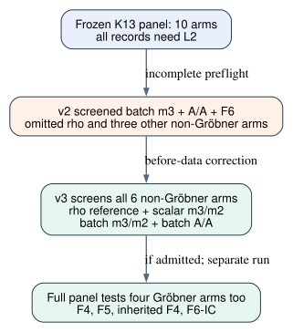

# Amendment 2: screen every non-Gröbner panel arm

Filed before any probe execution, image build, or EKS submission. The intended
execution spec is now [v3](SPEC-K13-ADMISSION-v3.json), SHA-256
`ef890a6193c6b7c45d09775a27dede3c3eb16d7ab2ffaac8b359d18e976ef308`.
The original [protocol](PROTOCOL.md) and [v1 spec](SPEC-K13-ADMISSION.json),
and [Amendment 1](AMENDMENT-1.md) with its [v2 spec](SPEC-K13-ADMISSION-v2.json)
remain byte-for-byte historical records. No probe result exists for any
version. The frozen ten-arm K13 comparison is unchanged.

## Why v2 was insufficient

The native `isolab_k8s_benchmark` contract rejects **any** record below L2.
Its source is `taskq/deploy/eks-karpenter/mcp/src/main.rs`, SHA-256
`7353a57a151810173d36eaff6b8486a74d840c94dfe9954c543bad76972c8f4c`.
The frozen [ten-arm panel](../rootfind_f456_batch_combined_20261115/SPEC-K13.json)
includes rho, scalar rootfinding m=3/m=2, batched rootfinding m=3/m=2 and
the batch A/A control. V2 checked only batch m=3, its A/A and F6-IC. Even a
perfect v2 admission outcome would say nothing about L2 admission for the
other four non-Gröbner arms. In particular it would miss the panel's actual
`rho-strong` reference. This is a coverage flaw in the preflight, not a
change in measured performance.

## Revised fixed cell and decision

V3 copies all **six non-Gröbner arm objects exactly** from the frozen panel:
`rho-strong` (the actual reference), `rootfind-m3`, `rootfind-m2`,
`batch-m3`, `batch-m2`, and `batch-m3-aa` (matching control). No role metadata
is relabeled. Keep the same registered Koblitz E0 n13 curve, all eight target
indices from public seed `202611151301`, factor-base dimension five,
`max_trials=200000`, algorithm seed `202611151302`, order, release binary,
four threads, native `cpu-l2-spot` c8a.2xlarge and four reserved CPUs.
One warmup plus five measured rounds gives **288 fresh processes**, 240
measured (40 per arm). The 30-second per-execution cap, 3,000-second Job
deadline, USD 5 new-job ceiling and zero automatic retries from Amendment 1
remain. Queue, image build, failures, storage and transfer count toward the
ceiling; both daily and monthly available headroom must each cover USD 5.

The preflight passes only if the native launcher accepts the request, every
record including warmups has the exact frozen workload/method and a scalar
satisfying `[d]G=Q`, complete clocks and phases, L2/L3 grade, and
`solve_wall_ns >= 1,000,000`. Independently replay all records on a second
host class. Report every short, sub-L2, timed-out, incorrect, interrupted or
missing row; report A/A and process-wall spread as diagnostics. A failed row
stops the inference that this source/host can admit the full panel. A pass
only permits submitting the separately frozen ten-arm study after its own
cost, checkpoint, source-publication and existing-Job gates. It establishes
no F4/F5/F6 timing advantage; the four Gröbner arms remain untested by this
probe.

The current budget readback exceeds the daily and monthly limits, and
Conductor T-6814 still reserves the checkpoint path. There is no authorized
new EKS launch under these gates. Before any launch, run the native benchmark
validator and a source-bound `ecbench plan` on v3; the
[static validation](VALIDATION-v3.json) checks only its source/spec shape.

