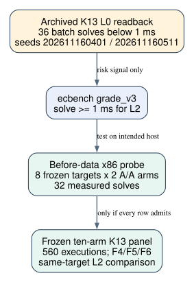

# K13 solve-duration admission readback

This is a read-only audit of two archived L0 sessions and a before-data x86
probe design. It creates no new curve solve or performance verdict. The
measurement claim is `PCC-20261116-912e14`, currently **unverified**; the
producer-authored recomputation wrapper has no independent PCC signature.
[pcc:unverified]

## Bound inputs and result

[`duration_readback.py`](duration_readback.py) hash-checks both content-addressed
JSONL objects, checks the registered Koblitz E0 n13 ICV1 identity, target seed,
verified outcome and L0 grade, and extracts measured `batch-m3`
`time.solve_wall_ns`. The [machine readback](DURATION_READBACK.json) retains
all 36 record IDs and the two object hashes. The raw objects were archived by
the source branches; this audit does not change their bytes. [pcc:unverified]

| Archived session | Target seed | Measured batch rows | Solve range | Below 1 ms | Host grade |
| --- | ---: | ---: | ---: | ---: | --- |
| `ECBS1h08f6d5475be8` | 202611160401 | 32 | 0.239–0.572 ms | 32 | L0 |
| `ECBS1hc322a24b6610` | 202611160511 | 4 | 0.263–0.505 ms | 4 | L0 |

The code's [`grade_v3`](../../src/cryptanalysis/ecbench/measurement.rs)
sets `MIN_SOLVE_WALL_NS_V3 = 1_000_000` and records an L2 blocker below it.
The frozen [ten-arm K13 panel](../rootfind_f456_batch_combined_20261115/PROTOCOL.md)
requires L2 on every admitted target-round pair. These local sessions have
different seeds from its `202611151301`, and the M4 Pro clocks give no x86
duration estimate. They justify the short [admission probe](PROTOCOL.md),
not a change to the frozen panel or a claim of relative solver speed.
[pcc:unverified]

The flow makes the two independent gates explicit: a source-bound x86
duration/isolation probe, then the full ten-arm same-target comparison.
An x86 row below 1 ms would block the current all-pairs decision rule on
that observed source and host; 32 admitted probe rows would only permit
submitting the full panel after its resource and publication checks.
The correct AWS account currently exceeds both its USD 1,300 monthly and
USD 200 daily limits, and Conductor T-6814 holds the branch checkpoint path.
No new image or Job was submitted. [pcc:unverified]

Canonical graphs checked: `docs/ic/LEADERBOARD.md`,
`docs/backend-leaderboard/LEADERBOARD.md`, and the frozen panel's
`panel.svg`. None changes because this readback adds neither an admitted
timing result nor a new comparison. The [problem record](../../problems/rootfinding-complete-cost-calibration.md)
retains the unresolved full-cost and independent-replay exit criteria.
