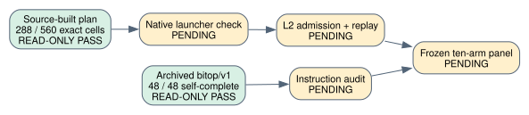

# K13 source-plan and archived-counter audit

This read-only audit checks the preflight's exact native plan and the scope of
the archived `bitop/v1` accounting. It launches no scientific trial and makes
no new performance ranking. Its reproducible output is
[PLAN-AUDIT.json](PLAN-AUDIT.json), generated by [audit.py](audit.py).

## Identity and method

The locally built release `ecbench` executable has SHA-256
`7b062c58a5a1bfa0309d68732f57cf36f8d2394780bc3e111ee7b64b2e3092ed`.
It was built from branch commit `38ddf8432d` with Rust 1.99.1 using
`cargo build --release --locked --bin ecbench -j 2` and an explicit Rust 1.99.1
`RUSTC`; the local build is not an independently attested image build. The
auditor calls that executable's `plan --doc` on the committed [v3 admission
spec](../rootfind_k13_l2_admission_probe_20261116/SPEC-K13-ADMISSION-v3.json)
and the separately frozen [ten-arm
panel](../rootfind_f456_batch_combined_20261115/SPEC-K13.json). It compares
full workload and arm objects and each overlapping `(arm, workload, round,
warmup, algorithm_seed)` cell. The source record is the content-addressed
archived JSONL object with SHA-256
`dc16c97ae21a250cc1d47237231d9642960c100dc3fdb68f4dd210af171bff44`
from session `ECBS1hc322a24b6610`; the independent scalar-answer audit is
[here](../rootfind_k13_l0_independent_audit_20261116/REPORT.md).

## Findings

| Read-only check | Observed result | Meaning |
| --- | --- | --- |
| Native plan | 8 workloads; 6 exactly copied non-Gröbner arms | The intended admission coverage matches the panel's reference and candidate definitions. |
| Execution cells | All 288 admission cells, including algorithm seeds, occur in the 560-cell frozen panel | The probe is a strict plan subset for overlapping rounds. |
| Plan warning | Five measured rounds with `alternate` give unequal order parity | Keep this visible; the probe tests admission, not a timing advantage. |
| Archived L0 work | 48 of 48 rows report `work.complete=true`, empty `unpriced` and `known_uncounted`, and phase totals summing to their recorded total | Internal consistency of producer counters, not independent coverage proof. |
| Native solver flag | 24 of 24 matrix F4/F5, inherited F4 and F6-IC rows carry `bitop_complete=1` | Their source code claims to count the solver primitives; instruction audit remains required. |

The archived session covers two K13 targets, two measured rounds plus a warmup,
and eight arms; it has no scalar or batched m=2 arm. Its L0 host and small
sample do not qualify a timing comparison. The repository's
[`bitop/v1` contract](../../docs/units/BITOPS.md) requires an instruction
audit before ranking complete arms in that unit. No such audit accompanies
this object, and `work.complete` is a producer flag. These checks do not
establish physical gate counts or a wall-time advantage. [pcc:unverified]

## Remaining gates

The native EKS benchmark argument validator still needs a read-only invocation
on the exact v3 request. The L2 admission run then needs source and image
identity, current cost and checkpoint admission, exact answer checks, A/A,
and independent second-host replay. The four Gröbner arms enter only the
separate frozen full panel. A later `audit-ir` on matching records must test
the solver-counter coverage before modeled work is ranked. The existing
[complete-cost obstruction](../../problems/rootfinding-complete-cost-calibration.md)
tracks those requirements. The graph below distinguishes the completed
read-only checks from the remaining measurements.



Reproduce the read-only audit with the exact cached JSONL object and a binary
whose hash matches the one above:

```sh
python3 research/rootfind_k13_source_plan_audit_20261116/audit.py \
  --binary /Volumes/SSD990-2/crypto/target/release/ecbench \
  --admission research/rootfind_k13_l2_admission_probe_20261116/SPEC-K13-ADMISSION-v3.json \
  --panel research/rootfind_f456_batch_combined_20261115/SPEC-K13.json \
  --records /Users/adamburan/.cache/crypto-store/sha256/dc/dc16c97ae21a250cc1d47237231d9642960c100dc3fdb68f4dd210af171bff44
```

## Subsequent gate outcome (2026-11-16)

The native argument check listed above as pending was subsequently completed
by the separate [launcher check](../rootfind_k13_native_launcher_check_20261116/REPORT.md).
Its [machine receipt](../rootfind_k13_native_launcher_check_20261116/RESULT.json)
records eight passing source-compiled Rust tests, including exact embedding of
the frozen v3 spec, with no image or Job submission. This is a later result;
the plan and archived-counter findings in this report are unchanged. The
deployed launcher, verified image, current budget and checkpoint gates, L2
execution, and independent replay remain outstanding. [pcc:unverified]
